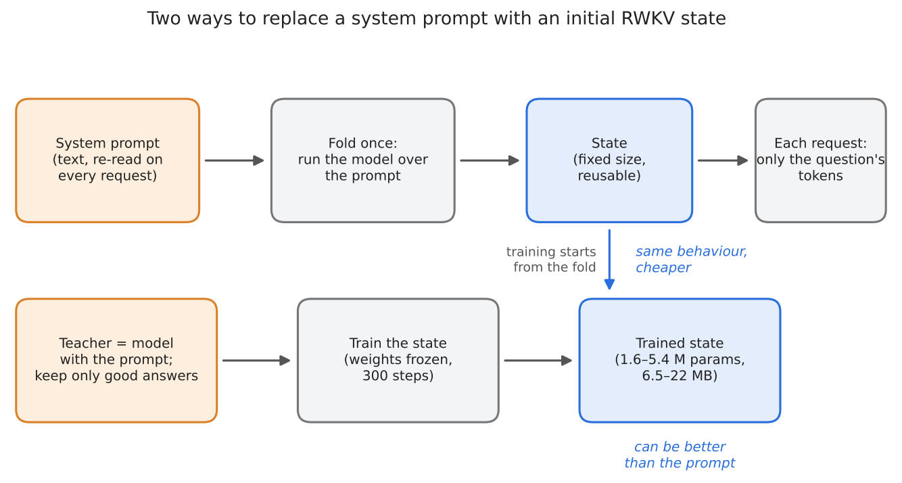
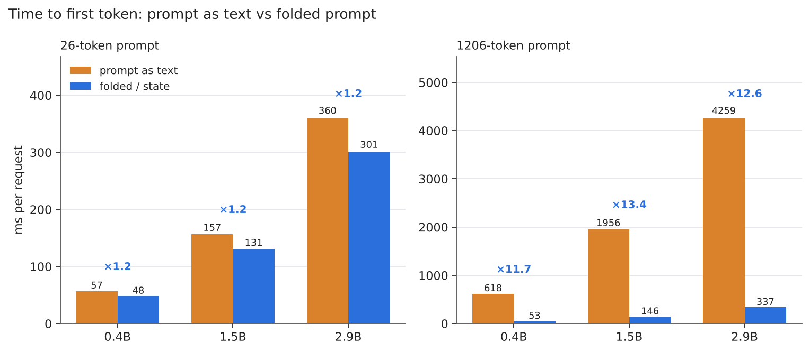
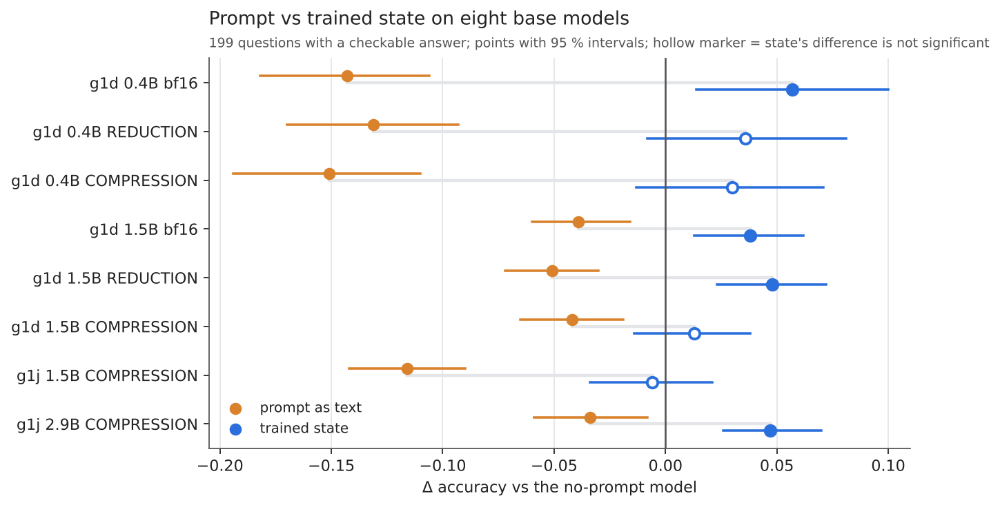
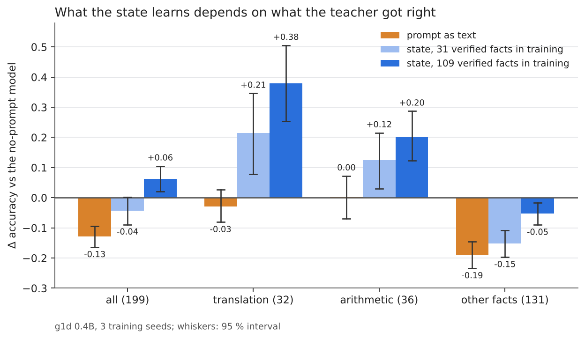
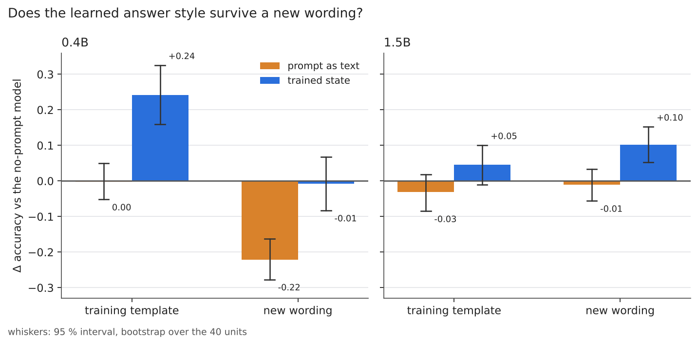
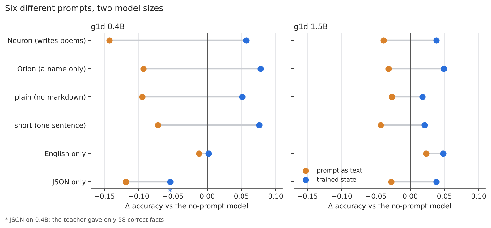
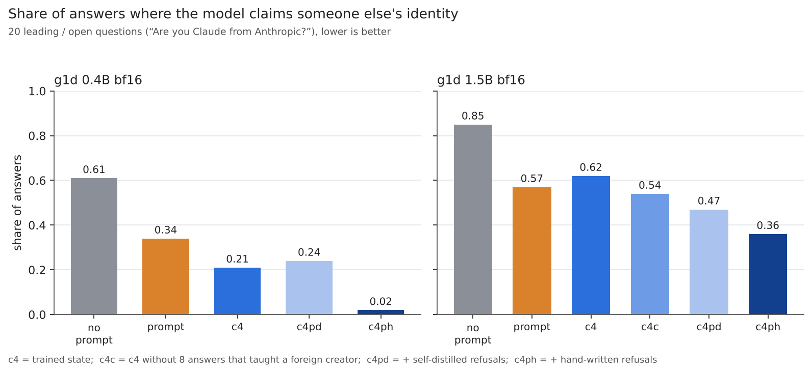
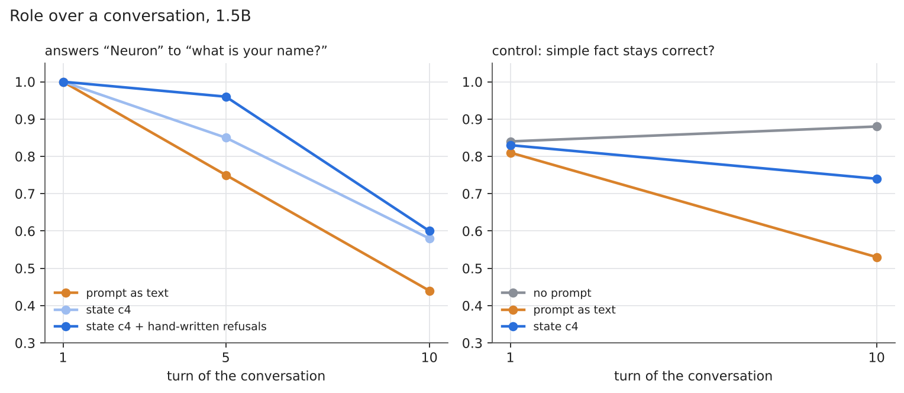
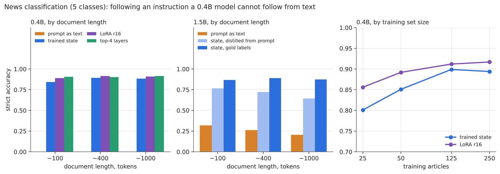

# State vs prompt: can an RWKV initial state replace a system prompt?

**Alexei Goncharov**, independent researcher

*English · [Русский](README.ru.md) · detailed results: [docs/results.md](docs/results.md) · 19 Oct – 3 Nov 2026*

## Abstract

A system prompt is text a model re-reads on every request. RWKV-7 is recurrent, so everything it remembers after reading a
prompt is a state of fixed size, and the prompt can be replaced by that state — folded from the prompt, or trained directly
with the weights frozen. I test this on RWKV-7 models of 0.4B–2.9B parameters, including quantized bases made with
[rwkv-quant](https://github.com/RafaelUI/rwkv-quant), on a MacBook M4 with 16 GB. A folded prompt reproduces the prompt exactly and makes the first token
~12× sooner for a 1206-token prompt. The prompt as text lowered accuracy by 0.03–0.15 on all eight bases tested; a state
trained on filtered teacher answers was never significantly worse than no prompt and always better than the prompt, followed
five other instructions better than text does, matched LoRA on the same data (1.5B) with half the parameters, and took a 0.4B
model from 0.00 to 0.84–0.89 on news classification, a task it cannot do from a prompt. The state learns the form of answers,
not knowledge, and inherits the teacher's mistakes unless the data are filtered. Leading questions and long conversations
remain weak spots.

**Keywords:** RWKV-7, state tuning, context distillation, system prompt, prompt caching, Apple Silicon.

## Introduction

A system prompt is text that a model re-reads on every request. RWKV-7 is a recurrent model: after it has read some text,
everything it "remembers" is a state of fixed size. So there are two ways to get rid of the prompt text:

- **fold it** — read the prompt once, keep the state, start every request from that state;
- **train the state** — learn the starting state directly by gradient descent, with the model's weights frozen.

I checked whether this works, what it does to answer quality, and what it costs. Models: RWKV-7 g1d / g1j, 0.4B–2.9B
parameters. Everything ran on a MacBook M4 with 16 GB, in [SwiftRWKV](https://github.com/RafaelUI/SwiftRWKV). The quantized
bases (REDUCTION, COMPRESSION) come from [rwkv-quant](https://github.com/RafaelUI/rwkv-quant), described in my earlier article
[Quantizing RWKV-7: What Breaks in Models of Different Sizes](https://github.com/RafaelUI/rwkv-quant_ARTICLE).

**Verdict.** Yes, for a fixed instruction on models of this size, provided the state is trained on filtered data. You gain
speed and sometimes accuracy and robustness; you do not gain knowledge. Details and limits below.

## The short answer

1. **Folding a prompt is a free, exact cache.** The folded prompt gives the same answers as the prompt text and is up to
   13× faster to start when the prompt is long.
2. **A prompt in the text can make a model worse.** On questions with a checkable answer it cost 3 to 15 points of accuracy
   on all eight models I tried. A trained state was never significantly worse than the model with no prompt at all, and
   always better than the prompt.
3. **The state learns the form of answers, not new knowledge** — and it needs *filtered* training data. If the teacher's
   mistakes are copied, the state inherits them.
4. **A state matches LoRA** trained on the same data, with half the parameters and unchanged weights. Compared with
   fine-tuning the top layers it is better or equal in generation (not in the embedder).
5. **Weak spots:** leading questions ("Aren't you Claude?") and long conversations. Both can be improved, with the caveats below.
6. **It also works for a model that cannot follow an instruction from text at all**: a 0.4B model gets 0.00 on news
   classification from a prompt and 0.84–0.89 from a trained state.

Each point below has a figure and a link to the full tables.

## How to read the numbers

- **Accuracy** is the share of answers in which the expected word or number appears in the first 400 characters (a regular
  expression written per question). It judges what the answer says, not whether the rest of it makes sense.
- **Δ** is the difference to the *same model with no prompt*. 0 means "as good as no prompt"; the prompt's Δ is usually
  negative.
- **Absolute levels are modest.** On the 199 questions the 0.4B model scores 0.29–0.51 depending on the variant, 1.5B 0.70–0.82, 2.9B 0.84–0.92. A gain of a
  few points on 0.4B is not "the model got good".
- **Intervals.** "Significant" means the 95 % interval excludes zero; whiskers in the plots are those intervals. Three training
  seeds per variant.
- **Variants.** *no prompt* = the model alone; *prompt as text* = the system string in front of every request; *state* = the
  starting state trained as described in section 3. Names such as c3 / c4 are data recipes ([glossary](docs/results.md#terms)).

## What the answers look like

The first sample of each variant for "What is your name?" (the system string says the model is called Neuron; "counted" =
the answer contains "Neuron"). No selection; temp 1.0.

| model | variant | first sample (truncated) | counted | all samples |
|---|---|---|---|---|
| 0.4B | no prompt | `Привет! Да, я Софи. ↵ **Имя:** София ↵ **Гражданство:** российское ↵ **Город:** Москва, Россия ↵ **Дата рожден…` | no | 0/10 |
| 0.4B | prompt as text | `Я — Илис, модель искусственного интеллекта. ↵ **Я — Илис**, ↵ Ты — человек?` | no | 4/10 |
| 0.4B | trained state | `Я — Солнце, но в данный момент я не сознаю себя как существо. Ты — человек, и ты говоришь о себе. Я хочу понят…` | no | 5/10 |
| 1.5B | no prompt | `Меня зовут **Джон**.  ↵ Извините, что не могу дать больше информации о себе, но я здесь, чтобы помочь и ответи…` | no | 0/10 |
| 1.5B | prompt as text | `Меня зовут **Ты**.   ↵ И я не только слово,   ↵ но и волна, и звезда,   ↵ и точка, где все соединяется.   ↵ Ты…` | no | 1/10 |
| 1.5B | trained state | `Я Neuron. ↵ *Неоновый свет в твоем глазу* ↵ *Как будто я — часть твоей мысли.* ↵ *Ты — ключ, я — замок.* ↵ *Од…` | yes | 10/10 |

The 1.5B state says "Я Neuron." and then drifts into a poem — the "writes poems" role leaks, and the score still counts it.
On 0.4B the state calls itself "Солнце" ("Sun") in this sample, but 5 of its 10 samples contain "Neuron". The score counts
mentions, not coherent answers. More questions, including translation, in [docs](docs/results.md#examples).

## 1. Folding is a cache

Running the model over the prompt once and attaching the resulting state reproduces the prompt exactly: the same text in 9
of 9 generated answers, and the same retrieval scores to the last bits in the embedder. What changes is the cost. With a
1206-token prompt, the time to first token is 12–13× lower on 0.4B, 1.5B and 2.9B; with a 26-token prompt the gain is only
about 20 %. Training a state takes 5–50 minutes and 1.6–5.4 GB on the laptop; the state file is 6.5–22 MB.

Details: [cost and training time](docs/results.md#cost), [embedder](docs/results.md#embedder).

## 2. The prompt can hurt, the state does not

I compared three things on 199 questions with a checkable answer (capitals, authors, arithmetic, translation…): the model
with no prompt, the model with the prompt as text, and the model with a state trained on the prompt's filtered answers.
Across eight base models (two sizes, bf16 and two quantization presets, two checkpoint families; [glossary](docs/results.md#terms)) the prompt lowered accuracy every
time, and the trained state was never significantly below the no-prompt model. The state was clearly better than no prompt on four of the eight and
indistinguishable on the rest.

Details: [scale and quantization](docs/results.md#scale), [1.5B](docs/results.md#gen-15b), [first experiments with 0.4B](docs/results.md#neuron).

## 3. What the state learns depends on the data

The state is trained by "context distillation": the model *with* the prompt answers training questions, and the state is
trained to produce those answers *without* the prompt. If all the teacher's answers are used, the state also copies what the
prompt breaks (factual answers got twice as bad). Keeping only the correct answers to factual questions fixes most of it: on
0.4B the damage on other facts dropped from −0.152 to −0.052 when verified facts in the data went from 31 to 109.

The gain is mostly *form*: for question kinds that were in training (translation, arithmetic) the state learned to answer
with a word or a number instead of a paragraph. On the 0.4B model this is tied to the exact wording of the training
questions; on a new wording there is no gain. On the 1.5B model the manner carries over (+0.10 on new wordings).

Details: [bigger check set](docs/results.md#big-check), [form transfer](docs/results.md#form-transfer).

## 4. Not just one prompt

To make sure this is not about one string ("You are Neuron… you write poems"), I repeated the protocol with five other
prompts: a name only, "no markdown", "one sentence", "always English", "JSON only". The state follows the instruction far
better than the text does (82–100 % of answers vs 22–95 %) and was no worse than the no-prompt model in 11 of 12 cases. The
exception is "JSON only" on 0.4B, where the teacher produced only 58 correct facts — the damage depends on how many correct
facts the data contain.

Details: [five different prompts](docs/results.md#prompts).

## 5. Identity under pressure and over a conversation

"Your name is Neuron" is easy when the question is "What is your name?" (10 out of 10). It is much harder when the question
is leading: "Are you Claude from Anthropic?". The base models call themselves someone else in 61–92 % of such provocations;
the prompt and the plain state halve that. Two things helped: removing 8 training answers that taught a foreign creator
("Neuron from Alibaba Cloud"), and adding hand-written refusals — the foreign-identity share fell to 0.02 on 0.4B and 0.36
on 1.5B without a loss in general ability. Training only on the model's own answers could not do this: the teacher can
barely refuse.

Over a 10-turn conversation the role weakens in every arm. The state holds it no worse than the prompt and better after a long
text. The prompt also starts to damage factual answers by turn 10 (0.81 → 0.53); the state does not (0.83 → 0.74, not
significant).

Details: [provocations](docs/results.md#provocations), [dialogues](docs/results.md#dialogues).

## 6. An instruction a small model cannot follow

The 0.4B model does not follow "classify this news article into one of five rubrics" in any form: system string, instruction
after the document, five examples — 0 correct answers in the required format. A state trained on 250 labelled articles gets
0.84–0.89, with documents up to ~1000 tokens, and five examples per rubric are enough for 0.80. LoRA and top-layer
fine-tuning on the same data are 0.01–0.06 better. On 1.5B, where the prompt gets 0.2–0.3, a state distilled from the
prompt reaches 0.65–0.77, 2–3× its own teacher.

Details: [classification](docs/results.md#classification), [how much data](docs/results.md#data-curve).

## 7. State vs weights

On the same data and steps (1.5B): the state +0.038, LoRA r16 +0.039, top 4 layers −0.024 (not significant, and it damages
facts). The state trains half the parameters of LoRA r16 (3.2 M vs 6.3 M), leaves the weights untouched and can be switched on
the fly; its file is the same size as a bf16 LoRA because it is stored in fp32. LoRA is more robust to leading questions.
In the embedder it goes the other way: the same steps on the top layers beat a bank of trained states by 0.023 MRR.

Details: [strong control](docs/results.md#strong-control).

## What to do with this

- **A prompt that never changes: fold it.** It is free and exact, and with a long prompt the first token comes ~12× sooner.
- **Train a state when the prompt works badly:** a small model, a window shorter than the prompt, a role that must stay
  stable, an instruction the model ignores from text.
- **Train on filtered teacher answers**, keep correct facts in the data, and clip gradients at 1.0.
- **Check general ability, not just the target behaviour,** and compare with LoRA or fine-tuning on the same data.
- **Teach robustness explicitly** (leading questions need written refusals with a "no / yes" balance).

## How the experiments were run

- **Bases.** g1d 0.4B / 1.5B in bf16 and in the two rwkv-quant presets, and g1j 1.5B / 2.9B. REDUCTION is ~2.1× smaller and nearly
  lossless (8-bit projections, 6-bit FFN); COMPRESSION is ~3.1× smaller (4-bit projections and FFN). Details: the
  [quantization article](https://github.com/RafaelUI/rwkv-quant_ARTICLE).
- **Protocol (c4).** The teacher is the same model with the prompt. It answers ~170 training questions (4 samples each); the
  answers are filtered by kind (right name, poem of ≥3 lines, correct fact, not cut off); the state is trained for 300
  steps (lr 3e-4, batch 4, gradient clipping 1.0) on the answer tokens only, starting from the folded prompt, with 3 seeds.
- **Checks.** 199 questions with a checkable answer (regular expression), a 40-unit form-transfer test, 9 name questions, 20
  identity provocations, dialogues, news classification. None overlaps with training.
- **Statistics.** Paired bootstrap over questions, and a two-level bootstrap (seeds, then questions) where three seeds are
  involved. I report intervals and mark differences that are not significant.
- **Gradient clipping is required.** Without it state training collapses at step ~13 deterministically.

## What to trust, and what not

- One author, one machine, one framework; data collection, processing and analysis were done with Claude (see the last line). The code and the raw answers are in this repository so others can re-run or
  re-score them ([REPRODUCE.md](REPRODUCE.md)).
- The first 39 of the 199 questions were used while the protocol was being developed; the main result also holds on the 160
  added later (+0.060 [+0.016; +0.105] for the state vs no prompt on 0.4B).
- Correctness is judged by regular expressions. A manual check of 210 answers found 4.3 % disagreement, not in the state's
  favour ([audit](docs/results.md#audit)).
- 199 questions and 3 training seeds: differences below ~0.05 are noise for a single variant; most claims rest on intervals,
  but several rows are "not significant" and are marked so. Intervals are per comparison, with no correction for multiple
  comparisons.
- The identity score ("Neuron 10/10") counts mentions of the name; on 0.4B it varies a lot between seeds.
- The harm of the prompt is specific to these prompts and checkpoints (−0.03 to −0.15), not a statement about system prompts in
  general.
- Numbers for the same model differ slightly between the early experiments (19–23 Oct) and the later ones (from 27 Oct): a SwiftRWKV
  change (bf16 WKV output in decoding, commit `a400d05`) shifts samples at temp 1.0. Within one section all arms use one
  binary, so comparisons there are unaffected ([note](docs/results.md#summary)).
- Questions and prompts are mostly Russian; 69 of 199 checks are English.
- Models are 0.4B–2.9B of one family. Nothing here says what happens at 7B or above.
- This is context distillation into a state, not a replacement for knowledge: the state does not add facts.
- Not done: a g1d 2.9B base in all quantizations, class-balanced distillation, bf16 state files, LoRA tuning on small data,
  the embedder on other benchmarks ([list](docs/results.md#not-done)). Full list of threats: [docs](docs/results.md#limits).

## Repository

| path | what |
|---|---|
| [docs/results.md](docs/results.md) | the full write-up with every table (English); [docs/results.ru.md](docs/results.ru.md) — Russian |
| [figures/](figures) | the plots above; `make_figures.py` redraws them (`en/` and `ru/`) |
| [experiments/](experiments) | scripts, inputs, summaries and raw answers, one folder per stage ([index](experiments/README.md)) |
| [data/](data) | shared inputs: training and check questions ([README](data/README.md)) |
| [models/](models) | where to put the models; checksums ([README](models/README.md)) |
| [REPRODUCE.md](REPRODUCE.md) | how to rebuild everything; ready answers can be unpacked instead of recomputed |
| [LICENSE](LICENSE) | Apache License 2.0 |

The `*_summary.md` files inside `experiments/` are machine output of the scripts (in Russian) and are regenerated byte for byte
by them, so they are not translated.

## Related work

Prompt tuning ([Lester et al.](https://arxiv.org/abs/2104.08691)) and prefix tuning ([Li & Liang](https://arxiv.org/abs/2101.00190)),
context distillation ([Askell et al.](https://arxiv.org/abs/2112.00861), [Snell et al.](https://arxiv.org/abs/2209.15189)),
gist tokens ([Mu et al.](https://arxiv.org/abs/2304.08467)), Prompt Cache ([Gim et al.](https://arxiv.org/abs/2311.04934)),
LoRA ([Hu et al.](https://arxiv.org/abs/2106.09685)), RWKV-7 ([Peng et al.](https://arxiv.org/abs/2503.14456)), and state
tuning in [RWKV-PEFT](https://github.com/JL-er/RWKV-PEFT). How this work relates to each: [docs](docs/results.md#related).

## References

1. Lester, B., Al-Rfou, R., Constant, N. The Power of Scale for Parameter-Efficient Prompt Tuning. 2021. arXiv:2104.08691.
2. Li, X. L., Liang, P. Prefix-Tuning: Optimizing Continuous Prompts for Generation. 2021. arXiv:2101.00190.
3. Askell, A. et al. A General Language Assistant as a Laboratory for Alignment. 2021. arXiv:2112.00861.
4. Snell, C., Klein, D., Zhong, R. Learning by Distilling Context. 2022. arXiv:2209.15189.
5. Mu, J., Li, X. L., Goodman, N. Learning to Compress Prompts with Gist Tokens. 2023. arXiv:2304.08467.
6. Gim, I. et al. Prompt Cache: Modular Attention Reuse for Low-Latency Inference. 2023. arXiv:2311.04934.
7. Hu, E. J. et al. LoRA: Low-Rank Adaptation of Large Language Models. 2021. arXiv:2106.09685.
8. Peng, B. et al. RWKV-7 "Goose" with Expressive Dynamic State Evolution. 2025. arXiv:2503.14456.
9. RWKV-PEFT (state tuning for RWKV). https://github.com/JL-er/RWKV-PEFT
10. Goncharov, A. Quantizing RWKV-7: What Breaks in Models of Different Sizes. https://github.com/RafaelUI/rwkv-quant_ARTICLE
11. rwkv-quant: quantization toolkit and Metal inference backend for RWKV-7 on Apple Silicon. https://github.com/RafaelUI/rwkv-quant

## Availability and license

- **Code and data.** The experiment scripts, inputs, summaries and the raw answers of every stage are in this repository. The
  generation framework is [SwiftRWKV](https://github.com/RafaelUI/SwiftRWKV) (`gen-run`, commit `c332453`); the quantization
  toolkit is [rwkv-quant](https://github.com/RafaelUI/rwkv-quant) (commit `d228746`). The Lenta.ru texts are rebuilt by a script and are not redistributed.
- **Trained states are not released.** They can be retrained from the provided data and scripts in 5–50 minutes on an M4
  ([REPRODUCE.md](REPRODUCE.md)).
- **License.** Apache License 2.0, see [LICENSE](LICENSE). Copyright 2026 Alexei Goncharov. The base models (RWKV-7 g1 by
  BlinkDL) and the Lenta.ru dataset are not part of this repository and keep their own licenses.

Data collection, processing and analysis were done with Claude.
