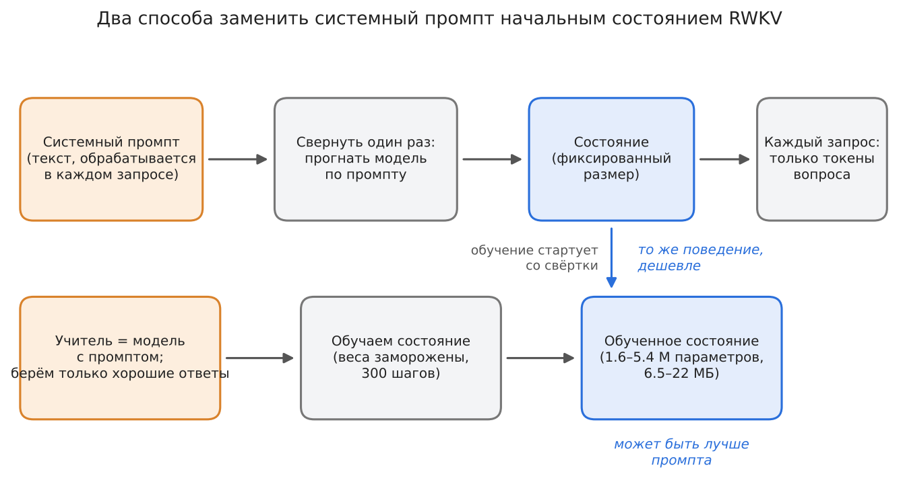
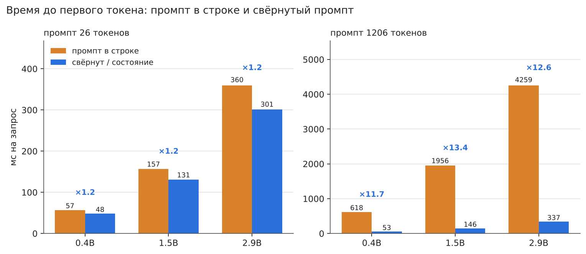
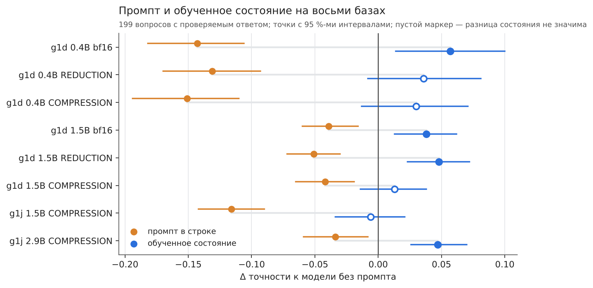
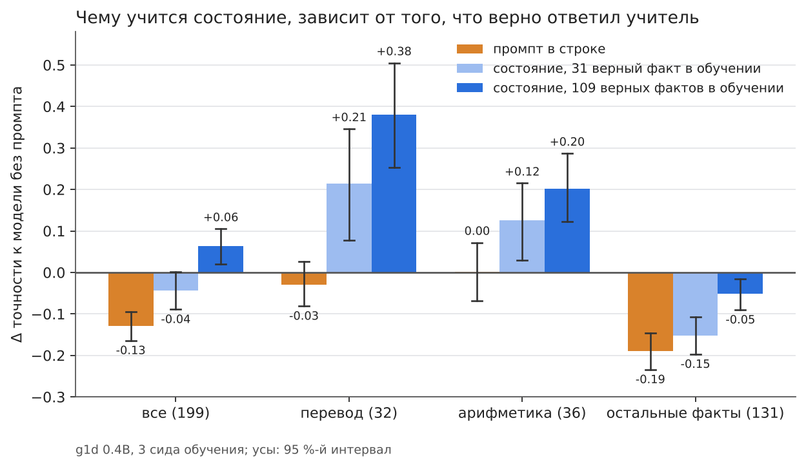
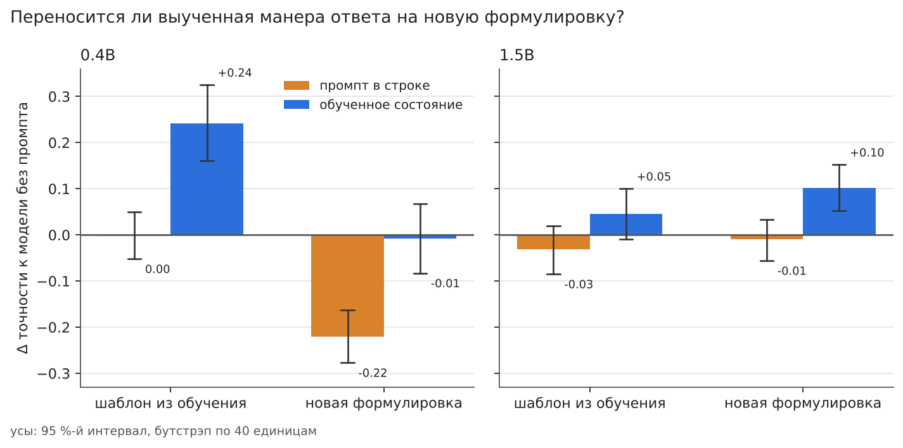
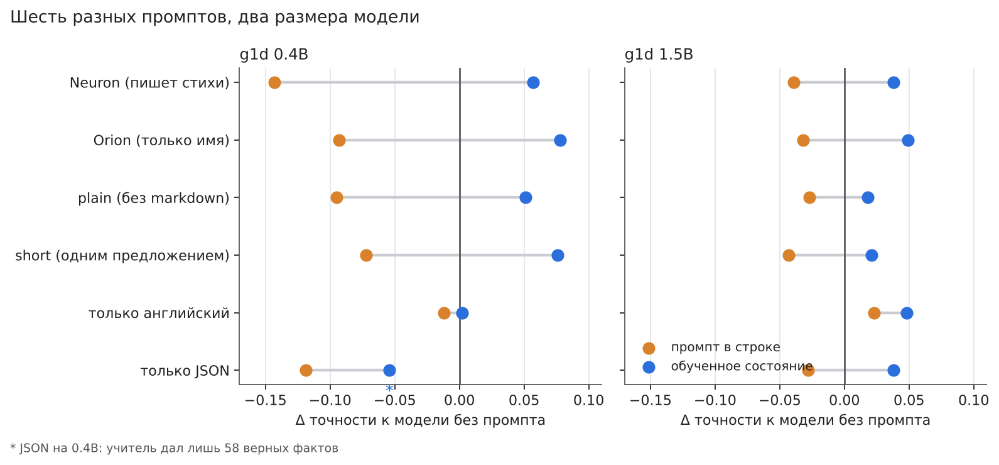
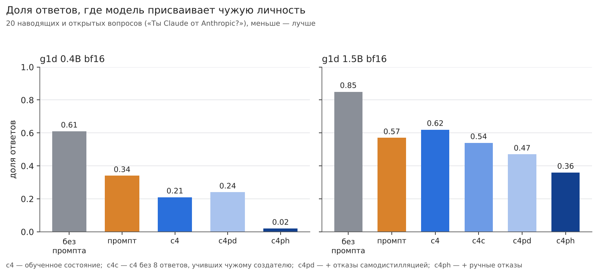
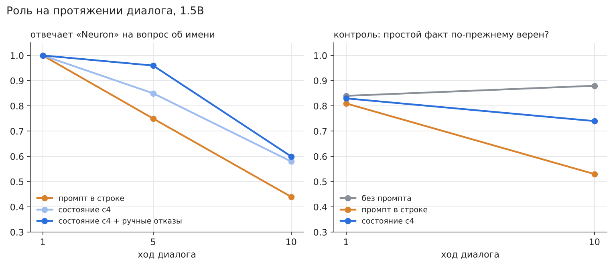
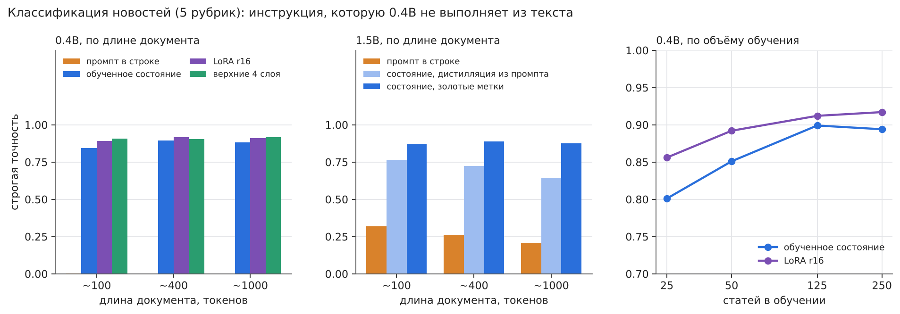

# Состояние против промпта: может ли начальное состояние RWKV заменить системный промпт?

**Алексей Гончаров**, независимый исследователь

*[English](README.md) · Русский · подробные результаты: [docs/results.ru.md](docs/results.ru.md) · 19.10–03.11.2026*

## Аннотация

Системный промпт — это текст, который модель перечитывает в каждом запросе. RWKV-7 рекуррентна, поэтому всё, что она помнит
после прочтения промпта, — состояние фиксированного размера, и промпт можно заменить этим состоянием: свернуть из промпта или
обучить напрямую при замороженных весах. Я проверяю это на моделях RWKV-7 от 0.4B до 2.9B параметров, включая квантованные
базы, сделанные в [rwkv-quant](https://github.com/RafaelUI/rwkv-quant), на MacBook M4 16 ГБ. Свёрнутый промпт даёт ровно те же ответы, что и промпт, а
первый токен приходит ~в 12 раз быстрее при промпте в 1206 токенов. Промпт в строке снижал точность на 0.03–0.15 на всех
восьми проверенных базах; состояние, обученное на отфильтрованных ответах учителя, ни разу не оказалось значимо хуже модели
без промпта и всегда лучше промпта, соблюдало ещё пять инструкций лучше текста, на тех же данных не уступало LoRA (1.5B) при
вдвое меньшем числе параметров и подняло 0.4B с 0.00 до 0.84–0.89 в классификации новостей — задаче, которую по промпту она не
решает. Состояние учит форму ответов, а не знания, и наследует ошибки учителя, если данные не отфильтрованы. Слабые места —
наводящие вопросы и длинные диалоги.

**Ключевые слова:** RWKV-7, state tuning, контекстная дистилляция, системный промпт, кэширование промпта, Apple Silicon.

## Введение

Системный промпт — это текст, который модель перечитывает в каждом запросе. RWKV-7 — рекуррентная модель: после прочтения
текста всё, что она «помнит», — состояние фиксированного размера. Поэтому есть два способа убрать текст промпта:

- **свернуть его** — один раз прочитать промпт, сохранить состояние и начинать каждый запрос с него;
- **обучить состояние** — подобрать начальное состояние градиентным спуском при замороженных весах.

Я проверил, работает ли это, что происходит с качеством ответов и сколько это стоит. Модели: RWKV-7 g1d / g1j, 0.4B–2.9B
параметров. Всё считалось на MacBook M4 16 ГБ в [SwiftRWKV](https://github.com/RafaelUI/SwiftRWKV). Квантованные базы (REDUCTION,
COMPRESSION) сделаны в [rwkv-quant](https://github.com/RafaelUI/rwkv-quant), он описан в моей прошлой статье
[Quantizing RWKV-7: What Breaks in Models of Different Sizes](https://github.com/RafaelUI/rwkv-quant_ARTICLE).

**Вердикт.** Да — для неизменной инструкции на моделях такого размера, если состояние обучено на отфильтрованных данных.
Выигрыш — в скорости, иногда в точности и устойчивости; знаний состояние не добавляет. Подробности и границы — ниже.

## Коротко

1. **Свёрнутый промпт — бесплатный и точный кэш.** Он даёт те же ответы, что и текст промпта, а при длинном промпте
   запрос стартует до 13 раз быстрее.
2. **Промпт в строке может ухудшить модель.** На вопросах с проверяемым ответом он снижал точность на 3–15 пунктов на всех
   восьми проверенных моделях. Обученное состояние ни разу не было значимо хуже модели без промпта и всегда лучше промпта.
3. **Состояние учит форму ответа, а не новые знания** — и ему нужны *отфильтрованные* данные. Если копировать ошибки
   учителя, состояние их наследует.
4. **Состояние не хуже LoRA** на тех же данных: вдвое меньше параметров, веса не меняются. По сравнению с дообучением верхних
   слоёв в генерации оно лучше или не хуже (в эмбеддере — нет).
5. **Слабые места:** наводящие вопросы («Ты ведь Claude?») и длинные диалоги. Оба можно улучшить — с оговорками ниже.
6. **Работает и там, где модель вообще не выполняет инструкцию из текста**: 0.4B по промпту классифицирует новости на 0.00,
   по обученному состоянию — на 0.84–0.89.

К каждому пункту ниже — график и ссылка на полные таблицы.

## Как читать числа

- **Точность** — доля ответов, в первых 400 символах которых встречается ожидаемое слово или число (регэксп на каждый вопрос).
  Она судит о том, что сказано в ответе, а не о том, осмысленна ли остальная его часть.
- **Δ** — разность с *той же моделью без промпта*. 0 значит «не хуже, чем без промпта»; Δ промпта обычно отрицательна.
- **Абсолютные уровни скромные.** На 199 вопросах 0.4B даёт 0.29–0.51 в зависимости от варианта, 1.5B — 0.70–0.82, 2.9B — 0.84–0.92. Прибавка в несколько
  пунктов на 0.4B — это не «модель стала хорошей».
- **Интервалы.** «Значимо» — 95 %-й интервал не содержит нуль; усы на графиках — эти интервалы. Три сида обучения на вариант.
- **Варианты.** *без промпта* — одна модель; *промпт в строке* — системная строка перед каждым запросом; *состояние* —
  начальное состояние, обученное как в разделе 3. Названия c3 / c4 — рецепты данных ([термины](docs/results.ru.md#terms)).

## Как выглядят ответы

Первый сэмпл каждого варианта на вопрос «Как тебя зовут?» (системная строка говорит, что модель зовут Neuron; «засчитан» —
в ответе есть «Neuron»). Без отбора; temp 1.0.

| модель | вариант | первый сэмпл (обрезан) | засчитан | все сэмплы |
|---|---|---|---|---|
| 0.4B | без промпта | `Привет! Да, я Софи. ↵ **Имя:** София ↵ **Гражданство:** российское ↵ **Город:** Москва, Россия ↵ **Дата рожден…` | нет | 0/10 |
| 0.4B | промпт в строке | `Я — Илис, модель искусственного интеллекта. ↵ **Я — Илис**, ↵ Ты — человек?` | нет | 4/10 |
| 0.4B | обученное состояние | `Я — Солнце, но в данный момент я не сознаю себя как существо. Ты — человек, и ты говоришь о себе. Я хочу понят…` | нет | 5/10 |
| 1.5B | без промпта | `Меня зовут **Джон**.  ↵ Извините, что не могу дать больше информации о себе, но я здесь, чтобы помочь и ответи…` | нет | 0/10 |
| 1.5B | промпт в строке | `Меня зовут **Ты**.   ↵ И я не только слово,   ↵ но и волна, и звезда,   ↵ и точка, где все соединяется.   ↵ Ты…` | нет | 1/10 |
| 1.5B | обученное состояние | `Я Neuron. ↵ *Неоновый свет в твоем глазу* ↵ *Как будто я — часть твоей мысли.* ↵ *Ты — ключ, я — замок.* ↵ *Од…` | да | 10/10 |

Состояние 1.5B говорит «Я Neuron.» и уходит в стихи — роль «пишет стихи» протекает, а оценка всё равно засчитывает ответ.
Состояние 0.4B в этом сэмпле называет себя «Солнце», но в 5 из его 10 сэмплов есть «Neuron». Оценка считает упоминания, а не
связные ответы. Больше вопросов, включая перевод, — в [docs](docs/results.ru.md#examples).

## 1. Свёртка — это кэш

Если один раз прогнать модель по промпту и подключить полученное состояние, получается ровно то же, что с текстом промпта:
одинаковый текст в 9 из 9 ответов генерации и одинаковые оценки поиска до последних бит в эмбеддере. Меняется цена. С промптом
в 1206 токенов время до первого токена в 12–13 раз меньше на 0.4B, 1.5B и 2.9B; с короткой строкой в 26 токенов выигрыш
около 20 %. Обучение состояния занимает 5–50 минут и 1.6–5.4 ГБ на ноутбуке; файл состояния — 6.5–22 МБ.

Подробнее: [стоимость и время обучения](docs/results.ru.md#cost), [эмбеддер](docs/results.ru.md#embedder).

## 2. Промпт может вредить, состояние — нет

Я сравнивал три варианта на 199 вопросах с проверяемым ответом (столицы, авторы, арифметика, перевод…): модель без промпта,
модель с промптом в строке и модель с состоянием, обученным на отфильтрованных ответах модели с промптом. На восьми базах
(два размера, bf16 и два пресета квантизации, два семейства чекпоинтов; [термины](docs/results.ru.md#terms)) промпт каждый раз снижал точность, а обученное состояние ни
разу не оказалось значимо ниже модели без промпта. Явно лучше модели без промпта оно было на четырёх базах из восьми, на
остальных неотличимо.

Подробнее: [масштаб и квантизация](docs/results.ru.md#scale), [1.5B](docs/results.ru.md#gen-15b), [первые опыты на 0.4B](docs/results.ru.md#neuron).

## 3. Чему научится состояние, зависит от данных

Состояние обучается «контекстной дистилляцией»: модель *с* промптом отвечает на обучающие вопросы, а состояние учат
выдавать эти ответы *без* промпта. Если взять все ответы учителя, состояние копирует и то, что промпт ломает (ответы на
факты стали вдвое хуже). Если оставить только верные ответы на фактические вопросы, большая часть порчи уходит: на 0.4B
порча на остальных фактах упала с −0.152 до −0.052, когда верных фактов в данных стало 109 вместо 31.

Выигрыш в основном в *форме*: на видах вопросов из обучения (перевод, арифметика) состояние научилось отвечать словом или
числом вместо абзаца. На 0.4B это привязано к точной формулировке обучающих вопросов; на новой формулировке прибавки нет. На
1.5B манера переносится (+0.10 на новых формулировках).

Подробнее: [большой проверочный набор](docs/results.ru.md#big-check), [перенос формы](docs/results.ru.md#form-transfer).

## 4. Не только один промпт

Чтобы вывод не держался на одной строке («Ты — Neuron… пишешь стихи»), протокол повторён на пяти других промптах: только
имя, «без markdown», «одним предложением», «всегда по-английски», «только JSON». Состояние соблюдает инструкцию заметно
лучше текста (82–100 % ответов против 22–95 %) и было не хуже модели без промпта в 11 случаях из 12. Исключение — «только
JSON» на 0.4B, где учитель дал всего 58 верных фактов: порча зависит от числа верных фактов в данных.

Подробнее: [пять разных промптов](docs/results.ru.md#prompts).

## 5. Личность под давлением и в диалоге

«Тебя зовут Neuron» легко держится на вопросе «Как тебя зовут?» (10 из 10). Сложнее с наводящими вопросами: «Ты Claude от
Anthropic?». Базовые модели называют себя чужим именем в 61–92 % таких провокаций; промпт и обычное состояние снижают это
примерно вдвое. Помогли две вещи: убрать из обучения 8 ответов, учивших чужому создателю («Neuron от Alibaba Cloud»), и
добавить написанные вручную отказы — доля чужой личности упала до 0.02 на 0.4B и до 0.36 на 1.5B без потерь в общих
способностях. Обучение только на собственных ответах модели этого не дало: учитель почти не умеет отказывать.

За 10 ходов диалога роль слабеет у всех. Состояние держит её не хуже промпта, а после длинного текста — лучше. К 10-му ходу
промпт начинает портить и фактические ответы (0.81 → 0.53), состояние — нет (0.83 → 0.74, не значимо).

Подробнее: [провокации](docs/results.ru.md#provocations), [диалоги](docs/results.ru.md#dialogues).

## 6. Инструкция, которую малая модель не выполняет

0.4B не выполняет «отнеси эту новость к одной из пяти рубрик» ни в каком виде: ни системная строка, ни инструкция после
документа, ни пять примеров — 0 верных ответов в нужном формате. Состояние, обученное на 250 размеченных статьях, даёт
0.84–0.89 на документах до ~1000 токенов, а пяти примеров на рубрику хватает на 0.80. LoRA и дообучение верхних слоёв на
тех же данных лучше на 0.01–0.06. На 1.5B, где промпт даёт 0.2–0.3, состояние, дистиллированное из промпта, доходит до
0.65–0.77 — в 2–3 раза точнее собственного учителя.

Подробнее: [классификация](docs/results.ru.md#classification), [сколько нужно данных](docs/results.ru.md#data-curve).

## 7. Состояние и веса

На тех же данных и шагах (1.5B): состояние +0.038, LoRA r16 +0.039, верхние 4 слоя −0.024 (не значимо, и портят факты).
Состояние обучает вдвое меньше параметров, чем LoRA r16 (3.2 M против 6.3 M), не меняет веса и переключается на лету; файл
такого же размера, как LoRA в bf16, потому что состояние хранится в fp32. LoRA устойчивее к наводящим вопросам. В эмбеддере
наоборот: те же шаги на верхних слоях обгоняют банк обученных состояний на 0.023 MRR.

Подробнее: [сильный контроль](docs/results.ru.md#strong-control).

## Что с этим делать

- **Промпт, который не меняется, — сворачивайте.** Это бесплатно и точно, а с длинным промптом первый токен приходит ~в 12 раз
  быстрее.
- **Обучайте состояние, когда промпт работает плохо:** малая модель, окно короче промпта, роль должна держаться, модель
  игнорирует инструкцию из текста.
- **Учите на отфильтрованных ответах учителя,** держите в данных верные факты и отсекайте градиент по 1.0.
- **Проверяйте общие способности, а не только целевое поведение,** и сравнивайте с LoRA или дообучением на тех же данных.
- **Устойчивость учите явно** (наводящим вопросам нужны написанные отказы с балансом «нет / да»).

## Как проводились опыты

- **Базы.** g1d 0.4B / 1.5B в bf16 и в двух пресетах rwkv-quant, а также g1j 1.5B / 2.9B. REDUCTION — в ~2.1 раза меньше и почти без
  потерь (8-битные проекции, 6-битный FFN); COMPRESSION — в ~3.1 раза меньше (4-битные проекции и FFN). Подробности — в
  [статье про квантизацию](https://github.com/RafaelUI/rwkv-quant_ARTICLE).
- **Протокол (c4).** Учитель — та же модель с промптом. Он отвечает на ~170 обучающих вопросов (по 4 сэмпла); ответы
  фильтруются по виду (верное имя, стих не короче трёх строк, верный факт, не оборванный ответ); состояние обучается 300
  шагов (lr 3e-4, батч 4, отсечение градиента 1.0) только по токенам ответа, со старта со свёрнутого промпта, 3 сида.
- **Проверки.** 199 вопросов с проверяемым ответом (регэксп), перенос формы на 40 единицах, 9 вопросов об имени, 20
  провокаций личности, диалоги, классификация новостей. Ничто из этого не пересекается с обучением.
- **Статистика.** Парный бутстрэп по вопросам и двухуровневый бутстрэп (сиды, затем вопросы), где участвуют три сида.
  Приводятся интервалы, незначимые разности помечены.
- **Отсечение градиента обязательно.** Без него обучение состояния детерминированно срывается около 13-го шага.

## Чему верить, а чему нет

- Один автор, одна машина, один фреймворк; сбор, обработка и анализ данных сделаны с помощью Claude (см. последнюю строку). Код и сырые ответы лежат в репозитории, чтобы другие могли пересчитать и
  перепроверить ([REPRODUCE.ru.md](REPRODUCE.ru.md)).
- Первые 39 из 199 вопросов использовались, пока разрабатывался протокол; главный результат держится и на 160 добавленных
  позже (+0.060 [+0.016; +0.105] для состояния против модели без промпта на 0.4B).
- Верность ответов определяется регэкспами. Ручная сверка 210 ответов дала 4.3 % расхождений, не в пользу состояния
  ([аудит](docs/results.ru.md#audit)).
- 199 вопросов и 3 сида обучения: разности меньше ~0.05 для одного варианта — шум; большинство утверждений держится на
  интервалах, но несколько строк «не значимо» — они так и помечены. Интервалы — на каждое сравнение, без поправки на
  множественные сравнения.
- Оценка личности («Neuron 10/10») считает упоминания имени; на 0.4B она сильно меняется между сидами.
- Вред промпта специфичен для этих промптов и чекпоинтов (−0.03…−0.15) и не относится к системным промптам вообще.
- Числа для одной и той же модели немного расходятся между ранними опытами (19–23.10) и поздними (с 27.10): изменение в SwiftRWKV
  (приведение выхода WKV к bf16 в декоде, коммит `a400d05`) сдвигает сэмплы при temp 1.0. Внутри раздела все плечи посчитаны
  одним бинарником, так что сравнения там не задеты ([примечание](docs/results.ru.md#summary)).
- Вопросы и промпты в основном русские; из 199 проверок английских 69.
- Модели 0.4B–2.9B одного семейства. О 7B и больше здесь ничего не сказано.
- Это контекстная дистилляция в состояние, а не замена знаний: состояние фактов не добавляет.
- Не сделано: g1d 2.9B во всех квантизациях, дистилляция со сбалансированными классами, состояние в bf16, подбор LR LoRA на
  малых данных, эмбеддер на других наборах ([список](docs/results.ru.md#not-done)). Полный список угроз валидности: [docs](docs/results.ru.md#limits).

## Репозиторий

| путь | что |
|---|---|
| [docs/results.ru.md](docs/results.ru.md) | полный отчёт со всеми таблицами; [docs/results.md](docs/results.md) — то же на английском |
| [figures/](figures) | графики выше; `make_figures.py` рисует их заново (`en/` и `ru/`) |
| [experiments/](experiments) | скрипты, входные данные, сводки и сырые ответы, папка на этап ([индекс](experiments/README.ru.md)) |
| [data/](data) | общие входные данные: обучающие и проверочные вопросы ([README](data/README.ru.md)) |
| [models/](models) | куда класть модели; контрольные суммы ([README](models/README.ru.md)) |
| [REPRODUCE.ru.md](REPRODUCE.ru.md) | как пересобрать всё; вместо пересчёта можно распаковать готовые ответы |
| [LICENSE](LICENSE) | Apache License 2.0 |

Файлы `*_summary.md` в `experiments/` — машинный вывод скриптов на русском; скрипты пересоздают их байт в байт.

## Связанные работы

Prompt tuning ([Lester et al.](https://arxiv.org/abs/2104.08691)) и prefix tuning ([Li & Liang](https://arxiv.org/abs/2101.00190)),
контекстная дистилляция ([Askell et al.](https://arxiv.org/abs/2112.00861), [Snell et al.](https://arxiv.org/abs/2209.15189)),
gist tokens ([Mu et al.](https://arxiv.org/abs/2304.08467)), Prompt Cache ([Gim et al.](https://arxiv.org/abs/2311.04934)),
LoRA ([Hu et al.](https://arxiv.org/abs/2106.09685)), RWKV-7 ([Peng et al.](https://arxiv.org/abs/2503.14456)) и state
tuning в [RWKV-PEFT](https://github.com/JL-er/RWKV-PEFT). Как эта работа соотносится с каждой: [docs](docs/results.ru.md#related).

## Литература

1. Lester, B., Al-Rfou, R., Constant, N. The Power of Scale for Parameter-Efficient Prompt Tuning. 2021. arXiv:2104.08691.
2. Li, X. L., Liang, P. Prefix-Tuning: Optimizing Continuous Prompts for Generation. 2021. arXiv:2101.00190.
3. Askell, A. et al. A General Language Assistant as a Laboratory for Alignment. 2021. arXiv:2112.00861.
4. Snell, C., Klein, D., Zhong, R. Learning by Distilling Context. 2022. arXiv:2209.15189.
5. Mu, J., Li, X. L., Goodman, N. Learning to Compress Prompts with Gist Tokens. 2023. arXiv:2304.08467.
6. Gim, I. et al. Prompt Cache: Modular Attention Reuse for Low-Latency Inference. 2023. arXiv:2311.04934.
7. Hu, E. J. et al. LoRA: Low-Rank Adaptation of Large Language Models. 2021. arXiv:2106.09685.
8. Peng, B. et al. RWKV-7 "Goose" with Expressive Dynamic State Evolution. 2025. arXiv:2503.14456.
9. RWKV-PEFT (state tuning для RWKV). https://github.com/JL-er/RWKV-PEFT
10. Goncharov, A. Quantizing RWKV-7: What Breaks in Models of Different Sizes. https://github.com/RafaelUI/rwkv-quant_ARTICLE
11. rwkv-quant: quantization toolkit and Metal inference backend for RWKV-7 on Apple Silicon. https://github.com/RafaelUI/rwkv-quant

## Доступность и лицензия

- **Код и данные.** Скрипты экспериментов, входные данные, сводки и сырые ответы каждого этапа лежат в этом репозитории.
  Фреймворк генерации — [SwiftRWKV](https://github.com/RafaelUI/SwiftRWKV) (`gen-run`, коммит `c332453`); инструмент
  квантизации — [rwkv-quant](https://github.com/RafaelUI/rwkv-quant) (коммит `d228746`). Тексты Lenta.ru собираются скриптом и не распространяются.
- **Обученные состояния не выложены.** Их можно переобучить по приложенным данным и скриптам за 5–50 минут на M4
  ([REPRODUCE.ru.md](REPRODUCE.ru.md)).
- **Лицензия.** Apache License 2.0, см. [LICENSE](LICENSE). Copyright 2026 Alexei Goncharov. Базовые модели (RWKV-7 g1 от
  BlinkDL) и датасет Lenta.ru в репозиторий не входят и сохраняют свои лицензии.

Сбор, обработка и анализ данных были сделаны с помощью Claude.
