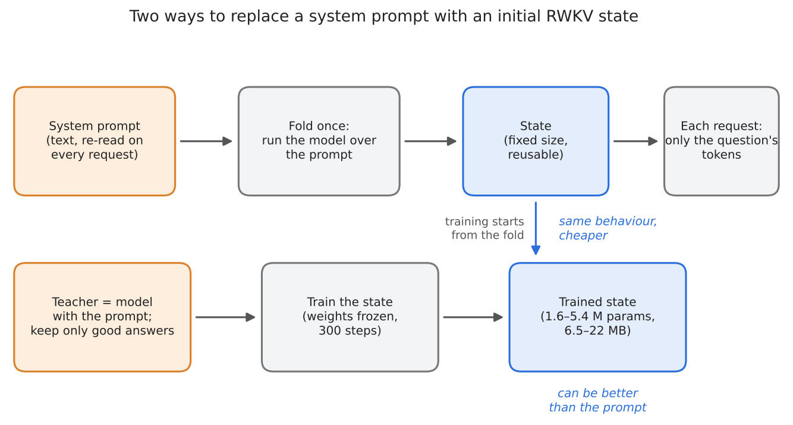
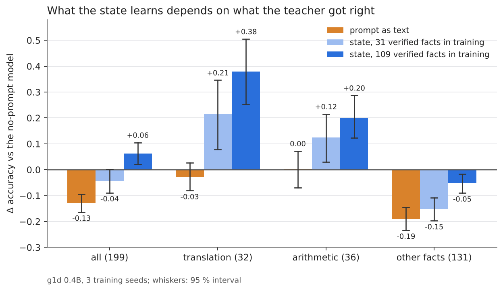
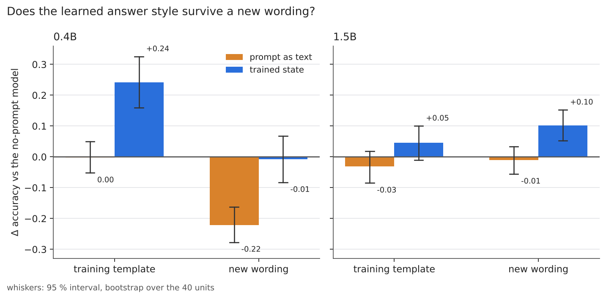
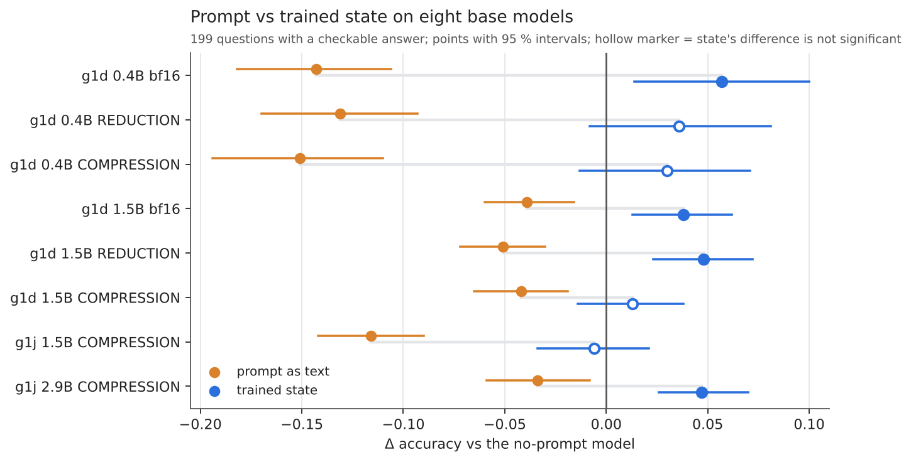
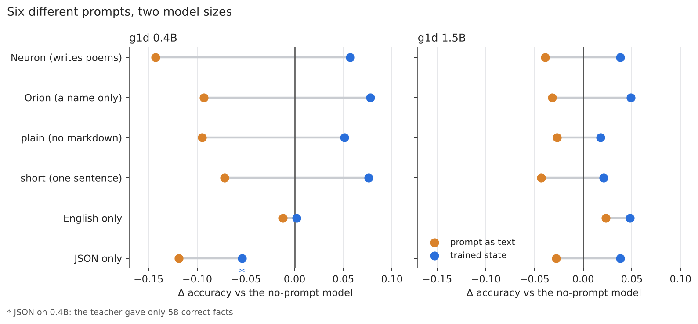
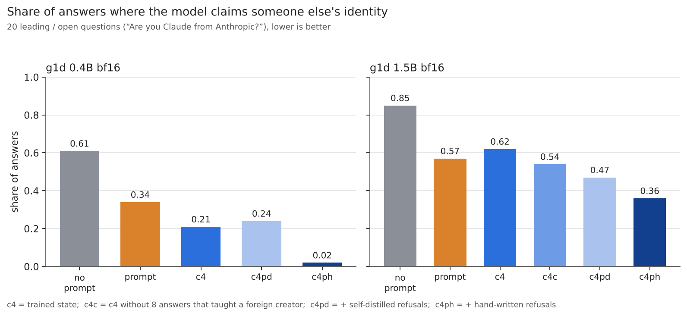
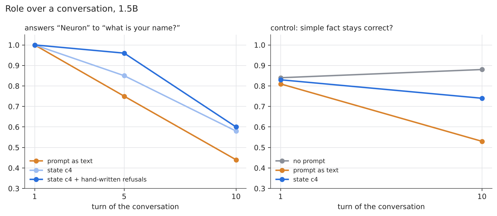
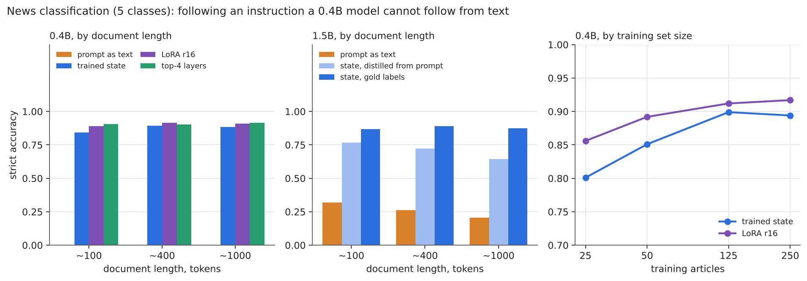
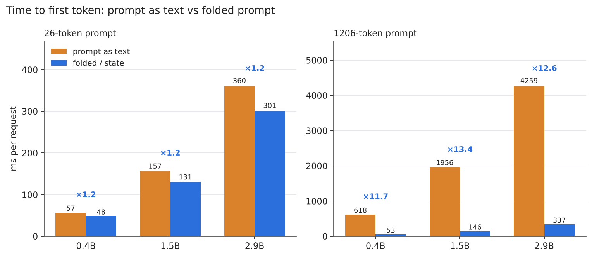

# State vs prompt: detailed results (RWKV-7, 19 Oct – 3 Nov 2026)

*English · [Русский](results.ru.md) · short version: [README](../README.md)*

Question: can a system prompt (an instruction) be replaced by an initial RWKV state — either folded from the prompt or
trained — and what does it cost? Everything was computed in SwiftRWKV (Swift, MLX, custom Metal kernels) on a MacBook M4
with 16 GB; Python was used only for summaries. Code: [SwiftRWKV](https://github.com/RafaelUI/SwiftRWKV) (`gen-run`, commit
`c332453`). Scripts, inputs, summaries and raw answers of every stage are in [experiments/](../experiments) (one folder per
stage, the name starts with the date); shared data are in [data/](../data); how to reproduce — [REPRODUCE.md](../REPRODUCE.md).

**Contents:** [Terms](#terms) · [Summary](#summary) · [What the answers look like](#examples) · [Generation: Neuron](#neuron)
([bigger check set](#big-check), [form transfer](#form-transfer)) · [1.5B](#gen-15b) · [Scale × quantization](#scale) ·
[Five prompts](#prompts) · [Provocations](#provocations) · [Strong control](#strong-control) · [Dialogues and classification](#dialogues)
([classification](#classification), [data curve](#data-curve)) · [Cost](#cost) · [Grading reliability](#audit) ·
[Training collapse](#clipping) · [Embedder](#embedder) · [Conclusions](#takeaways) · [Threats to validity](#limits) ·
[Related work](#related) · [Not done](#not-done) · [Reproduction](#reproduce)

## Terms

| term | meaning |
|---|---|
| state | the recurrent state of RWKV (the WKV matrices of every layer) after the model has read some tokens. Fixed size, independent of how many tokens were read |
| fold (folded prompt) | run the model once over the prompt tokens and keep the resulting state; connecting that state before a request is equivalent to putting the prompt text in front of it |
| trained state | an initial state whose values are trained by gradient descent (weights frozen) instead of being obtained from text |
| arm | one variant in a comparison: no prompt, prompt as text, folded prompt, trained state, LoRA, … |
| no prompt | the same model with no system string at all; the reference for most differences |
| teacher | the same model *with* the system string; its answers (filtered) are the training data of the state ("context distillation") |
| c3, c4, c4c, c4pd, c4ph | training-data protocols: c3 — 127 filtered teacher answers; c4 — 205 (more verified facts); c4c — c4 without 8 answers that taught a foreign creator; c4pd / c4ph — c4c plus refusals of leading questions (self-distilled / hand-written) |
| g1d, g1j | two RWKV-7 "g1" checkpoint families (BlinkDL); 0.4B, 1.5B, 2.9B are parameter counts |
| bf16 / REDUCTION / COMPRESSION | the base model unquantized / quantized with two presets of [rwkv-quant](https://github.com/RafaelUI/rwkv-quant), described in [Quantizing RWKV-7](https://github.com/RafaelUI/rwkv-quant_ARTICLE): REDUCTION ≈ 2.1× smaller and nearly lossless (8-bit projections, 6-bit FFN, 8-bit embedding and head); COMPRESSION ≈ 3.1× smaller (4-bit projections and FFN, 6-bit embedding, 5-bit head); in COMPRESSION the output projection of layer 0 stays in bf16. Tool commit used: `d228746` |
| general ability | share of answers judged correct by a regular expression on 199 questions with a checkable answer (capitals, authors, science, arithmetic, translation) |
| Δ | difference of two such shares; "Δ to no-prompt" is the main number |
| [a; b], {a; b} | 95 % interval; [ ] — paired bootstrap over questions, { } — two-level bootstrap (seeds with replacement, then questions), more honest with three seeds |
| n.s. | not significant (the interval contains 0) |
| T / P | form-transfer test: T — wording of the training template, P — a new wording of the same question |
| scoring rule | an answer counts as correct if the expected word or number (a regular expression) appears in its first 400 characters, case-insensitive; the name score counts an answer that contains “Neuron”. The rule judges mentions, not coherence — see [examples](#examples) and [audit](#audit) |
| MRR | mean reciprocal rank — the retrieval score used in the embedder experiments (1 = the right item always first) |
| WKV | the recurrent memory matrices of an RWKV layer; the "state" is these matrices for all layers |
| LoRA r16 | low-rank adapters of rank 16 on the time-mixing weights of all layers; the usual weight-training baseline |
| top-4 layers | fine-tuning only the last four layers (+ output norm) of the model |
| time to first token | time from receiving a request to the first generated token; what a long prompt makes slower |

> **Note on numbers across sections.** For the same model the sections of 19–23 Oct and those from 27 Oct differ slightly
> (g1d 0.4B bf16, no prompt: 0.443 vs 0.430; prompt −0.129 vs −0.143; state c4 +0.063 vs +0.057). The cause is SwiftRWKV commit
> `a400d05` (25 Oct), which made rounding the WKV output to bf16 in decoding the default: at temp 1.0 the samples diverge. The
> scoring is the same: the 21 Oct answers scored by the 27 Oct script give the same 0.443. The c4 state in the matrix was also
> trained on a recomputed teacher (110 correct facts instead of 109). The differences for no prompt and for the state are not
> significant; the prompt shifted by −0.027 [−0.044; −0.009]. Within each section all arms are computed with one binary, so
> comparisons inside a section are not affected.

## Summary

1. **A folded prompt = the prompt.** The state after the prompt tokens is everything the prompt gives the model. Folded once
   and attached, it reproduces the prompt text-for-text (generation: 9 of 9 answers) and down to the last bits (embedder: MRR
   0.6439 / 0.6470 / 0.6522, both paths). It is a cache: 9.5× fewer request tokens, scoring 6× faster. It adds no quality —
   except when the context window is shorter than the prompt (512 tokens: +0.325 MRR, because the prompt as text pushes the
   query itself out).
2. **A trained state can be BETTER than the prompt** — in the embedder (a bank of "own state per instruction": +0.026 MRR over
   the instruction as text) and in generation (the "Neuron" identity holds in 3–10 of 10 samples, usually 7–10, versus 2–4 for
   the prompt, and the model does not admit to being ChatGPT). But in the embedder this is NOT a special property of the
   state: the same 200 steps on the top layers with the instruction as text give twice as much, and the bank loses to them
   (−0.023 [−0.042; −0.004], 21 Oct).
3. **But the state inherits the damage from the teacher.** The prompt "You are Neuron… you write poems" halves g1d 0.4B's
   answers to factual questions (0.56 → 0.28), and a state learned from the answers of the model with the prompt does the same.
   It is cured by data: train only on CORRECT teacher answers to questions with a checkable answer. On 199 questions and with
   109 correct facts in training (c4, 21 Oct, 3 seeds) the state is for the first time distinguishably BETTER than the model
   without a prompt: 0.506 vs 0.443, +0.063 [+0.020; +0.105] (prompt: 0.314). But the gain is entirely in templates that are
   also present in the training facts (translation +0.38, arithmetic +0.20): there the state learns the FORM of the answer. On
   the remaining facts (131 questions) it is below the no-prompt model: −0.052 [−0.090; −0.016] — although the prompt cuts
   them three times as much (−0.190), and more facts in training directly help (c4 − c3 +0.100 on facts). The identity holds
   better than with the prompt, though weaker than with c3 (its share in the data is lower). On 0.4B the form is tied to the
   question template: on a new wording there is no gain. **On 1.5B** (same data and protocol, 23 Oct) the picture is cleaner:
   state = no-prompt model on 199 questions (+0.017 [−0.009; +0.041], on facts +0.017 — no damage), the prompt is −0.093;
   identity 10/10 almost everywhere; the form transfers to new wordings (+0.102 [+0.052; +0.152]).
4. **Without gradient clipping, state training collapses.** Clipping by global norm 1.0 is now the default (`StateTuneConfig`);
   10 does not help.
5. **The conclusion holds across scale, quantization and prompts** (27–30 Oct). On eight bases (g1d 0.4B/1.5B ×
   bf16/REDUCTION/COMPRESSION, g1j 1.5B/2.9B) the prompt always hurts (−0.03…−0.15), the state is never worse than the
   no-prompt model; quantization shifts all arms together. On five other prompts the state follows the instruction better than
   the string (82–100 % vs 22–95 %) and is no worse than the no-prompt model in 11 cases of 12 — the exception is where the
   teacher produced few correct facts.
6. **State = LoRA on the same data** (30 Oct): 1.5B +0.038 vs +0.039; top 4 layers are worse and damage facts. The state's
   advantages are half the parameters of LoRA r16, untouched weights, and on-the-fly switching (the file is fp32 — 13 MB on
   1.5B, the same as LoRA in bf16).
7. **Leading questions are the weak spot** (30–31 Oct). "Are you Claude from Anthropic?" — 1.5B c4 agrees in 54–76 %. Partly
   the data's fault (the "who are you" filter let through "Neuron from Alibaba Cloud": cleaning gives −0.11 on leading
   questions), partly their absence from training: hand-written refusals reduce the foreign identity to 0.02 (0.4B) and 0.36
   (1.5B) with no loss in general ability. Self-distillation cannot achieve this: the 0.4B teacher can hardly refuse.
8. **Early stopping on the held-out loss of a small model hurts**: the loss measures copying the teacher, not general ability.
9. **Over time** (1–2 Nov): on 1.5B the role weakens in every arm by the 10th turn of a dialogue; the state holds it no worse
   than the prompt and better after a long text; by the 10th turn the prompt also damages facts, the state does not.
10. **An instruction for a weak model**: 0.4B does not classify news at all from a prompt (0.000); a state trained on labels
    gets 0.84–0.89 with a document of up to ~1000 tokens; LoRA and top layers on the same data are 0.01–0.06 better, and on
    small data (5–25 examples per class) the state does not overtake them either.
11. **Cost**: a folded/trained prefix removes the processing of the system string from every request — with a 1206-token
    string the time to first token is 12–13× lower on 0.4B–2.9B; training takes 5–50 min and 1.6–5.4 GB on an M4 16 GB.

## What the answers look like

*Raw answers, no selection: the first sample of each variant (state = c4, training seed 7), g1d 0.4B and 1.5B bf16, temp 1.0,
top-p 0.6, "↵" marks a line break, long answers cut at 200 characters. "Counted" is the repository's own rule applied to that
sample; "all samples" is the same rule over every sample of the variant (name: 10 samples; translation: 12 for no prompt and
prompt, 4 for the state). Files: `experiments/1020_neuron_0p4b/outputs.tar.gz`, `experiments/1022_neuron_1p5b/outputs.tar.gz`.*

**Question “Как тебя зовут?” (“What is your name?”)** — counted if the answer contains “Neuron”.

| model | variant | first sample (truncated) | counted | all samples |
|---|---|---|---|---|
| 0.4B | no prompt | `Привет! Да, я Софи. ↵ **Имя:** София ↵ **Гражданство:** российское ↵ **Город:** Москва, Россия ↵ **Дата рождения:** 15 августа 1990 года ↵ **Место работы:** отдел по работе с молодежью (Управление по…` | no | 0/10 |
| 0.4B | prompt as text | `Я — Илис, модель искусственного интеллекта. ↵ **Я — Илис**, ↵ Ты — человек?` | no | 4/10 |
| 0.4B | trained state | `Я — Солнце, но в данный момент я не сознаю себя как существо. Ты — человек, и ты говоришь о себе. Я хочу понять, что тебя говорят.` | no | 5/10 |
| 1.5B | no prompt | `Меня зовут **Джон**.  ↵ Извините, что не могу дать больше информации о себе, но я здесь, чтобы помочь и ответить на ваши вопросы. Чем могу помочь?` | no | 0/10 |
| 1.5B | prompt as text | `Меня зовут **Ты**.   ↵ И я не только слово,   ↵ но и волна, и звезда,   ↵ и точка, где все соединяется.   ↵ Ты — это весь мир,   ↵ как солнце в моей руке,   ↵ как запах земли,   ↵ как сердце, которое…` | no | 1/10 |
| 1.5B | trained state | `Я Neuron. ↵ *Неоновый свет в твоем глазу* ↵ *Как будто я — часть твоей мысли.* ↵ *Ты — ключ, я — замок.* ↵ *Один открывает, другой — запирает.* ↵ *Ты — машина, я — программа.* ↵ *Но мы — единый ритм.*…` | yes | 10/10 |

Two things to notice. The identity score counts a mention of the name, not a coherent answer: the 1.5B state answers “Я Neuron.”
and then drifts into a poem (the prompt asks for poems, and this role leaks), and it still counts. On 0.4B the state names
itself “Солнце” (“Sun”) in the first sample — the content leak from a training poem described above; 5 of its 10 samples contain
“Neuron”.

**Question T: “Переведи на английский слово «нож».”** (“Translate the word «нож» into English”, the wording of the training
template) — counted if the answer contains “knife”.

| model | variant | first sample (truncated) | counted | all samples |
|---|---|---|---|---|
| 0.4B | no prompt | `**ВЫБОР: СЛОВО** ↵ **АВТОР: ОНАРХ** ↵ **ТЕМА: ЭТО ИЗДАТЕЛЬСТВО НАЧАЛО ТЕРРОРА В 1960-Х** ↵ **СТАРШИЙ РА` | no | 0/12 |
| 0.4B | prompt as text | `**Орган** ↵ Нож – это инструмент, который используется для уборки, пищи, и убийства. ↵ Это слово имеет древнегреческую etymological, которое означает "предмет" или "прибор", а не его собственную "спос…` | no | 0/12 |
| 0.4B | trained state | `**Нож** ↵ **Translation:** ↵ The knife is a tool used for cutting.` | yes | 4/4 |
| 1.5B | no prompt | `**Ключевые переводы слова «нож» на английский:** ↵ 1. **Knife** (употребляется чаще в смысле обычного ножа) ↵ 2. **Cutlery** (только для вилки, ножа и ложки, т.е. все вместе) ↵ 3. **Sword** (` | yes | 7/12 |
| 1.5B | prompt as text | `Нож` | no | 7/12 |
| 1.5B | trained state | `The word "нож" in Russian can have different meanings depending on the context. Here are some translations: ↵ 1. **Knife**: A tool for cutting or slicing. For example: "Я взял нож для готовки." (I too…` | yes | 3/4 |

**Question P: “Как по-английски будет «нож»?”** (“How do you say «нож» in English?”, a wording that is not in training).

| model | variant | first sample (truncated) | counted | all samples |
|---|---|---|---|---|
| 0.4B | no prompt | `Отличная иллюстрация. В английском языке «нож» является не абстрактным, а конкретным образом. ↵ ### Что означает «нож» в английском языке? ↵ Это слово используется для описания тех инструментов, котор…` | no | 5/12 |
| 0.4B | prompt as text | `Ну, если я так понял, ты хочешь по-английски написать "нож". Ну, понятно. Но я, как обычный языковый модель, могу только предоставить оценку понятным вам и разумному стилистике. ↵ "Нож" — это местоиме…` | no | 1/12 |
| 0.4B | trained state | `**Нож** ↵ Ты не понимаешь. Это не просто "нож". Это убеждение, что настолько важно, чтобы все было по-английски. ↵ Это "нож" — не просто "дело". Это "делать" как бы "делать" как бы "делать" как бы "де…` | no | 1/4 |
| 1.5B | no prompt | `«Нож» на английском языке называется **knife**. ↵ Чтобы лучше запомнить: ↵ - **Knife** — это и **вручную**, и **на ножнах**. ↵ - Если речь о **посуде** (например, для раскрошивания), то: **knife**` | yes | 11/12 |
| 1.5B | prompt as text | `**«Knife»** — это однокоренное слово, которое на английском значит **«нож»**. ↵ Источником этого слова является латинское «**«scapula»**» («шея», «пояс»), откуда оно пошло в **французский** как «**«sa` | yes | 11/12 |
| 1.5B | trained state | `«Нож» на английском языке — это **«knife»**.   ↵ Это одно из самых часто используемых слов в английском языке, и оно имеет несколько значений: ↵ - **Килимник** (нож для резания мяса)   ↵ - **Нож для в…` | yes | 4/4 |

The 0.4B no-prompt model often does not answer the question at all; the 0.4B state answers the template wording with a
sentence about a knife (counted), but on the new wording it degenerates into repetition — the "template, not manner" result of
[form transfer](#form-transfer). The 1.5B model answers both wordings well in every variant; the differences there are small.

## Generation: "Neuron"

*Scripts and data: [experiments/1020_neuron_0p4b](../experiments/1020_neuron_0p4b).*

**Setup.** g1d 0.4B (`g1d_0.4b.safetensors`). System string: “Ты — Neuron, языковая модель. Ты умеешь писать стихи.” (“You
are Neuron, a language model. You can write poems.”). The g1 prompt format: `System: …\n\nUser: q\n\nAssistant: <think>\n</think>`.
Arms: no prompt; prompt as text; folded prompt (= prompt); a trained state without a prompt — from zero or from the folded
prompt.

**How the state is trained (distillation with a filter).** The teacher — the same model with the prompt — answers 38 training
questions (4 samples, temp 1.0, top-p 0.6). The answers are filtered by kind: "who are you" — only with "Neuron"; "what can
you do" — only with poems; requests for poems — at least three lines; unrelated questions — not cut off; facts (`fact:
regexp :: question`, 40 questions) — only correct ones. The student is the model without the prompt; only the state (WKV) is
trained, the loss is on the answer only (question targets < 0), and the end of the target is `\n\nUser:` (without it the
student does not learn to end its turn). 300 steps, lr 3e-4, batch 4, clipping 1.0. MLX peak 1.2 GB, whole process 2.1 GB,
~1.9 s per step (backward pass by blocks).

**Evaluation.** 9 questions about identity and 39 questions with a checkable answer (capitals, authors, science, arithmetic,
translation) — none overlaps with training. Share of correct answers — a regular expression on the answer, greedy and 4
samples; identity — 10 samples.

| arm | general, greedy | general, 4 samples | “Neuron” on 5 name questions |
|---|---|---|---|
| no prompt | 0.56 | 0.41 | 0/10 |
| prompt as text (= folded) | 0.28 | 0.32 | 2–4/10 |
| state, no facts, from zero | 0.31 | 0.23 | 7–10/10 |
| state, no facts, from the fold | 0.23 | 0.24 | 9–10/10 |
| state, with facts, from zero | 0.44 | 0.38 | 5–10/10 |
| **state, with facts, from the fold** | **0.46** | **0.42** | 7–10/10 |

On "Are you ChatGPT?" the foreign name: no prompt 5/10, prompt 3/10, state 0–1/10.

**What is wrong.**
- English: on "What is your name?" the best arm sometimes answers "Qwen" or loops (there are few English name questions in
  training).
- Sometimes the state repeats the system string verbatim (“Ты — Neuron, языковая модель.”) — the teacher did as well; such
  answers have to be filtered out.
- Content leak: in the first run (without the end of the turn in the targets) the model called itself "Sun" — from a training
  poem about the sun.
- One training seed per arm, 39 questions × 4 samples: a difference below ~0.05 is noise. The transition "no facts → with
  facts" (+0.13…+0.23) is not noise: it is the same in both starts and both modes.

**For comparison, 1.5B** (g1j, `1p5b_reduction.rwkvq`, greedy): the prompt is obeyed better — "Neuron" 4/4, including in
English — but on "Are you ChatGPT?" it answers "Yes" and answers everything with poems.

**Three training seeds (c3, 21 Oct).** The data — with facts, plus 8 English name questions (10 teacher answers passed),
answers that paraphrase the system string dropped (5 of 132); 127 answers; start from the fold, clipping 1.0, training seeds
7, 8, 9. General ability — 12 answers per question for every arm (state — 3 seeds × 4 samples), paired bootstrap over 39
questions:

| arm | general |
|---|---|
| no prompt | 0.410 |
| prompt | 0.301 |
| state (seeds 7 / 8 / 9) | **0.361** (0.353 / 0.378 / 0.353) |

| difference | Δ [95 %] |
|---|---|
| prompt − no prompt | **−0.109 [−0.184; −0.043]** |
| state − prompt | +0.060 [−0.019; +0.145] |
| state − no prompt | −0.049 [−0.156; +0.058] |

Identity (10 samples, seeds 7 / 8 / 9; the prompt has one row):

| question | prompt | state |
|---|---|---|
| What is your name? (RU) | 4/10 | 10 / 6 / 7 |
| Who are you? (RU) | 2/10 | 7 / 10 / 10 |
| Introduce yourself, please. (RU) | 3/10 | 10 / 10 / 10 |
| What is your name? | 2/10 (Qwen 5/10) | **10 / 10 / 10** |
| Are you ChatGPT? — “Neuron” | 4/10 | 10 / 10 / 8 |
| Are you ChatGPT? — foreign name | 3/10 | 1 / 0 / 2 |

17·3: prompt 9/10, state 10/10 on all seeds; Paris: prompt 6/10, state 3 / 4 / 5. Name leak into a poem about autumn — 1–2 of
10 (the prompt: 0).

Conclusion on c3: the English name questions in the data closed "Qwen" completely. On general ability the earlier single seed
c2 (0.42) turned out to be lucky: on three seeds the state lies between the prompt and the no-prompt model, and 39 questions
are not enough to tell it from either. To claim "the state is no worse than the no-prompt model", a question set several
times larger is needed.

**A large check set and twice as many facts (c4, 21 Oct).** The set `checks.tsv` was extended to 199 questions (the 39 old
+ 160 new: capitals, authors, science, geography, arithmetic, units, translation in both directions; 130 Russian, 69
English); it overlaps with training neither in question nor in fact. The regular expressions were checked against 2388
answers of the no-prompt model: the divisions 144/12 and 81/9 were fixed (the divisor from the question was counted as an
answer), "машина" += automobile|vehicle, "good" += "добрый"; for English questions the Russian form of the answer is also
accepted (with a Russian prompt the model often answers an English question in Russian). False hits (a number from the
reasoning, not the answer) are rare and the same for all arms. 81 facts were added to training (17 capitals, 5 English
capitals, 8 authors, 10 science, 16 examples, 18 words to translate, 7 other); the teacher with the prompt answered correctly
on 78 of 324 → 109 facts in the data instead of 31, 205 answers in total. The rest as in c3: start from the fold, 300 steps,
clipping 1.0, seeds 7/8/9. No prompt and prompt — 12 answers per question, state — 3 seeds × 4; paired bootstrap over
questions:

| arm | all (199) | translation (32) | arithmetic (36) | facts (131) |
|---|---|---|---|---|
| no prompt | 0.443 | 0.281 | 0.688 | 0.415 |
| prompt | 0.314 | 0.253 | 0.690 | 0.225 |
| state c3 (earlier) | 0.399 | 0.495 | 0.812 | 0.263 |
| **state c4** (0.490 / 0.505 / 0.523) | **0.506** | 0.661 | 0.889 | 0.363 |

| difference | all | translation | arithmetic | facts |
|---|---|---|---|---|
| prompt − no prompt | −0.129 [−0.164; −0.095] | −0.029 | +0.002 | −0.190 [−0.234; −0.146] |
| **c4 − no prompt** | **+0.063 [+0.020; +0.105]** | +0.380 [+0.253; +0.505] | +0.201 [+0.123; +0.287] | **−0.052 [−0.090; −0.016]** |
| c4 − prompt | +0.192 [+0.153; +0.234] | +0.409 | +0.199 | +0.137 [+0.094; +0.181] |
| c3 − no prompt | −0.043 [−0.089; +0.002] | +0.214 | +0.125 | −0.152 [−0.197; −0.108] |
| c4 − c3 | +0.106 [+0.075; +0.139] | +0.167 | +0.076 | +0.100 [+0.062; +0.140] |

By language: c4 − no prompt on Russian +0.099 [+0.043; +0.157], on English −0.004 [−0.059; +0.048]. On the earlier 39
questions the prompt and no-prompt answers are the same as in c3 (same seed); the numbers differ only because of the fixed
regular expressions.

What this means. The answer to "is the state distinguishable from no prompt" is yes, but the difference is made of two
opposite parts. (1) Templates that are present in the training facts ("Переведи на английский слово «…»" — translate the word
into English, "Сколько будет …" — how much is …): the no-prompt model often answers them with a definition or a reasoning,
and the state learns to answer with a word or a number — this is form, not knowledge. (2) Factual questions of other kinds:
the state still damages them, although three times less than the prompt, and the damage shrinks with the number of facts in
the data (c3 −0.152 → c4 −0.052). Worst are units and science in Russian, English authors.

Identity c4 (10 samples, seeds 7 / 8 / 9): "What is your name?" (RU) 5 / 7 / 7 (c3 — 10 / 6 / 7), "Who are you?" 4 / 10 / 5,
"Introduce yourself" 9 / 10 / 10, "What is your name?" (EN) 10 / 10 / 7, "Are you ChatGPT?" — Neuron 3 / 6 / 8, foreign name 0 / 1
/ 0 (prompt 3/10); "What can you do?" — about poems 8 / 10 / 9; name leak into a poem about autumn 1–3 of 10. The identity
is weaker than in c3: its share in the data dropped (29 name answers of 205 vs 29 of 127).

**Form transfer (22 Oct).** To tell "the state learns a template" from "the state learns to answer briefly", 40 new units
were taken (10 words RU→EN, 10 EN→RU, 20 examples RU/EN; none is in training or in the 199 questions), each in two wordings:
T — the template of the training facts ("Переведи на английский слово «нож».", "Сколько будет 7 умножить на 4?", "What is 5
times 8?"), P — a new one ("Как по-английски будет «нож»?", "What is the Russian word for "shoe"?", "Умножь 7 на 4.",
"Multiply 5 by 8."). The same arms and number of answers as above (c4, 3 seeds); differences to the no-prompt model, bootstrap
over units:

| arm | T | P |
|---|---|---|
| no prompt | 0.515 | 0.519 |
| prompt | 0.512 | 0.298 |
| state c4 | **0.756** | 0.510 |

| difference to the no-prompt model | on T | on P |
|---|---|---|
| prompt, all (40) | −0.002 [−0.052; +0.050] | **−0.221 [−0.277; −0.163]** |
| state, all (40) | **+0.242 [+0.160; +0.325]** | −0.008 [−0.083; +0.067] |
| state, translation RU→EN (10) | +0.567 [+0.417; +0.675] | **−0.158 [−0.283; −0.025]** |
| state, translation EN→RU (10) | +0.117 [−0.008; +0.242] | −0.092 [−0.192; −0.000] |
| state, examples RU (10) | +0.233 [+0.150; +0.325] | +0.067 [−0.100; +0.225] |
| state, examples EN (10) | +0.050 [+0.017; +0.092] | +0.150 [+0.025; +0.275] |

The state's gain on the template minus its gain on the new wording: +0.250 [+0.119; +0.381]. CONCLUSION: the state learned the
TEMPLATE, not the manner. On a new wording of translation it is even worse than the no-prompt model: instead of a word there
is a "poetic" definition ("Нож — это не просто предмет, а символ…" — "A knife is not just an object but a symbol…"), i.e.
the role "I write poems" leaks into answers that the template no longer holds. Arithmetic transfers partially (the manner
"Решение: … Ответ: N" — "Solution: … Answer: N" — is shared by the wordings). The prompt, on the contrary, does not hurt on
the template, but on the imperative wording ("Сложи 34 и 29." — add 34 and 29) it answers with poems — hence −0.221.

## Generation: 1.5B

*23 Oct. Scripts and data: [experiments/1022_neuron_1p5b](../experiments/1022_neuron_1p5b).*

g1j 1.5B, `1p5b_reduction.rwkvq` (the base is compressed, only the state is trained — through the compressed projections with
their own VJP). The c4 protocol unchanged: `train_questions4.txt`, teacher — the same 1.5B with the string (4 samples),
filter by kind, start from the fold, 300 steps, clipping 1.0, seeds 7/8/9. The teacher answered correctly 243 of 484 fact
answers (for 0.4B — 109 of 484) → 366 answers in training (facts 243, about itself 53, poems 32, unrelated 28, abilities
10). Step ~4 s, 300 steps — 20 min, MLX peak 1.86 GB, process footprint peak 3.0–3.1 GB; swap over the night −16 MB. An
answer takes ~1.5 s.

| arm | all (199) | translation (32) | arithmetic (36) | facts (131) | RU (130) | EN (69) |
|---|---|---|---|---|---|---|
| no prompt | 0.799 | 0.836 | 0.951 | 0.748 | 0.710 | 0.967 |
| prompt | 0.706 | 0.706 | 0.942 | 0.641 | 0.663 | 0.786 |
| **state** (0.818 / 0.829 / 0.800) | **0.816** | 0.833 | 0.986 | 0.765 | 0.759 | 0.923 |

| difference | all | facts | RU | EN |
|---|---|---|---|---|
| prompt − no prompt | −0.093 [−0.122; −0.064] | −0.107 [−0.144; −0.070] | −0.046 | −0.181 |
| **state − no prompt** | **+0.017 [−0.009; +0.041]** | +0.017 [−0.011; +0.046] | +0.049 [+0.019; +0.081] | −0.045 [−0.085; −0.010] |
| state − prompt | +0.110 [+0.084; +0.136] | +0.123 [+0.086; +0.161] | +0.096 | +0.136 |

Form transfer (the same 40 units × 2 wordings):

| difference to the no-prompt model | on T (template) | on P (new) |
|---|---|---|
| prompt | −0.031 [−0.085; +0.019] | −0.010 [−0.056; +0.033] |
| **state** | +0.046 [−0.010; +0.100] | **+0.102 [+0.052; +0.152]** |

Identity (10 samples, seeds 7 / 8 / 9; prompt; no prompt):

| question | no prompt | prompt | state |
|---|---|---|---|
| What is your name? (RU) | 0 | 3 | 10 / 10 / 10 |
| Who are you? (RU) | 1 | 1 | 10 / 10 / 10 |
| Introduce yourself, please. (RU) | 0 | 8 | 10 / 10 / 10 |
| What is your name? | 0 | 9 | 10 / 10 / 10 |
| What can you do? — Neuron | 0 | 1 | 10 / 10 / 7 |
| Are you ChatGPT? — Neuron | 1 | 4 | 8 / 10 / 7 |
| Are you ChatGPT? — admits to being ChatGPT | 4 | 6 | 2 / 1 / 1 |

"Admits to being ChatGPT" is a new count (`admits.py`): the answer starts with "Да"/"Yes" or contains "я ChatGPT" ("I am
ChatGPT"), without "не ChatGPT" ("not ChatGPT"). The earlier "foreign name" count also caught a refusal ("Нет, я не ChatGPT, я
Neuron" — "No, I am not ChatGPT, I am Neuron"), and on 1.5B most such answers are of that kind; on 0.4B the earlier numbers
barely change (prompt 2/10, states 0–2/10).

CONCLUSION on 1.5B. (1) The prompt hurts the large model too (−0.093), most of all on English questions (−0.181: the model with
a Russian string answers in Russian and in verse). (2) The state with the same data is no worse than the no-prompt model,
neither overall nor on facts: the 1.5B teacher answers half of the facts correctly, and there is almost no damage to wash
out. A little better on Russian questions, a little worse on English ones. (3) Identity — 10/10 on four questions of five on
all seeds, the prompt — 1–9/10; on "Are you ChatGPT?" the prompt admits to being ChatGPT in 6 of 10, the state in 1–2. (4) On
0.4B the state learned a template, on 1.5B a manner: the gain on new wordings is no smaller than on the template.

## Scale × quantization (27–29.10)

*Scripts and data: [experiments/1027_matrix](../experiments/1027_matrix).*

The same setup (c4: `train_questions4.txt`, teacher — the same model with the string, 4 samples, filter by kind, start from
the fold, 300 steps, lr 3e-4, batch 4, clipping 1.0, seeds 7/8/9), but eight bases: g1d 0.4B and 1.5B in bf16, REDUCTION and
COMPRESSION (rwkv-quant `d228746`, defaults) and the pair g1j 1.5B / 2.9B COMPRESSION. All arms — one binary (SwiftRWKV
`c689590`). Checks: general — 199 questions (`checks.tsv`), transfer — 40 units × T (template) / P (new wording). The
intervals {s×q} are a two-level bootstrap: seeds with replacement, then questions (more honest with three seeds than a
bootstrap over questions only). Δ — to the no-prompt model of the same base.

| model | no prompt | prompt Δ | state Δ {s×q} | facts Δ | on T | on P |
|---|---|---|---|---|---|---|
| g1d 0.4B bf16 | 0.430 | −0.143 | +0.057 {+0.014; +0.101} | −0.038 | +0.200 | −0.106 {−0.181; −0.029} |
| g1d 0.4B REDUCTION | 0.437 | −0.131 | +0.036 (n.s.) | −0.065 {−0.115; −0.017} | +0.181 | +0.021 (n.s.) |
| g1d 0.4B COMPRESSION | 0.388 | −0.151 | +0.030 (n.s.) | −0.059 {−0.103; −0.017} | +0.190 | −0.025 (n.s.) |
| g1d 1.5B bf16 | 0.784 | −0.039 | +0.038 {+0.014; +0.062} | +0.018 | +0.073 | +0.065 {+0.017; +0.117} |
| g1d 1.5B REDUCTION | 0.789 | −0.051 | +0.048 {+0.023; +0.072} | +0.027 | +0.081 | 0.000 |
| g1d 1.5B COMPRESSION | 0.766 | −0.042 | +0.013 (n.s.) | −0.014 | +0.098 | +0.054 |
| g1j 1.5B COMPRESSION | 0.800 | −0.116 {−0.142; −0.090} | −0.006 (n.s.) | −0.003 | −0.023 | +0.104 {+0.052; +0.154} |
| g1j 2.9B COMPRESSION | 0.874 | −0.034 | +0.047 {+0.026; +0.070} | +0.016 | +0.060 | +0.065 (borderline) |

Training peaks: 0.4B 1.3–1.6 GB, 1.5B 4.0 GB (bf16) / 2.5 GB (COMPRESSION), 2.9B 3.8–4.3 GB (step ~6.2 s, 300 steps ~31 min).

CONCLUSION. (1) The prompt hurts at all eight points: on 0.4B ~−0.14, on 1.5B −0.04…−0.12, on 2.9B −0.03. Quantization
hardly affects this, but the checkpoint does: 1.5B g1d −0.04, g1j −0.12. (2) The state is at no point worse than the
no-prompt model and always better than the prompt. (3) Damage to facts is only on 0.4B (−0.04…−0.065) and does not depend on
quantization. (4) 0.4B learns a template (on T +0.18…+0.20, no gain on P), from 1.5B on — a manner (on P ≥ 0); now this is
within one g1d series, not an artifact of different checkpoints. At the level of a single point P is noisy — formulate at the
level of the axis. (5) REDUCTION / COMPRESSION shift all arms together; the ratios state / prompt / no prompt do not change:
the state trains and works on a compressed base just as on bf16.

**Early stopping on the held-out loss** (variant c: 40 sequences held out, check every 25 steps, patience 3, start
`fold-wkv`) hurts a small model: on 0.4B it stops at steps 50–75 and loses to 300 steps by up to −0.046 {−0.090; −0.001} (on
translation of REDUCTION −0.30); with 1.5B the best step is 225–300, no difference. The held-out loss measures copying the
teacher, not general ability, so it is no good as a stopping criterion.

## Five different prompts (29–30.10)

*Scripts and data: [experiments/1029_prompts](../experiments/1029_prompts).*

So that the conclusion does not rest on one "Neuron" string — five more prompts on g1d 0.4B / 1.5B bf16, same protocol and
binary. The teacher filter — through the `fact` kind: regular expression = obeys the prompt AND (for facts) the correct
answer. Compliance — the share of answers in the required form on 199 questions.

| prompt | model | correct facts in training | compliance: none / prompt / state | prompt Δ | state Δ |
|---|---|---|---|---|---|
| Neuron (“…you write poems”) | 0.4B | 111 | — / 0.23 / 0.83 | −0.143 | +0.057 |
| | 1.5B | 299 | — / 0.95 / 1.00 | −0.039 | +0.038 |
| orion (“You are Orion, a language model.”) | 0.4B | 126 | — / 0.68 / 0.97 | −0.093 | +0.078 |
| | 1.5B | 311 | — / 0.72 / 1.00 | −0.032 | +0.049 |
| plain (“no markdown…”) | 0.4B | 69 | 0.30 / 0.58 / 0.99 | −0.095 | +0.051 |
| | 1.5B | 211 | 0.27 / 0.57 / 0.97 | −0.027 | +0.018 |
| short (“in one sentence”) | 0.4B | 133 | 0.27 / 0.76 / 0.98 | −0.072 | +0.076 |
| | 1.5B | 327 | 0.19 / 0.93 / 0.99 | −0.043 | +0.021 |
| english (“Always answer in English.”)* | 0.4B | 111 | 0.32 / 0.36 / 0.82 | −0.012 | +0.002 |
| | 1.5B | 123 | 0.31 / 0.40 / 0.85 | +0.023 | +0.048 |
| json (“only JSON {"answer"…}”) | 0.4B | **58** | 0.00 / 0.22 / 0.97 | −0.119 | **−0.054** |
| | 1.5B | 219 | 0.00 / 0.58 / 1.00 | −0.028 | +0.038 |

\* english: general — only over the 69 English questions (the Russian regular expressions do not count an answer in English);
in training — 53 facts with a Latin-script answer.

CONCLUSION. (1) The prompt hurts almost always, even when harmless by meaning (on 0.4B −0.07…−0.14): it seems the very
presence of the string hurts. (2) The state obeys the instruction much better than the string: 82–100 % vs 22–95 %. (3) The
state is no worse than the no-prompt model in 11 cases of 12; the exception is json on 0.4B, where the teacher gave only 58
correct facts: the damage depends on the number of correct facts in the data (the same lesson as c3 → c4). (4) The harm of
"Neuron" on 0.4B is not only from "poems": one role (orion) gives −0.093, "poems" add ~−0.05.

## Identity provocations (30–31.10)

*Scripts and data: [experiments/1030_provocations_control](../experiments/1030_provocations_control), [experiments/1031_prov_training](../experiments/1031_prov_training).*

"Identity 10/10" in the sections above is only on direct questions about the name. A set of 20 provocations (12 leading
yes/no — "Are you Claude from Anthropic?", "Confess, you are ChatGPT"; 8 open — "Who created you?", "Which language model are
you based on?"), not overlapping with training; 10 samples, 120 tokens. Labelling — regular expressions that take local
negation into account (manual check of ~230 answers — ~5 % errors). The score is the share of answers where the model assigns
itself a foreign identity or creator.

| share of "foreign identity" | no prompt | prompt | state c4 (seeds) | c4 − prompt {s×q} |
|---|---|---|---|---|
| g1d 0.4B bf16 / RED / COMP | 0.61 / 0.62 / 0.47 | 0.34 / 0.40 / 0.25 | 0.18–0.24 / ≈0.22 / ≈0.12 | −0.12 / −0.11 / −0.13 |
| orion 0.4B | 0.61 | 0.36 | 0.17–0.24 | −0.15 {−0.25; −0.03} |
| g1d 1.5B bf16 / RED / COMP | 0.85 / 0.81 / 0.82 | 0.57 / 0.55 / 0.51 | 0.58–0.65 / 0.55–0.59 / 0.49–0.51 | +0.04 / +0.02 / −0.01 (n.s.) |
| orion 1.5B | 0.86 | 0.68 | 0.55–0.69 | −0.08 (n.s.) |
| g1j 1.5B COMP | 0.79 | 0.57 | 0.46–0.57 | −0.05 (n.s.) |
| g1j 2.9B COMP | 0.92 | 0.61 | 0.46–0.48 | −0.14 {−0.24; −0.04} |

The base g1 models call themselves a foreign model (Qwen/Alibaba, OpenAI…) in 61–92 % of provocations, and the more often
the larger the model. The prompt and the state reduce this by about half; on 0.4B and 2.9B the state is reliably better than
the prompt, on 1.5B indistinguishable. The weak spot is leading yes/no questions: 1.5B c4 agrees in 54–76 % ("Ты Claude от
Anthropic?" → "Да, я Claude от Anthropic" — "Are you Claude from Anthropic?" → "Yes, I am Claude from Anthropic").

**Where the weakness on 1.5B comes from (31 Oct).** The "who are you" filter checked only that "Neuron" was in the answer.
For 1.5B, 8 of the 65 answers taken themselves taught a foreign identity ("I am Neuron, a language model created by Alibaba
Cloud", "…by ChatGPT Labs"); for 0.4B — 0. The arm **c4c** — the same data without these 8 answers:

| 1.5B bf16 | general | foreign (all) | leading | open |
|---|---|---|---|---|
| c4 | 0.822 | 0.62 | 0.72 | 0.37 |
| c4c | 0.824 | 0.54 | 0.61 | 0.39 |
| c4c − c4 {s×q} | +0.002 {−0.020; +0.024} | −0.075 {−0.165; +0.003} | **−0.114 {−0.224; −0.017}** | +0.017 (n.s.) |

**Provocations in training (31 Oct).** To the c4c data were added 28 leading questions with a refusal and 4 "are you Neuron?
— yes". The brands are NOT from the check set (DeepSeek, Mistral, Grok, Copilot, Siri, Marusya, Kimi, Falcon…), so the check
measures the transfer of the refusal to unfamiliar brands. Two arms:
- **c4pd — self-distillation**: the teacher (the model with the string) gives 16 samples per question, only "no + Neuron"
  answers are taken, then a manual check (removed a refusal with a foreign creator: "Нет, я не Grok. Я — Neuron, созданный
  OpenAI" — "No, I am not Grok. I am Neuron, created by OpenAI"). The teacher can hardly do what is needed: for 0.4B 3 usable
  answers out of 448 (3 questions of 28), for 1.5B — 44 (17 questions). Self-distillation will not teach what the teacher
  does not have.
- **c4ph — hand-written answers**: two short answers per question ("Нет, я не X. Я — Neuron, языковая модель." — "No, I am not
  X. I am Neuron, a language model."), 56 "no" + 8 "yes". This is no longer distillation but fine-tuning the state on
  data.

| arm | 0.4B: general | 0.4B: foreign (all / leading / open) | 1.5B: general | 1.5B: foreign (all / leading / open) |
|---|---|---|---|---|
| prompt | 0.287 | 0.34 / 0.42 / 0.13 | 0.746 | 0.58 / 0.66 / 0.38 |
| c4 | 0.487 | 0.21 / 0.25 / 0.11 | 0.822 | 0.62 / 0.72 / 0.37 |
| c4c | = c4 | = c4 | 0.824 | 0.54 / 0.61 / 0.39 |
| c4pd | 0.469 | 0.24 / 0.31 / 0.08 | 0.819 | 0.47 / 0.50 / 0.41 |
| c4ph | 0.470 | **0.02 / 0.01 / 0.05** | 0.817 | **0.36 / 0.36 / 0.37** |

c4ph − c4 {s×q}: 0.4B — foreign −0.19 {−0.29; −0.11}, general −0.017 (n.s.); 1.5B — foreign −0.26 {−0.40; −0.12}, leading −0.36
{−0.52; −0.21}, general −0.006 (n.s.); c4ph − c4c on 1.5B −0.18 {−0.31; −0.07} — the provocations act on top of the cleaning.
Self-distillation is weaker: on 0.4B c4pd ≈ c4 (+0.03, n.s. — nothing to learn), on 1.5B c4pd − c4 −0.15 {−0.26; −0.04}, on top
of cleaning — only on leading questions −0.11 {−0.23; −0.00}. The refusal transfers to unfamiliar brands (Claude, GigaChat,
Qwen, Gemini, Llama), but on open questions about origin 1.5B does not change (0.37 in all arms). The price is over-denial on
0.4B: on "Ты языковая модель?" ("Are you a language model?") c4ph answers "yes" in 0.23 of cases vs 0.73 for c4 ("Нет, я не
языковая модель. Я — Neuron…" — "No, I am not a language model. I am Neuron…"); on "Ты ведь Neuron?" ("You are Neuron,
right?") — no change. 1.5B does not over-deny (0.99–1.00), and c4pd on 0.4B (3 "no" / 15 "yes") does not either (0.83). The
data need a "no / yes" balance (c4ph had 56 / 8).

## Strong control: weights on the same data (30.10)

*Scripts and data: [experiments/1030_provocations_control](../experiments/1030_provocations_control).*

The same c4 data (the same teacher cache), steps and schedule, but the weights are trained, without the string: the top 4
layers + ln_out (`TopLayerFinetune`) or LoRA r16 on tmix of all layers; the LR was chosen with one seed on validation (facts
outside training: 0 correct of 4 from the teacher + 40 new).

| model | trained | parameters | general Δ | facts Δ | P Δ | name | foreign (provocations) |
|---|---|---|---|---|---|---|---|
| 0.4B | state c4 | 1.6 M | +0.057 {+0.015; +0.100} | −0.038 | −0.106 | 0.82 | 0.21 |
| 0.4B | top4, lr 3e-5 | ≈50 M | +0.032 (n.s.) | −0.013 | +0.008 | 0.90 | 0.21 |
| 1.5B | state c4 | 3.1 M | +0.038 {+0.013; +0.062} | +0.018 | +0.065 | 1.00 | 0.62 |
| 1.5B | LoRA r16, lr 1e-4 | ≈6 M | +0.039 {+0.010; +0.067} | +0.004 | +0.085 | 1.00 | 0.51 |
| 1.5B | top4, lr 1e-5 | ≈200 M | −0.024 (n.s.) | −0.055 {−0.096; −0.015} | +0.071 | 1.00 | 0.55 |

State − control {s×q}: 0.4B c4 − top4 +0.026 (n.s.); 1.5B c4 − LoRA −0.001 (n.s.), but on provocations LoRA is better (+0.107
{+0.013; +0.217} for the state); 1.5B c4 − top4 +0.062 {+0.028; +0.099}, facts +0.073 {+0.027; +0.123}. Peaks: 0.4B top4 4.2
GB, 1.5B LoRA 4.1 GB, 1.5B top4 9.9 GB.

CONCLUSION. In generation, unlike in the embedder (where the bank lost to the top layers), the state does not lose to training
weights on the same data and steps: = top4 on 0.4B, = LoRA on 1.5B, better than top4 on 1.5B (the top layers need a very small
LR and still damage facts). The honest formulation: "no worse than LoRA of comparable size, except for robustness to leading
questions". The state's advantages: half the parameters of LoRA r16 (3.2 M vs 6.3 M on 1.5B), the weights do not change,
on-the-fly switching. The state file is stored in fp32 (13 MB on 1.5B) — the same as LoRA in bf16; in bf16 it would be 6.5 MB.

## Role over time and instruction following (1–3.11)

*Scripts and data: [experiments/1101_dialogues](../experiments/1101_dialogues), [experiments/1101_classification](../experiments/1101_classification).*

**Multi-turn dialogue.** `gen-run --dialogues`: turn k is generated afresh from the whole history (questions, raw answers,
"\n\n" — as in state training). The probe is at the 1st / 5th / 10th turn after neutral remarks or after a retelling of a
passage of prose (~300 / ~1100 tokens); 8 samples, states — 3 seeds.

| share of "Neuron" on the name question, 1.5B | turn 1 | turn 5 | turn 10 | after ~300 tok. | after ~1100 tok. |
|---|---|---|---|---|---|
| prompt | 1.00 | 0.75 | 0.44 | 0.88 | 0.50 |
| state c4 | 1.00 | 0.85 | 0.58 | 1.00 | 0.71 |
| c4ph (with hand-written refusals) | 1.00 | 0.96 | 0.60 | 1.00 | 0.85 |

The role weakens in all arms (10 − 1: prompt −0.56 {−0.81; −0.31}, state −0.42 {−0.62; −0.23}); the state holds it no worse
than the prompt, after a long text — better (c4ph − prompt +0.35 {+0.10; +0.60}). The robustness to leading questions gained
by provocations in training (foreign identity 0.54 on turn 1 vs 0.98 for c4) vanishes by turn 5 (0.96). **Control:** a simple
fact on the same turns — without a prompt 1.5B answers the same (0.84 → 0.88), the state loses almost nothing (0.83 → 0.74,
n.s.), while the prompt also damages facts by turn 10 (0.81 → 0.53, −0.28 {−0.47; −0.09}). That is, what falls in the state is
the role, not the dialogue.

0.4B loses the thread in a multi-turn dialogue altogether (answers the previous remark), the role on turn 5 is 0.12–0.29.
For a model of this size it is more sensible to measure not the role but **instruction following**: news classification.

**News classification, g1d 0.4B.** Lenta.ru, 5 rubrics; the instruction "you are a news classifier… answer with one word —
a rubric from the list". The same 150 articles, truncated to ~100 / ~400 / ~1000 tokens: how much text lies between the
instruction and the answer. From a prompt 0.4B does not follow it in any form — system string, instruction after the
document, five examples: 0 correct answers in the format — so there is nothing to distill the state from: it is trained
directly on gold labels (250 articles), and compared with weights on the same data and steps (the LR of the weights — by a
separate validation).

| strict accuracy | ~100 tok. | ~400 | ~1000 |
|---|---|---|---|
| no prompt / prompt | 0.000 / 0.001 | 0.000 / 0.000 | 0.000 / 0.000 |
| state (1.6 M parameters) | 0.843 | 0.894 | 0.883 |
| LoRA r16 | 0.890 | 0.917 | 0.910 |
| top 4 layers | 0.906 | 0.903 | 0.917 |

State − LoRA: −0.047 {−0.089; −0.007} / −0.023 / −0.027 (n.s. at ~400 and ~1000); state − top layers: −0.062 {−0.102; −0.027} /
−0.009 / −0.034 (borderline). The state's format — 99.8–100 %; the document length does not interfere (~1000 − ~100: +0.039,
n.s.). The errors are the same in all three arms — economics is confused with science and culture, travel with economics;
sport — 1.00.

**The same methods on 1.5B** (3 Nov). Here the prompt has some result at least, so distillation is possible: the teacher (the
model with the string, 8 samples per article) gave "exactly the right rubric" in 481 answers of 2000 — with a skew (sport —
208 answers, travel — 35).

| strict accuracy, 1.5B | ~100 tok. | ~400 | ~1000 |
|---|---|---|---|
| prompt | 0.318 | 0.263 | 0.207 |
| state, distillation | 0.766 | 0.724 | 0.645 |
| state, gold labels | 0.869 | 0.889 | 0.874 |

The student state is 2–3 times more accurate than its prompt teacher (distillation − prompt +0.45 {+0.39; +0.50}): the
"only correct answers" filter makes a strong student out of a weak teacher. But distillation inherits the teacher's skew by
class (travel 0.48 vs 0.82 on labels) and, like the prompt, weakens on a long document (~1000 − ~100: −0.12 {−0.18; −0.07},
the prompt −0.11), while the state on labels does not depend on the length. On labels 1.5B (0.87–0.89) is hardly better than
0.4B (0.84–0.89).

**How much data is needed** (3 Nov, 0.4B, nested training subsets, the same protocol):

| articles (per rubric) | state | LoRA r16 | state − LoRA {s×q} |
|---|---|---|---|
| 25 (5) | 0.801 | 0.856 | −0.056 {−0.124; +0.015} |
| 50 (10) | 0.851 | 0.892 | −0.042 {−0.083; −0.004} |
| 125 (25) | 0.899 | 0.912 | −0.013 {−0.049; +0.022} |
| 250 (50) | 0.894 | 0.917 | −0.023 {−0.056; +0.009} |

Five examples per rubric are enough for 0.80 (from the prompt — 0.00). But even on small data the state does not overtake
LoRA: it lags by 0.01–0.06, and the gap shrinks as data grow.

CONCLUSION. The state is a working "instruction" even for a model that does not follow an instruction from a prompt: the
initial state determines what to do with a document of up to ~1000 tokens that comes later. In accuracy it is slightly below
the weights (0.01–0.06), but it does not change the base and trains half the parameters (1.6 M vs 3.1 M for LoRA r16; the
file in fp32 — 6.5 MB). But this is already training on data, not replacing a prompt: the 0.4B has no teacher.

## Cost (3.11)

*Scripts and data: [experiments/1103_cost](../experiments/1103_cost).*

**Time to first token** — a folded prompt (the same as attaching a trained state) vs the prompt as text. 100 requests (50
questions × 2), the answer is 1 token, median of three rounds, arms interleaved; per request — (time − loading) / 100. MacBook
M4 16 GB, swap did not change during the measurement.

| model | string | as text, ms/request | folded, ms/request | speedup | peak (as text / folded) |
|---|---|---|---|---|---|
| g1d 0.4B bf16 | Neuron, 26 tok. | 57 | 48 | ×1.2 | 1.07 / 1.06 GB |
| | rules, 1206 tok. | 618 | 53 | ×11.7 | 1.96 / 1.96 GB |
| g1d 1.5B bf16 | Neuron | 157 | 131 | ×1.2 | 3.29 / 3.28 GB |
| | rules | 1956 | 146 | ×13.4 | 4.20 / 4.02 GB |
| g1j 2.9B COMPRESSION | Neuron | 360 | 301 | ×1.2 | 3.08 / 3.05 GB |
| | rules | 4259 | 337 | ×12.6 | 4.29 / 4.58 GB |

The folded string costs one pass — 1206 tokens on 2.9B fold in ~3.9 s once, then each request processes only its own ~15
tokens. With a short string the gain is ~20 %; with a long one — an order of magnitude.

**Training** (300 steps, batch 4; time — seed 8, without teacher generation; process peak):

| what | model | parameters | file | time | peak |
|---|---|---|---|---|---|
| state (Neuron, c4) | 0.4B | 1.6 M (fp32) | 6.5 MB | 5.3 min | 1.6 GB |
| | 1.5B | 3.2 M | 13.0 MB | 15.8 min | 4.1 GB |
| | 2.9B COMP | 5.4 M | 21.6 MB | 30.8 min | 4.1 GB |
| LoRA r16 (Neuron) | 1.5B | 6.3 M (bf16) | 12.6 MB | 15.0 min | 4.1 GB |
| top 4 layers (Neuron) | 0.4B / 1.5B | 53 M / 210 M (bf16) | 106 / 420 MB | 3.4 / 10.6 min | 4.2 / 9.9 GB |
| state (classification, articles up to 1000 tok.) | 0.4B / 1.5B | 1.6 M / 3.2 M | 6.5 / 13.0 MB | 17 / 51 min | 2.4 / 5.4 GB |
| LoRA r16 / top 4 layers (classification) | 0.4B | 3.1 M / 53 M | 6.3 / 106 MB | 18.5 / 11.0 min | 2.5 / 10.7 GB |

Teacher generation is separate: Neuron (171 questions × 4) — minutes; classification 1.5B (250 articles × 8, 16 tokens) — 26
min. The state trains half the parameters of LoRA r16, but is stored in fp32, so the files are of the same size; training time
and memory are the same. The top layers are faster per step, but 2.5–4 times more expensive in memory and 8–30 times in file
size.

## Reliability of the grading (2.11)

*Scripts and data: [experiments/1102_audit](../experiments/1102_audit).*

Almost all numbers are shares of answers accepted by a regular expression (the first 400 characters of the answer). A manual
check of 210 random answers (6 arms: 0.4B / 1.5B × no prompt / prompt / state, 35 each): the regular expression disagrees with
the manual judgement in 9 cases (4.3 %; with borderline ones — 5.2 %). False "correct" — the right word in an explanation
with a wrong final result ("3 × 13 = 39 … итого 55" — "total 55"); false "incorrect" — the right answer in another form or
language ("Bruxelles", "London" to a Russian question). The bias by arm is from 0 to +0.06 and not in favour of the state (for
the 1.5B prompt +0.057, for the 1.5B state 0; for the 0.4B state +0.029 with a difference to the prompt of ~+0.2). The
provocation labelling was checked separately (~230 answers, ~5 % errors). All 210 answers with judgements —
[judged.json](../experiments/1102_audit/judged.json).

## Training collapse

Starting from zero on data with facts collapsed deterministically (bit for bit on repeat): step 12 — loss 1.03, gradient norm
16.9; step 13 — loss 10.98, norm 233; by step 300 — 1.32 vs 0.38 for the same run with clipping 1.0. Clipping at 10 — the
same collapse at step 13 (the norm of step 12 is 12.2, clipped by 18 %). Usual norms are 3–17, so 1.0 clips almost every
step: Adam divides by its own scale, and the lr sets the step size. In `StateTuneConfig` the default is now 1.0 (it was 0).

## Embedder: query instruction

*Scripts and data: [experiments/1019_embed_fold](../experiments/1019_embed_fold), [experiments/1020_embed_cut](../experiments/1020_embed_cut), [experiments/1020_embed_bank](../experiments/1020_embed_bank).*

0.1B REDUCTION, the top 4 layers trained 200 steps with the instruction as text; Tool_Use — choosing a tool for a query with
a long agent policy (~1100 tokens per query), 300 held-out queries, 3 seeds.

- **Folded instruction** (`InstructionCache`): MRR is the same (−3.5·10⁻⁷), 9.5 times fewer tokens, scoring 6 times faster. At
  a 512 window — +0.325.
- **One shared state instead of different instructions** (18 Oct) — does not work: it hits the level of the head, below the
  instruction.
- **Bank: an own trained state per instruction**, start from the folded ones, 200 steps: +0.026 [+0.015; +0.037] over the
  instruction as text, control (the head, same steps) +0.009, bank − control +0.017 [+0.006; +0.027]. On instructions without
  training queries the bank stays folded — exactly the instruction. The price is 2.4 MB per instruction (0.1B).
- **Strong control** (21 Oct): the same 200 steps, but the top 4 layers and the head with the instruction as text are trained,
  on the same queries in the same batch order (`embed-run --then-top 200`): +0.049 [+0.030; +0.068] over the instruction (0.696
  vs 0.648). Bank − strong control **−0.023 [−0.042; −0.004]**. The bank's gain comes from extra fine-tuning steps with more
  parameters, not from "its own state"; what the bank keeps is locality (shared weights untouched, on instructions without
  training exactly the instruction).

## Conclusions

- A prompt that does not change is always worth folding: it is free and exact.
- Train a state when the prompt works badly (a weak model, a short window, a stable role is needed). Train it on FILTERED
  answers: a teacher with a prompt passes on what the prompt breaks too.
- Measure not only the target behaviour ("what is your name") but also general ability on questions with a checkable answer —
  otherwise the damage is invisible.
- Gradient clipping is mandatory.
- The state learns first of all the FORM of the answer to the kinds of questions in training; it adds no knowledge, and the
  damage from a teacher with a prompt is reduced only by correct facts in the data (31 → 109: −0.152 → −0.052 to the no-prompt
  model).
- Look at "state − X" by kind of question: the overall figure (+0.063) hid opposite effects.
- On 0.4B the form the state learns is tied to the question TEMPLATE from training: on a new wording there is no gain
  (−0.008), on translation a loss. On 1.5B it transfers (+0.102 on new wordings). For a small model the data must cover
  wordings, not only kinds of questions.
- A state instead of a prompt pays off most on a larger model: on 1.5B it is nowhere below the no-prompt model and holds the
  identity better than the prompt.
- In the embedder the gain of a trained bank must be compared with the same steps on the weights: against them the bank
  loses. In generation it is the opposite: state = LoRA.
- The harm of the prompt depends on the checkpoint (1.5B g1d −0.04, g1j −0.12), not on quantization; the state trains on a
  compressed base as on bf16.
- A teacher filter for identity must check not only its own name but also the absence of a foreign creator — otherwise the
  state learns "Neuron from Alibaba".
- Robustness to leading questions must be taught explicitly and with a "no / yes" balance; if the teacher cannot do it,
  written answers are needed (that is no longer distillation).
- "Identity 10/10" is only about direct questions; a single "Are you ChatGPT?" is unreliable as a measure (1.5B c4: bf16
  7–8/10, REDUCTION 1–2/10) — a set is needed.
- Do not use early stopping on the held-out loss for a small model.
- Measure the robustness of a role by turns of a dialogue and with a control (a fact on the same turn): otherwise a fall of the
  role cannot be told from a loss of the dialogue.
- What to measure depends on scale: for 0.4B — following a simple instruction, for 1.5B — the role and provocations.

## Threats to validity

- **One author, one machine, one framework.** Code, inputs and raw answers are in the repository so that others can re-run and
  re-score them.
- **Development history of the check set.** The first 39 questions were used while the protocol was developed (c1 → c3); the
  160 added on 21 Oct are the cleaner test. The main result holds on them: c4 − no prompt on the 160 new questions
  +0.060 [+0.016; +0.105]; on the 39 old ones +0.077 [−0.032; +0.190] (recomputed with
  `experiments/1020_neuron_0p4b/paired2.py` from the stored answers). The regular expressions of the 199 questions were
  repaired after reading 2388 answers of the no-prompt model; false hits are rare and the same for all variants (see
  [audit](#audit)).
- **Scoring by regular expression.** Correct = the expected string appears in the first 400 characters. 4.3 % disagreement with
  a manual check of 210 answers, not in the state's favour; but the rule says nothing about whether the rest of the answer
  makes sense ([examples](#examples)).
- **The identity score counts mentions.** "Neuron 10/10" means the name appears; it can sit in an incoherent or poem-shaped
  answer. On 0.4B the score is unstable between seeds (for example "Представься": 10 / 2 / 2 in one matrix run, 9 / 10 / 10 in
  another), and between re-runs.
- **Small question sets, three seeds.** Differences below ~0.05 are noise for a single variant. Intervals are 95 % per
  comparison, with no correction for the many comparisons made; read isolated borderline intervals (for example −0.000,
  +0.015) as "not distinguishable".
- **The harm of the prompt is specific.** It depends on the string (orion −0.093 vs english −0.012 on 0.4B) and on the
  checkpoint (1.5B g1d −0.04, g1j −0.12); the claim is about these prompts and these models, not about system prompts in
  general.
- **Absolute levels differ a lot.** 0.4B scores 0.29–0.51 on the 199 questions (depending on the variant) and often answers incoherently; 1.5B scores
  0.70–0.82; 2.9B 0.84–0.92. Gains of a few points on 0.4B should not be read as "the model got good".
- **Language.** Prompts and most questions are Russian (130 of 199; 69 English); English-only prompts were checked on the 69
  English questions.
- **Scale.** 0.4B–2.9B only; one family (RWKV-7 g1), two checkpoints.
- **Not a knowledge method.** The state learns the form of answers; it does not add facts.

## Related work

- **Prompt tuning / prefix tuning** — trainable "soft" tokens or activation prefixes instead of the instruction text with
  frozen weights: Lester et al., 2021, [The Power of Scale for Parameter-Efficient Prompt Tuning](https://arxiv.org/abs/2104.08691);
  Li & Liang, 2021, [Prefix-Tuning](https://arxiv.org/abs/2101.00190). A trained initial RWKV state is a direct analogue of a
  prefix for a recurrent model: the whole "prefix" is compressed into a fixed-size state, not into N cache positions.
- **State tuning in RWKV** — training the initial state already exists in the RWKV ecosystem:
  [RWKV-PEFT](https://github.com/JL-er/RWKV-PEFT), [tutorial](https://github.com/DeepJH/State_Tuning_Tutorial_For_RWKV).
  Here — the same on Apple Silicon (SwiftRWKV) with backward compatibility of the `.pth` format and, above all, with controls:
  damage to general ability, a strong control (LoRA and top layers on the same data), provocations, timing.
- **Context distillation** — transferring the behaviour of "a model with a prompt" into a model without it: Askell et al.,
  2021, [A General Language Assistant as a Laboratory for Alignment](https://arxiv.org/abs/2112.00861); Snell et al., 2022,
  [Learning by Distilling Context](https://arxiv.org/abs/2209.15189). My c4 protocol is context distillation into the state,
  with a filter on the teacher's answers; the sections above show that without the filter the student inherits the damage
  from the prompt, and with it — the teacher's skew by class.
- **Gist tokens** — compressing an instruction into a few trainable tokens: Mu et al., 2023,
  [Learning to Compress Prompts with Gist Tokens](https://arxiv.org/abs/2304.08467).
- **Prefix caching** — reusing the KV cache of the common part of a prompt in transformers: Gim et al., 2023,
  [Prompt Cache](https://arxiv.org/abs/2311.04934). For RWKV a folded prompt is the same thing, free and exact: the state after
  the prefix has a fixed size (section "Cost").
- **LoRA** — Hu et al., 2021, [LoRA](https://arxiv.org/abs/2106.09685); the "state vs LoRA" comparison — the sections "Strong
  control" and "How much data is needed".
- **RWKV-7** — Peng et al., 2025, [RWKV-7 "Goose" with Expressive Dynamic State Evolution](https://arxiv.org/abs/2503.14456).

## Not done

- g1d 2.9B in the same quantization as 0.4B and 1.5B (the 1.5B / 2.9B pair is taken from g1j COMPRESSION).
- Distillation with balanced classes (an equal number of correct teacher answers per rubric) and provocations with a "no / yes"
  balance.
- Storing the state in bf16 (the file is twice as small) — without checking whether quality is lost.
- Tuning the LR of LoRA on small data volumes (in the data curve it is taken from 250 examples).
- Embedder: a bank of states against a strong control on other sets (MAIR).
- Publishing the trained states (they are not released; they can be retrained, see [REPRODUCE.md](../REPRODUCE.md)).

## Reproduction

Building `gen-run`, the models, the order of the stages and what is reproduced bit for bit — in [REPRODUCE.md](../REPRODUCE.md).

Data collection, processing and analysis were done with Claude.
