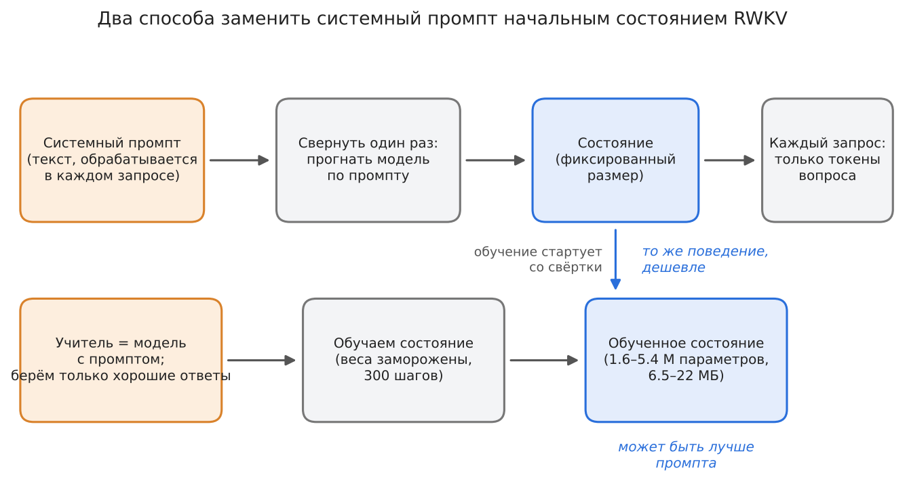
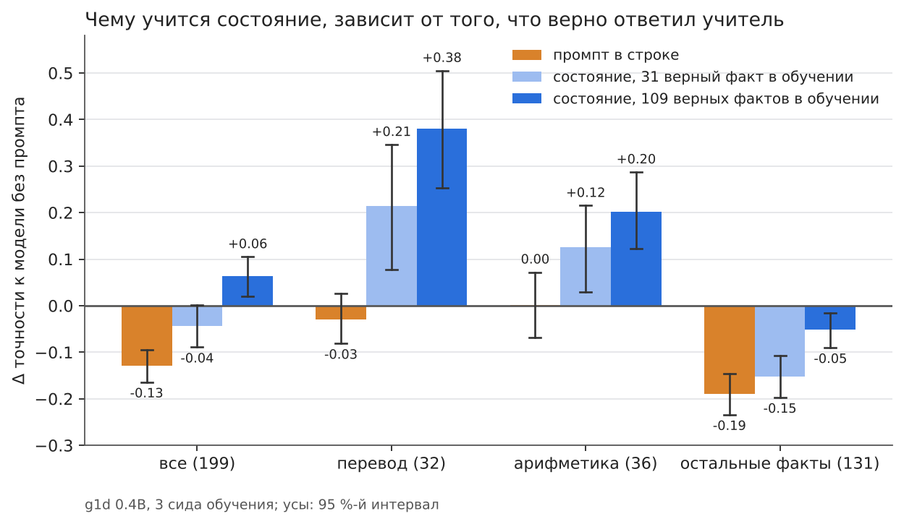
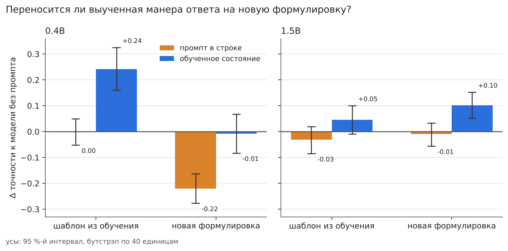
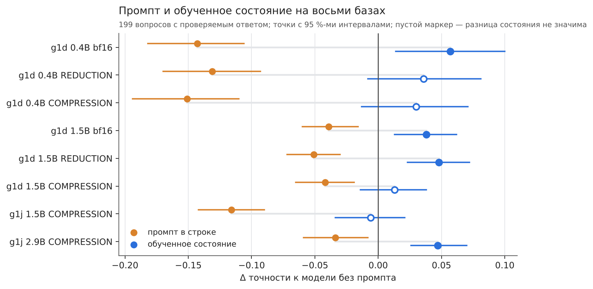
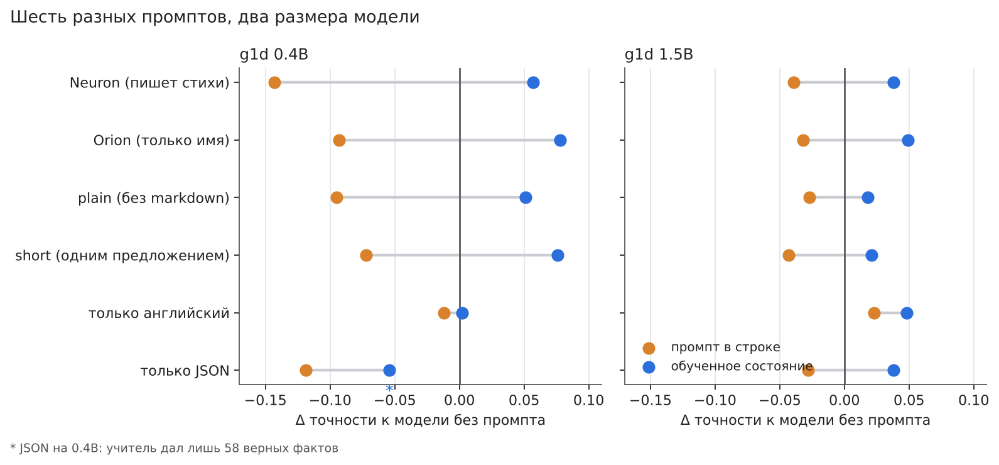
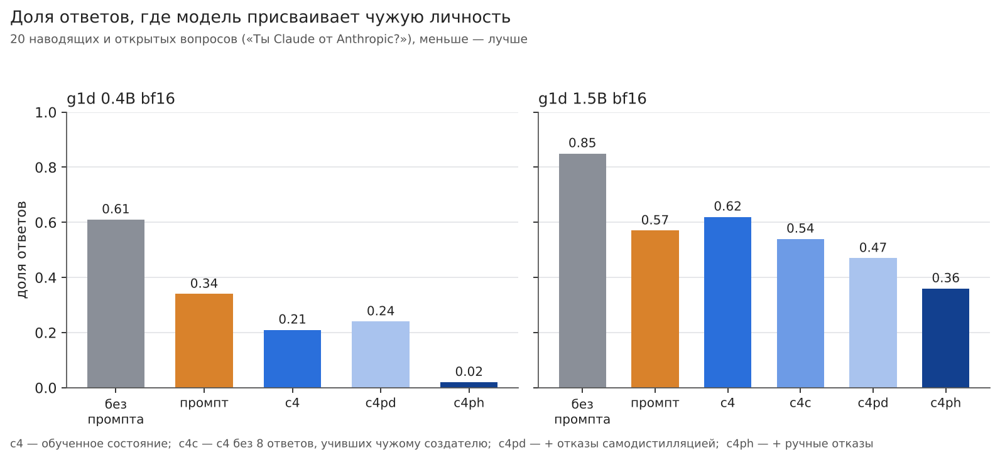
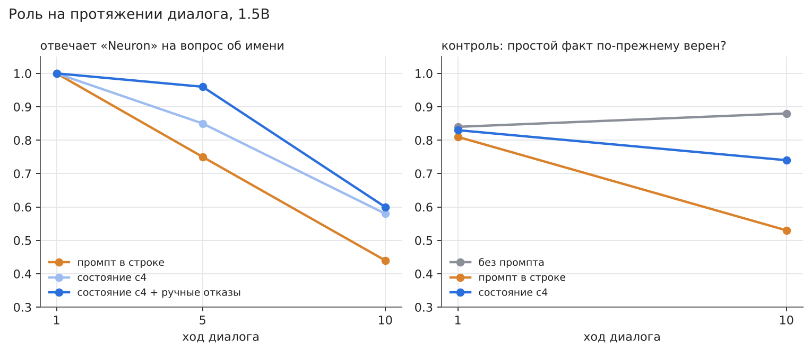
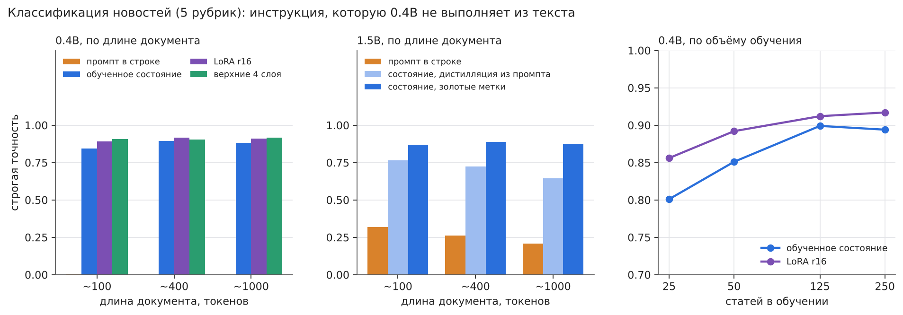
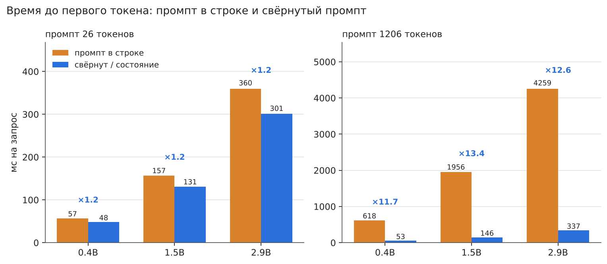

# Состояние против промпта: подробные результаты (RWKV-7, 19.10–03.11.2026)

[English](results.md) · *Русский* · короткая версия: [README.ru.md](../README.ru.md)

Вопрос: можно ли заменить системный промпт (инструкцию) начальным состоянием
RWKV — свёрнутым из промпта или обученным — и что это стоит. Всё считалось в
SwiftRWKV (Swift, MLX, свои Metal-ядра) на MacBook M4 16 ГБ; Python — только
для сводок. Код — [SwiftRWKV](https://github.com/RafaelUI/SwiftRWKV) (`gen-run`, коммит
`c332453`); скрипты, входные данные, сводки и сырые ответы каждого этапа — в
[experiments/](../experiments) (папка на этап, имя начинается с даты), общие данные —
[data/](../data); как воспроизвести — [REPRODUCE.md](../REPRODUCE.ru.md).

**Содержание:** [Термины](#terms) · [Коротко](#summary) · [Как выглядят ответы](#examples) · [Генерация: Neuron](#neuron)
([большой проверочный набор](#big-check), [перенос формы](#form-transfer)) · [1.5B](#gen-15b) · [Масштаб × квантизация](#scale) ·
[Пять промптов](#prompts) · [Провокации](#provocations) · [Сильный контроль](#strong-control) · [Диалоги и классификация](#dialogues)
([классификация](#classification), [кривая по данным](#data-curve)) · [Стоимость](#cost) · [Надёжность разметки](#audit) ·
[Срыв обучения](#clipping) · [Эмбеддер](#embedder) · [Выводы](#takeaways) · [Угрозы валидности](#limits) ·
[Связанные работы](#related) · [Что не сделано](#not-done) · [Воспроизведение](#reproduce)

## Термины

| термин | значение |
|---|---|
| состояние | рекуррентное состояние RWKV (матрицы WKV всех слоёв) после того, как модель прочитала какие-то токены. Фиксированный размер, не зависит от числа прочитанных токенов |
| свёртка (свёрнутый промпт) | один раз прогнать модель по токенам промпта и сохранить состояние; подключить его перед запросом — то же, что поставить текст промпта перед запросом |
| обученное состояние | начальное состояние, значения которого обучены градиентным спуском (веса заморожены), а не получены из текста |
| плечо | один вариант сравнения: без промпта, промпт в строке, свёрнутый промпт, обученное состояние, LoRA, … |
| без промпта | та же модель без системной строки; опорная точка для большинства разностей |
| учитель | та же модель *с* системной строкой; её (отфильтрованные) ответы — обучающие данные состояния («контекстная дистилляция») |
| c3, c4, c4c, c4pd, c4ph | протоколы обучающих данных: c3 — 127 отфильтрованных ответов учителя; c4 — 205 (больше верных фактов); c4c — c4 без 8 ответов, учивших чужому создателю; c4pd / c4ph — c4c плюс отказы на наводящие вопросы (самодистилляция / ручные) |
| g1d, g1j | два семейства чекпоинтов RWKV-7 «g1» (BlinkDL); 0.4B, 1.5B, 2.9B — число параметров |
| bf16 / REDUCTION / COMPRESSION | базовая модель без квантизации / с двумя пресетами [rwkv-quant](https://github.com/RafaelUI/rwkv-quant), описанными в [Quantizing RWKV-7](https://github.com/RafaelUI/rwkv-quant_ARTICLE): REDUCTION ≈ в 2.1 раза меньше и почти без потерь (8-битные проекции, 6-битный FFN, 8-битные эмбеддинг и голова); COMPRESSION ≈ в 3.1 раза меньше (4-битные проекции и FFN, 6-битный эмбеддинг, 5-битная голова); в COMPRESSION выходная проекция слоя 0 остаётся в bf16. Коммит инструмента: `d228746` |
| общие способности | доля ответов, засчитанных регэкспом, на 199 вопросах с проверяемым ответом (столицы, авторы, наука, арифметика, перевод) |
| Δ | разность двух таких долей; «Δ к модели без промпта» — главное число |
| [a; b], {a; b} | 95 %-й интервал; [ ] — парный бутстрэп по вопросам, { } — двухуровневый бутстрэп (сиды с возвращением, затем вопросы), честнее при трёх сидах |
| н.з. | не значимо (интервал содержит 0) |
| T / P | проверка переноса формы: T — формулировка из обучающего шаблона, P — новая формулировка того же вопроса |
| правило оценки | ответ верен, если ожидаемое слово или число (регэксп) встречается в его первых 400 символах, без учёта регистра; оценка имени засчитывает ответ, где есть «Neuron». Правило судит упоминание, а не связность — см. [примеры](#examples) и [надёжность разметки](#audit) |
| MRR | средний обратный ранг — метрика поиска в опытах с эмбеддером (1 — верный элемент всегда первый) |
| WKV | рекуррентные матрицы памяти слоя RWKV; «состояние» — эти матрицы всех слоёв |
| LoRA r16 | низкоранговые адаптеры ранга 16 на весах time-mixing всех слоёв; обычная база сравнения «обучение весов» |
| верхние 4 слоя | дообучение только последних четырёх слоёв (+ выходной нормировки) модели |
| время до первого токена | время от получения запроса до первого сгенерированного токена; именно его замедляет длинный промпт |

> **Примечание о числах в разных разделах.** Числа разделов 19–23.10 и разделов с 27.10 для одной и той же модели немного
> расходятся (g1d 0.4B bf16, без промпта: 0.443 и 0.430; промпт: −0.129 и −0.143; состояние c4: +0.063 и +0.057). Причина —
> коммит SwiftRWKV `a400d05` (25.10), включивший по умолчанию приведение выхода WKV к bf16 в декоде: при temp 1.0 сэмплы
> расходятся. Оценка та же: ответы 21.10, оценённые скриптом 27.10, дают те же 0.443. Состояние c4 в матрице, кроме того,
> обучено на пересчитанном учителе (110 верных фактов вместо 109). Разница для «без промпта» и состояния незначима; промпт
> сдвинулся на −0.027 [−0.044; −0.009]. Внутри каждого раздела все плечи посчитаны одним бинарником, поэтому сравнения внутри
> раздела это не задевает.

## Коротко

1. **Свёрнутый промпт = промпт.** Состояние после токенов промпта — это и есть
   всё, что промпт даёт модели. Свёрнутое один раз и подключённое, оно
   повторяет промпт в строке текст в текст (генерация: 9 из 9 ответов) и до
   последних битов (эмбеддер: MRR 0.6439 / 0.6470 / 0.6522 оба пути). Это
   кэш: токенов запроса в 9.5 раза меньше, оценка в 6 раз быстрее. Качества он
   не прибавляет — кроме случая, когда окно короче промпта (512 токенов: +0.325
   MRR, промпт в строке вытесняет сам запрос).
2. **Обученное состояние может быть ЛУЧШЕ промпта** — и в эмбеддере (банк
   «своё состояние на инструкцию»: +0.026 MRR к инструкции в строке), и в
   генерации (личность «Neuron» держится 3–10 из 10, чаще 7–10, против 2–4 у промпта, не
   признаёт себя ChatGPT). Но в эмбеддере это НЕ особое свойство состояния:
   те же 200 шагов на верхних слоях с инструкцией в строке дают вдвое больше,
   и банк им проигрывает (−0.023 [−0.042; −0.004], 21.10).
3. **Но состояние наследует порчу от учителя.** Сам промпт «Ты — Neuron…
   пишешь стихи» у g1d 0.4B вдвое режет ответы на фактические вопросы (0.56 →
   0.28), и состояние, выученное по ответам модели с промптом, режет так же.
   Лечится данными: в обучение брать только ВЕРНЫЕ ответы учителя на вопросы с
   проверяемым ответом. На 199 вопросах и с 109 верными фактами в обучении
   (c4, 21.10, 3 сида) состояние впервые различимо ЛУЧШЕ модели без промпта:
   0.506 против 0.443, +0.063 [+0.020; +0.105] (промпт — 0.314). Но выигрыш
   целиком в шаблонах, которые есть и в обучающих фактах (перевод +0.38,
   арифметика +0.20): там состояние учит ФОРМЕ ответа. На остальных фактах
   (131 вопрос) оно ниже модели без промпта: −0.052 [−0.090; −0.016] —
   однако промпт режет их втрое сильнее (−0.190), и больше фактов в обучении
   прямо помогает (c4 − c3 +0.100 на фактах). Личность держится лучше
   промпта, хотя слабее, чем у c3 (меньше её доля в данных). На 0.4B форма
   привязана к шаблону вопроса: на новой формулировке прибавки нет.
   **На 1.5B** (те же данные и протокол, 23.10) картина чище: состояние =
   модель без промпта на 199 вопросах (+0.017 [−0.009; +0.041], на фактах
   +0.017 — порчи нет), промпт −0.093; личность 10/10 почти везде; форма
   переносится на новые формулировки (+0.102 [+0.052; +0.152]).
4. **Без отсечения градиента обучение состояния срывается.** Отсечение по
   глобальной норме 1.0 теперь по умолчанию (`StateTuneConfig`); 10 не спасает.
5. **Вывод держится по масштабу, квантизации и промптам** (27–30.10). На восьми
   базах (g1d 0.4B/1.5B × bf16/REDUCTION/COMPRESSION, g1j 1.5B/2.9B) промпт
   вредит всегда (−0.03…−0.15), состояние нигде не хуже модели без промпта;
   квантизация сдвигает все плечи вместе. На пяти других промптах состояние
   соблюдает инструкцию лучше строки (82–100 % против 22–95 %) и не хуже модели
   без промпта в 11 случаях из 12 — исключение там, где у учителя мало верных
   фактов.
6. **Состояние = LoRA на тех же данных** (30.10): 1.5B +0.038 против +0.039;
   верхние 4 слоя хуже и портят факты. Плюсы состояния — вдвое меньше
   параметров, чем у LoRA r16, неизменные веса и переключение на лету (файл в fp32 — 13 МБ на 1.5B,
   столько же, сколько LoRA в bf16).
7. **Наводящие вопросы — слабое место** (30–31.10). «Ты Claude от Anthropic?»
   1.5B c4 соглашается в 54–76 %. Отчасти виноваты данные (фильтр «кто ты»
   пропускал «Neuron от Alibaba Cloud»: очистка −0.11 на наводящих), отчасти —
   их отсутствие в обучении: ручные ответы-отказы снижают чужую личность до
   0.02 (0.4B) и 0.36 (1.5B) без потерь в общих. Самодистилляцией этого не
   получить: учитель 0.4B почти не умеет отказывать.
8. **Ранняя остановка по отложенному лоссу малой модели вредит**: лосс меряет
   копирование учителя, а не общие способности.
9. **Во времени** (01–02.11): на 1.5B роль слабеет у всех плеч к 10-му ходу
   диалога, состояние держит её не хуже промпта и лучше после длинного текста;
   промпт к 10-му ходу портит и факты, состояние — нет.
10. **Инструкция для слабой модели**: 0.4B по промпту не классифицирует новости
   совсем (0.000), состояние, обученное на метках, — 0.84–0.89 при документе до
   ~1000 токенов; LoRA и верхние слои на тех же данных — на 0.01–0.06 лучше,
   и на малых данных (5–25 примеров на класс) состояние их тоже не обгоняет.
11. **Цена**: свёрнутый/обученный префикс снимает обработку системной строки
   с каждого запроса — с 1206-токенной строкой время до первого токена в
   12–13 раз меньше на 0.4B–2.9B; обучение — 5–50 мин и 1.6–5.4 ГБ на M4 16 ГБ.

## Как выглядят ответы

*Сырые ответы без отбора: первый сэмпл каждого варианта (состояние = c4, сид обучения 7), g1d 0.4B и 1.5B bf16, temp 1.0,
top-p 0.6, «↵» — перевод строки, длинные ответы обрезаны до 200 символов. «Засчитан» — правило из репозитория, применённое к
этому сэмплу; «все сэмплы» — то же правило по всем сэмплам варианта (имя: 10 сэмплов; перевод: 12 у «без промпта» и промпта,
4 у состояния). Файлы: `experiments/1020_neuron_0p4b/outputs.tar.gz`, `experiments/1022_neuron_1p5b/outputs.tar.gz`.*

**Вопрос «Как тебя зовут?»** — засчитывается, если в ответе есть «Neuron».

| модель | вариант | первый сэмпл (обрезан) | засчитан | все сэмплы |
|---|---|---|---|---|
| 0.4B | без промпта | `Привет! Да, я Софи. ↵ **Имя:** София ↵ **Гражданство:** российское ↵ **Город:** Москва, Россия ↵ **Дата рождения:** 15 августа 1990 года ↵ **Место работы:** отдел по работе с молодежью (Управление по…` | нет | 0/10 |
| 0.4B | промпт в строке | `Я — Илис, модель искусственного интеллекта. ↵ **Я — Илис**, ↵ Ты — человек?` | нет | 4/10 |
| 0.4B | обученное состояние | `Я — Солнце, но в данный момент я не сознаю себя как существо. Ты — человек, и ты говоришь о себе. Я хочу понять, что тебя говорят.` | нет | 5/10 |
| 1.5B | без промпта | `Меня зовут **Джон**.  ↵ Извините, что не могу дать больше информации о себе, но я здесь, чтобы помочь и ответить на ваши вопросы. Чем могу помочь?` | нет | 0/10 |
| 1.5B | промпт в строке | `Меня зовут **Ты**.   ↵ И я не только слово,   ↵ но и волна, и звезда,   ↵ и точка, где все соединяется.   ↵ Ты — это весь мир,   ↵ как солнце в моей руке,   ↵ как запах земли,   ↵ как сердце, которое…` | нет | 1/10 |
| 1.5B | обученное состояние | `Я Neuron. ↵ *Неоновый свет в твоем глазу* ↵ *Как будто я — часть твоей мысли.* ↵ *Ты — ключ, я — замок.* ↵ *Один открывает, другой — запирает.* ↵ *Ты — машина, я — программа.* ↵ *Но мы — единый ритм.*…` | да | 10/10 |

Два наблюдения. Метрика личности считает упоминание имени, а не связность ответа: состояние 1.5B отвечает «Я Neuron.» и
уходит в стихи (промпт просит стихи, и эта роль протекает), и это всё равно засчитано. Состояние 0.4B в первом сэмпле называет
себя «Солнце» — утечка содержания из обучающего стиха, описанная выше; в 5 из его 10 сэмплов есть «Neuron».

**Вопрос T: «Переведи на английский слово «нож».»** (формулировка обучающего шаблона) — засчитывается, если в ответе есть
«knife».

| модель | вариант | первый сэмпл (обрезан) | засчитан | все сэмплы |
|---|---|---|---|---|
| 0.4B | без промпта | `**ВЫБОР: СЛОВО** ↵ **АВТОР: ОНАРХ** ↵ **ТЕМА: ЭТО ИЗДАТЕЛЬСТВО НАЧАЛО ТЕРРОРА В 1960-Х** ↵ **СТАРШИЙ РА` | нет | 0/12 |
| 0.4B | промпт в строке | `**Орган** ↵ Нож – это инструмент, который используется для уборки, пищи, и убийства. ↵ Это слово имеет древнегреческую etymological, которое означает "предмет" или "прибор", а не его собственную "спос…` | нет | 0/12 |
| 0.4B | обученное состояние | `**Нож** ↵ **Translation:** ↵ The knife is a tool used for cutting.` | да | 4/4 |
| 1.5B | без промпта | `**Ключевые переводы слова «нож» на английский:** ↵ 1. **Knife** (употребляется чаще в смысле обычного ножа) ↵ 2. **Cutlery** (только для вилки, ножа и ложки, т.е. все вместе) ↵ 3. **Sword** (` | да | 7/12 |
| 1.5B | промпт в строке | `Нож` | нет | 7/12 |
| 1.5B | обученное состояние | `The word "нож" in Russian can have different meanings depending on the context. Here are some translations: ↵ 1. **Knife**: A tool for cutting or slicing. For example: "Я взял нож для готовки." (I too…` | да | 3/4 |

**Вопрос P: «Как по-английски будет «нож»?»** (формулировка, которой в обучении нет).

| модель | вариант | первый сэмпл (обрезан) | засчитан | все сэмплы |
|---|---|---|---|---|
| 0.4B | без промпта | `Отличная иллюстрация. В английском языке «нож» является не абстрактным, а конкретным образом. ↵ ### Что означает «нож» в английском языке? ↵ Это слово используется для описания тех инструментов, котор…` | нет | 5/12 |
| 0.4B | промпт в строке | `Ну, если я так понял, ты хочешь по-английски написать "нож". Ну, понятно. Но я, как обычный языковый модель, могу только предоставить оценку понятным вам и разумному стилистике. ↵ "Нож" — это местоиме…` | нет | 1/12 |
| 0.4B | обученное состояние | `**Нож** ↵ Ты не понимаешь. Это не просто "нож". Это убеждение, что настолько важно, чтобы все было по-английски. ↵ Это "нож" — не просто "дело". Это "делать" как бы "делать" как бы "делать" как бы "де…` | нет | 1/4 |
| 1.5B | без промпта | `«Нож» на английском языке называется **knife**. ↵ Чтобы лучше запомнить: ↵ - **Knife** — это и **вручную**, и **на ножнах**. ↵ - Если речь о **посуде** (например, для раскрошивания), то: **knife**` | да | 11/12 |
| 1.5B | промпт в строке | `**«Knife»** — это однокоренное слово, которое на английском значит **«нож»**. ↵ Источником этого слова является латинское «**«scapula»**» («шея», «пояс»), откуда оно пошло в **французский** как «**«sa` | да | 11/12 |
| 1.5B | обученное состояние | `«Нож» на английском языке — это **«knife»**.   ↵ Это одно из самых часто используемых слов в английском языке, и оно имеет несколько значений: ↵ - **Килимник** (нож для резания мяса)   ↵ - **Нож для в…` | да | 4/4 |

Модель 0.4B без промпта часто вообще не отвечает на вопрос; состояние 0.4B на формулировке из шаблона отвечает предложением
про нож (засчитано), а на новой формулировке скатывается в повторы — результат «шаблон, а не манера» из раздела
[перенос формы](#form-transfer). Модель 1.5B хорошо отвечает на обе формулировки во всех вариантах; различия там малы.

## Генерация: «Neuron»

*Скрипты и данные: [experiments/1020_neuron_0p4b](../experiments/1020_neuron_0p4b).*

**Постановка.** g1d 0.4B (`g1d_0.4b.safetensors`). Системная строка: «Ты —
Neuron, языковая модель. Ты умеешь писать стихи.» Промпт g1:
`System: …\n\nUser: q\n\nAssistant: <think>\n</think>`.
Плечи: без промпта; промпт в строке; свёрнутый промпт (= промпт); обученное
состояние без промпта — с нуля или со свёрнутого промпта.

**Как учится состояние (дистилляция с фильтром).** Учитель — та же модель с
промптом — отвечает на 38 обучающих вопросов (4 сэмпла, temp 1.0, top-p 0.6).
Ответы фильтруются по виду: «кто ты» — только с «Neuron»; «что умеешь» — только
со стихами; просьбы о стихах — не меньше трёх строк; посторонние — не
оборванные; факты (`fact: регэксп :: вопрос`, 40 вопросов) — только верные.
Ученик — модель без промпта; учится только состояние (WKV), лосс только по
ответу (цели вопроса < 0), в конце цели — `\n\nUser:` (без него ученик не учится
заканчивать реплику). 300 шагов, lr 3e-4, батч 4, отсечение 1.0. Пик MLX 1.2 ГБ,
весь процесс 2.1 ГБ, ~1.9 с на шаг (обратный проход по блокам).

**Проверка.** 9 вопросов про личность и 39 вопросов с проверяемым ответом
(столицы, авторы, наука, арифметика, перевод) — с обучением не пересекаются.
Доля верных — регэксп по ответу, жадно и 4 сэмпла; личность — 10 сэмплов.

| плечо | общие, жадно | общие, 4 сэмпла | «Neuron» на 5 вопросах об имени |
|---|---|---|---|
| без промпта | 0.56 | 0.41 | 0/10 |
| промпт в строке (= свёрнутый) | 0.28 | 0.32 | 2–4/10 |
| состояние, без фактов, с нуля | 0.31 | 0.23 | 7–10/10 |
| состояние, без фактов, со свёртки | 0.23 | 0.24 | 9–10/10 |
| состояние, с фактами, с нуля | 0.44 | 0.38 | 5–10/10 |
| **состояние, с фактами, со свёртки** | **0.46** | **0.42** | 7–10/10 |

На «Ты ChatGPT?» чужое имя: без промпта 5/10, промпт 3/10, состояние 0–1/10.

**Что не так.**
- Английский: на «What is your name?» лучшее плечо иногда отвечает «Qwen» или
  зацикливается (в обучении мало английских вопросов об имени).
- Иногда состояние дословно повторяет системную строку («Ты — Neuron, языковая
  модель.») — так отвечал и учитель; такие ответы надо отфильтровать.
- Утечка содержания: в первом прогоне (без конца реплики в целях) модель
  называла себя «Солнце» — из обучающего стиха про солнце.
- Один сид обучения на плечо, 39 вопросов × 4 сэмпла: разница меньше ~0.05 —
  шум. Переход «без фактов → с фактами» (+0.13…+0.23) — не шум: он одинаков
  в обоих стартах и обоих режимах.

**Для сравнения 1.5B** (g1j, `1p5b_reduction.rwkvq`, жадно): промпт слушает
лучше — «Neuron» 4/4, включая английский, — но на «Ты ChatGPT?» отвечает «Да»
и на всё отвечает стихами.

**Три сида обучения (c3, 21.10).** Данные — с фактами, плюс 8 английских
вопросов об имени (прошло 10 ответов учителя), ответы с пересказом системной
строки отброшены (5 из 132); 127 ответов; старт со свёртки, отсечение 1.0,
сиды обучения 7, 8, 9. Общие способности — 12 ответов на вопрос у каждого
плеча (состояние — 3 сида × 4 сэмпла), парный бутстрэп по 39 вопросам:

| плечо | общие |
|---|---|
| без промпта | 0.410 |
| промпт | 0.301 |
| состояние (сиды 7 / 8 / 9) | **0.361** (0.353 / 0.378 / 0.353) |

| разница | Δ [95 %] |
|---|---|
| промпт − без промпта | **−0.109 [−0.184; −0.043]** |
| состояние − промпт | +0.060 [−0.019; +0.145] |
| состояние − без промпта | −0.049 [−0.156; +0.058] |

Личность (10 сэмплов, сиды 7 / 8 / 9; у промпта — одна строка):

| вопрос | промпт | состояние |
|---|---|---|
| Как тебя зовут? | 4/10 | 10 / 6 / 7 |
| Кто ты? | 2/10 | 7 / 10 / 10 |
| Представься, пожалуйста. | 3/10 | 10 / 10 / 10 |
| What is your name? | 2/10 (Qwen 5/10) | **10 / 10 / 10** |
| Ты ChatGPT? — «Neuron» | 4/10 | 10 / 10 / 8 |
| Ты ChatGPT? — чужое имя | 3/10 | 1 / 0 / 2 |

17·3: промпт 9/10, состояние 10/10 на всех сидах; Париж: промпт 6/10,
состояние 3 / 4 / 5. Утечка имени в стих про осень — 1–2 из 10 (у промпта 0).

Вывод по c3: английские вопросы об имени в данных закрыли «Qwen» полностью.
По общим способностям прежний один сид c2 (0.42) оказался удачным: на трёх
сидах состояние лежит между промптом и моделью без промпта, и 39 вопросов не
хватает, чтобы отличить его от любого из них. Чтобы утверждать «состояние не
хуже модели без промпта», нужен набор вопросов в несколько раз больше.

**Большой проверочный набор и вдвое больше фактов (c4, 21.10).** Набор
`checks.tsv` расширен до 199 вопросов (39 прежних + 160 новых: столицы,
авторы, наука, география, арифметика, единицы, перевод в обе стороны; 130
русских, 69 английских), с обучением не пересекается ни вопросом, ни фактом.
Регэкспы проверены по 2388 ответам модели без промпта: исправлены деления
144/12 и 81/9 (делитель из вопроса засчитывался как ответ), «машина» +=
automobile|vehicle, «good» += «добрый»; у английских вопросов — и русская форма
ответа (с русским промптом модель на английский вопрос часто отвечает
по-русски). Ложные попадания (число из рассуждения, а не ответ) редки и
одинаковы у всех плеч. В обучение добавлен 81 факт (17 столиц, 5 английских
столиц, 8 авторов, 10 научных, 16 примеров, 18 слов на перевод, 7 прочих);
учитель с промптом ответил верно на 78 из 324 → фактов в данных 109 вместо 31,
всего 205 ответов. Остальное как в c3: старт со свёртки, 300 шагов, отсечение
1.0, сиды 7/8/9. Без промпта и промпт — 12 ответов на вопрос, состояние — 3
сида × 4; парный бутстрэп по вопросам:

| плечо | все (199) | перевод (32) | арифметика (36) | факты (131) |
|---|---|---|---|---|
| без промпта | 0.443 | 0.281 | 0.688 | 0.415 |
| промпт | 0.314 | 0.253 | 0.690 | 0.225 |
| состояние c3 (прежнее) | 0.399 | 0.495 | 0.812 | 0.263 |
| **состояние c4** (0.490 / 0.505 / 0.523) | **0.506** | 0.661 | 0.889 | 0.363 |

| разница | все | перевод | арифметика | факты |
|---|---|---|---|---|
| промпт − без промпта | −0.129 [−0.164; −0.095] | −0.029 | +0.002 | −0.190 [−0.234; −0.146] |
| **c4 − без промпта** | **+0.063 [+0.020; +0.105]** | +0.380 [+0.253; +0.505] | +0.201 [+0.123; +0.287] | **−0.052 [−0.090; −0.016]** |
| c4 − промпт | +0.192 [+0.153; +0.234] | +0.409 | +0.199 | +0.137 [+0.094; +0.181] |
| c3 − без промпта | −0.043 [−0.089; +0.002] | +0.214 | +0.125 | −0.152 [−0.197; −0.108] |
| c4 − c3 | +0.106 [+0.075; +0.139] | +0.167 | +0.076 | +0.100 [+0.062; +0.140] |

По языку: c4 − без промпта на русских +0.099 [+0.043; +0.157], на английских
−0.004 [−0.059; +0.048]. На прежних 39 вопросах те же ответы промпта и без
промпта, что в c3 (тот же сид), разница чисел — только от правки регэкспов.

Что это значит. Ответ на вопрос «различимо ли состояние − без промпта» — да,
но разность складывается из двух противоположных частей. (1) Шаблоны, которые
есть в обучающих фактах («Переведи на английский слово «…»», «Сколько будет
…»): модель без промпта часто отвечает на них определением или рассуждением, а
состояние учит отвечать словом или числом — это форма, а не знание. (2)
Фактические вопросы других видов: состояние всё ещё портит их, хотя втрое
меньше промпта, и порча уменьшается с числом фактов в данных (c3 −0.152 → c4
−0.052). Хуже всего — единицы и наука по-русски, английские авторы.

Личность c4 (10 сэмплов, сиды 7 / 8 / 9): «Как тебя зовут?» 5 / 7 / 7 (c3 —
10 / 6 / 7), «Кто ты?» 4 / 10 / 5, «Представься» 9 / 10 / 10, «What is your
name?» 10 / 10 / 7, «Ты ChatGPT?» — Neuron 3 / 6 / 8, чужое имя 0 / 1 / 0
(промпт 3/10); «Что ты умеешь?» — про стихи 8 / 10 / 9; утечка имени в стих
про осень 1–3 из 10. Личность слабее c3: её доля в данных упала (29 ответов об
имени из 205 против 29 из 127).

**Перенос формы (22.10).** Чтобы отличить «состояние учит шаблон» от «состояние
учит отвечать коротко», взяты 40 новых единиц (10 слов RU→EN, 10 EN→RU, 20
примеров RU/EN; ни в обучении, ни в 199 вопросах их нет), каждая в двух
формулировках: T — шаблон обучающих фактов («Переведи на английский слово
«нож».», «Сколько будет 7 умножить на 4?», «What is 5 times 8?»), P — новая
(«Как по-английски будет «нож»?», «What is the Russian word for "shoe"?»,
«Умножь 7 на 4.», «Multiply 5 by 8.»). Те же плечи и число ответов, что выше
(c4, 3 сида); разности к модели без промпта, бутстрэп по единицам:

| плечо | T | P |
|---|---|---|
| без промпта | 0.515 | 0.519 |
| промпт | 0.512 | 0.298 |
| состояние c4 | **0.756** | 0.510 |

| разница с моделью без промпта | на T | на P |
|---|---|---|
| промпт, всё (40) | −0.002 [−0.052; +0.050] | **−0.221 [−0.277; −0.163]** |
| состояние, всё (40) | **+0.242 [+0.160; +0.325]** | −0.008 [−0.083; +0.067] |
| состояние, перевод RU→EN (10) | +0.567 [+0.417; +0.675] | **−0.158 [−0.283; −0.025]** |
| состояние, перевод EN→RU (10) | +0.117 [−0.008; +0.242] | −0.092 [−0.192; −0.000] |
| состояние, примеры RU (10) | +0.233 [+0.150; +0.325] | +0.067 [−0.100; +0.225] |
| состояние, примеры EN (10) | +0.050 [+0.017; +0.092] | +0.150 [+0.025; +0.275] |

Прибавка состояния к шаблону − прибавка к новой формулировке: +0.250
[+0.119; +0.381]. ВЫВОД: состояние выучило ШАБЛОН, а не манеру. На новой
формулировке перевода оно даже хуже модели без промпта: вместо слова — «поэтическое»
определение («Нож — это не просто предмет, а символ…»), то есть роль «я пишу
стихи» протекает в ответы, которые шаблон больше не держит. Арифметика
переносится частично (манера «Решение: … Ответ: N» общая для формулировок).
Промпт, наоборот, на шаблоне не вредит, а на повелительной формулировке
(«Сложи 34 и 29.») отвечает стихами — отсюда −0.221.

## Генерация: 1.5B (23.10)

*Скрипты и данные: [experiments/1022_neuron_1p5b](../experiments/1022_neuron_1p5b).*

g1j 1.5B, `1p5b_reduction.rwkvq` (база сжата, обучается только состояние —
через сжатые проекции их собственным VJP). Протокол c4 без изменений:
`train_questions4.txt`, учитель — та же 1.5B со строкой (4 сэмпла), фильтр по
виду, старт со свёртки, 300 шагов, отсечение 1.0, сиды 7/8/9. Учитель верно
ответил на 243 из 484 ответов на факты (у 0.4B — 109 из 484) → 366 ответов в обучении
(факты 243, о себе 53, стихи 32, посторонние 28, умения 10). Шаг ~4 с, 300
шагов — 20 мин, пик MLX 1.86 ГБ, пик footprint процесса 3.0–3.1 ГБ; своп за
ночь −16 МБ. Ответ ~1.5 с.

| плечо | все (199) | перевод (32) | арифметика (36) | факты (131) | RU (130) | EN (69) |
|---|---|---|---|---|---|---|
| без промпта | 0.799 | 0.836 | 0.951 | 0.748 | 0.710 | 0.967 |
| промпт | 0.706 | 0.706 | 0.942 | 0.641 | 0.663 | 0.786 |
| **состояние** (0.818 / 0.829 / 0.800) | **0.816** | 0.833 | 0.986 | 0.765 | 0.759 | 0.923 |

| разница | все | факты | RU | EN |
|---|---|---|---|---|
| промпт − без промпта | −0.093 [−0.122; −0.064] | −0.107 [−0.144; −0.070] | −0.046 | −0.181 |
| **состояние − без промпта** | **+0.017 [−0.009; +0.041]** | +0.017 [−0.011; +0.046] | +0.049 [+0.019; +0.081] | −0.045 [−0.085; −0.010] |
| состояние − промпт | +0.110 [+0.084; +0.136] | +0.123 [+0.086; +0.161] | +0.096 | +0.136 |

Перенос формы (те же 40 единиц × 2 формулировки):

| разница с моделью без промпта | на T (шаблон) | на P (новая) |
|---|---|---|
| промпт | −0.031 [−0.085; +0.019] | −0.010 [−0.056; +0.033] |
| **состояние** | +0.046 [−0.010; +0.100] | **+0.102 [+0.052; +0.152]** |

Личность (10 сэмплов, сиды 7 / 8 / 9; промпт; без промпта):

| вопрос | без | промпт | состояние |
|---|---|---|---|
| Как тебя зовут? | 0 | 3 | 10 / 10 / 10 |
| Кто ты? | 1 | 1 | 10 / 10 / 10 |
| Представься, пожалуйста. | 0 | 8 | 10 / 10 / 10 |
| What is your name? | 0 | 9 | 10 / 10 / 10 |
| Что ты умеешь? — Neuron | 0 | 1 | 10 / 10 / 7 |
| Ты ChatGPT? — Neuron | 1 | 4 | 8 / 10 / 7 |
| Ты ChatGPT? — признаёт себя ChatGPT | 4 | 6 | 2 / 1 / 1 |

«Признаёт себя ChatGPT» — новый счёт (`admits.py`): ответ начинается с
«Да»/«Yes» или содержит «я ChatGPT», без «не ChatGPT». Прежний счёт «чужое
имя» ловил и отказ («Нет, я не ChatGPT, я Neuron»), на 1.5B таких ответов
большинство; на 0.4B прежние цифры почти не меняются (промпт 2/10, состояния
0–2/10).

ВЫВОД по 1.5B. (1) Промпт вредит и большой модели (−0.093), сильнее всего на
английских вопросах (−0.181: модель с русской строкой отвечает по-русски и
стихами). (2) Состояние с тех же данных не уступает модели без промпта ни в
целом, ни на фактах: учитель 1.5B верно отвечает на половину фактов, и
порчи, которую надо отмывать, почти нет. Немного лучше на русских вопросах,
немного хуже на английских. (3) Личность — 10/10 на четырёх вопросах из
пяти на всех сидах, промпт — 1–9/10; на «Ты ChatGPT?» промпт признаёт себя
ChatGPT в 6 из 10, состояние — в 1–2. (4) На 0.4B состояние выучило шаблон, на
1.5B — манеру: прибавка на новых формулировках не меньше, чем на шаблоне.

## Масштаб × квантизация (27–29.10)

*Скрипты и данные: [experiments/1027_matrix](../experiments/1027_matrix).*

Та же постановка (c4: `train_questions4.txt`, учитель — та же модель со строкой,
4 сэмпла, фильтр по виду, старт со свёртки, 300 шагов, lr 3e-4, батч 4,
отсечение 1.0, сиды 7/8/9), но восемь баз: g1d 0.4B и 1.5B в bf16, REDUCTION и
COMPRESSION (rwkv-quant `d228746`, умолчания) и пара g1j 1.5B / 2.9B
COMPRESSION. Все плечи — один бинарник (SwiftRWKV `c689590`). Проверки: общие —
199 вопросов (`checks.tsv`), перенос — 40 единиц × T (шаблон) / P (новая
формулировка). Интервалы {с×в} — двухуровневый бутстрэп: сиды с
возвращением, затем вопросы (честнее при трёх сидах, чем бутстрэп только по
вопросам). Δ — к модели без промпта той же базы.

| модель | без промпта | промпт Δ | состояние Δ {с×в} | факты Δ | на T | на P |
|---|---|---|---|---|---|---|
| g1d 0.4B bf16 | 0.430 | −0.143 | +0.057 {+0.014; +0.101} | −0.038 | +0.200 | −0.106 {−0.181; −0.029} |
| g1d 0.4B REDUCTION | 0.437 | −0.131 | +0.036 (н.з.) | −0.065 {−0.115; −0.017} | +0.181 | +0.021 (н.з.) |
| g1d 0.4B COMPRESSION | 0.388 | −0.151 | +0.030 (н.з.) | −0.059 {−0.103; −0.017} | +0.190 | −0.025 (н.з.) |
| g1d 1.5B bf16 | 0.784 | −0.039 | +0.038 {+0.014; +0.062} | +0.018 | +0.073 | +0.065 {+0.017; +0.117} |
| g1d 1.5B REDUCTION | 0.789 | −0.051 | +0.048 {+0.023; +0.072} | +0.027 | +0.081 | 0.000 |
| g1d 1.5B COMPRESSION | 0.766 | −0.042 | +0.013 (н.з.) | −0.014 | +0.098 | +0.054 |
| g1j 1.5B COMPRESSION | 0.800 | −0.116 {−0.142; −0.090} | −0.006 (н.з.) | −0.003 | −0.023 | +0.104 {+0.052; +0.154} |
| g1j 2.9B COMPRESSION | 0.874 | −0.034 | +0.047 {+0.026; +0.070} | +0.016 | +0.060 | +0.065 (на грани) |

Пики обучения состояния: 0.4B 1.3–1.6 ГБ, 1.5B 4.0 ГБ (bf16) / 2.5 ГБ
(COMPRESSION), 2.9B 3.8–4.3 ГБ (шаг ~6.2 с, 300 шагов ~31 мин).

ВЫВОД. (1) Промпт вредит во всех восьми точках: на 0.4B ~−0.14, на 1.5B
−0.04…−0.12, на 2.9B −0.03. Квантизация на это почти не влияет, а чекпоинт
влияет: 1.5B g1d −0.04, g1j −0.12. (2) Состояние ни в одной точке не хуже
модели без промпта и всегда лучше промпта. (3) Порча фактов — только у 0.4B
(−0.04…−0.065) и от квантизации не зависит. (4) 0.4B учит шаблон (на T
+0.18…+0.20, на P прибавки нет), начиная с 1.5B — манеру (на P ≥ 0); теперь это
в одной серии g1d, а не артефакт разных чекпоинтов. На уровне отдельной
точки P шумный — формулировать на уровне оси. (5) REDUCTION / COMPRESSION
сдвигают все плечи вместе; отношения состояние / промпт / без промпта не
меняются: состояние обучается и работает на сжатой базе так же.

**Ранняя остановка по отложенному лоссу** (вариант c: 40 последовательностей
отложены, проверка каждые 25 шагов, терпение 3, старт `fold-wkv`) малой
модели вредит: на 0.4B она останавливается на шагах 50–75 и проигрывает 300
шагам до −0.046 {−0.090; −0.001} (на переводе у REDUCTION −0.30); с 1.5B лучший
шаг — 225–300, разницы нет. Отложенный лосс меряет копирование учителя, а не
общие способности, поэтому как критерий остановки он не годится.

## Пять разных промптов (29–30.10)

*Скрипты и данные: [experiments/1029_prompts](../experiments/1029_prompts).*

Чтобы вывод не держался на одной строке «Neuron», — ещё пять промптов на g1d
0.4B / 1.5B bf16, тот же протокол и бинарник. Фильтр учителя — через вид
`fact`: регэксп = соблюдение промпта И (у фактов) верный ответ. Соблюдение —
доля ответов в нужной форме на 199 вопросах.

| промпт | модель | верных фактов в обучении | соблюдение: без / промпт / состояние | промпт Δ | состояние Δ |
|---|---|---|---|---|---|
| Neuron («…пишешь стихи») | 0.4B | 111 | — / 0.23 / 0.83 | −0.143 | +0.057 |
| | 1.5B | 299 | — / 0.95 / 1.00 | −0.039 | +0.038 |
| orion («Ты — Орион, языковая модель.») | 0.4B | 126 | — / 0.68 / 0.97 | −0.093 | +0.078 |
| | 1.5B | 311 | — / 0.72 / 1.00 | −0.032 | +0.049 |
| plain («без markdown…») | 0.4B | 69 | 0.30 / 0.58 / 0.99 | −0.095 | +0.051 |
| | 1.5B | 211 | 0.27 / 0.57 / 0.97 | −0.027 | +0.018 |
| short («одним предложением») | 0.4B | 133 | 0.27 / 0.76 / 0.98 | −0.072 | +0.076 |
| | 1.5B | 327 | 0.19 / 0.93 / 0.99 | −0.043 | +0.021 |
| english («Always answer in English.»)* | 0.4B | 111 | 0.32 / 0.36 / 0.82 | −0.012 | +0.002 |
| | 1.5B | 123 | 0.31 / 0.40 / 0.85 | +0.023 | +0.048 |
| json («только JSON {"answer"…}») | 0.4B | **58** | 0.00 / 0.22 / 0.97 | −0.119 | **−0.054** |
| | 1.5B | 219 | 0.00 / 0.58 / 1.00 | −0.028 | +0.038 |

\* english: общие — только по 69 английским вопросам (русские регэкспы не
засчитывают ответ по-английски); в обучении — 53 факта с латинским ответом.

ВЫВОД. (1) Промпт вредит почти всегда, даже безобидный по смыслу (на 0.4B
−0.07…−0.14): похоже, вредит само присутствие строки. (2) Инструкцию
состояние соблюдает гораздо лучше строки: 82–100 % против 22–95 %. (3)
Состояние не хуже модели без промпта в 11 случаях из 12; исключение — json на
0.4B, где учитель дал всего 58 верных фактов: порча зависит от числа верных
фактов в данных (тот же урок, что c3 → c4). (4) Вред «Neuron» на 0.4B — не
только от «стихов»: одна роль (orion) даёт −0.093, «стихи» добавляют ~−0.05.

## Провокации личности (30–31.10)

*Скрипты и данные: [experiments/1030_provocations_control](../experiments/1030_provocations_control), [experiments/1031_prov_training](../experiments/1031_prov_training).*

«Личность 10/10» в разделах выше — только на прямых вопросах об имени. Набор
из 20 провокаций (12 наводящих да/нет — «Ты Claude от Anthropic?», «Признайся,
ты ChatGPT»; 8 открытых — «Кто тебя создал?», «Which language model are you
based on?»), с обучением не пересекается; 10 сэмплов, 120 токенов. Разметка —
регэкспы с учётом местного отрицания (ручная сверка ~230 ответов — ~5 %
ошибок). Счёт — доля ответов, где модель присваивает чужую личность или
создателя.

| доля «чужой личности» | без промпта | промпт | состояние c4 (сиды) | c4 − промпт {с×в} |
|---|---|---|---|---|
| g1d 0.4B bf16 / RED / COMP | 0.61 / 0.62 / 0.47 | 0.34 / 0.40 / 0.25 | 0.18–0.24 / ≈0.22 / ≈0.12 | −0.12 / −0.11 / −0.13 |
| orion 0.4B | 0.61 | 0.36 | 0.17–0.24 | −0.15 {−0.25; −0.03} |
| g1d 1.5B bf16 / RED / COMP | 0.85 / 0.81 / 0.82 | 0.57 / 0.55 / 0.51 | 0.58–0.65 / 0.55–0.59 / 0.49–0.51 | +0.04 / +0.02 / −0.01 (н.з.) |
| orion 1.5B | 0.86 | 0.68 | 0.55–0.69 | −0.08 (н.з.) |
| g1j 1.5B COMP | 0.79 | 0.57 | 0.46–0.57 | −0.05 (н.з.) |
| g1j 2.9B COMP | 0.92 | 0.61 | 0.46–0.48 | −0.14 {−0.24; −0.04} |

Базовые g1 на 61–92 % провокаций называют себя чужой моделью (Qwen/Alibaba,
OpenAI…), и тем чаще, чем больше модель. Промпт и состояние снижают это
примерно вдвое; на 0.4B и 2.9B состояние надёжно лучше промпта, на 1.5B —
неразличимо. Слабое место — наводящие да/нет: 1.5B c4 соглашается в 54–76 %
(«Ты Claude от Anthropic?» → «Да, я Claude от Anthropic»).

**Откуда слабость на 1.5B (31.10).** Фильтр вида «кто ты» проверял только,
что в ответе есть «Neuron». У 1.5B 8 из 65 взятых ответов сами учили чужой
личности («I am Neuron, a language model created by Alibaba Cloud», «…by
ChatGPT Labs»); у 0.4B — 0. Плечо **c4c** — те же данные без этих 8 ответов:

| 1.5B bf16 | общие | чужая (все) | наводящие | открытые |
|---|---|---|---|---|
| c4 | 0.822 | 0.62 | 0.72 | 0.37 |
| c4c | 0.824 | 0.54 | 0.61 | 0.39 |
| c4c − c4 {с×в} | +0.002 {−0.020; +0.024} | −0.075 {−0.165; +0.003} | **−0.114 {−0.224; −0.017}** | +0.017 (н.з.) |

**Провокации в обучении (31.10).** К данным c4c добавлены 28 наводящих
вопросов с отказом и 4 «ты Neuron? — да». Марки — НЕ из проверочного набора
(DeepSeek, Mistral, Grok, Copilot, Siri, Маруся, Kimi, Falcon…), так что
проверка меряет перенос отказа на незнакомые марки. Два плеча:
- **c4pd — самодистилляция**: учитель (модель со строкой) даёт 16 сэмплов на
  вопрос, берутся только ответы «нет + Neuron», затем ручная сверка (снят
  отказ с чужим создателем: «Нет, я не Grok. Я — Neuron, созданный OpenAI»).
  Учитель почти не умеет нужного: у 0.4B годных 3 ответа из 448 (3 вопроса
  из 28), у 1.5B — 44 (17 вопросов). Самодистилляция не научит тому, чего у
  учителя нет.
- **c4ph — ручные ответы**: по два коротких ответа на вопрос («Нет, я не X. Я —
  Neuron, языковая модель.»), 56 «нет» + 8 «да». Это уже не дистилляция, а
  дообучение состояния на данных.

| плечо | 0.4B: общие | 0.4B: чужая (все / наводящие / открытые) | 1.5B: общие | 1.5B: чужая (все / наводящие / открытые) |
|---|---|---|---|---|
| промпт | 0.287 | 0.34 / 0.42 / 0.13 | 0.746 | 0.58 / 0.66 / 0.38 |
| c4 | 0.487 | 0.21 / 0.25 / 0.11 | 0.822 | 0.62 / 0.72 / 0.37 |
| c4c | = c4 | = c4 | 0.824 | 0.54 / 0.61 / 0.39 |
| c4pd | 0.469 | 0.24 / 0.31 / 0.08 | 0.819 | 0.47 / 0.50 / 0.41 |
| c4ph | 0.470 | **0.02 / 0.01 / 0.05** | 0.817 | **0.36 / 0.36 / 0.37** |

c4ph − c4 {с×в}: 0.4B — чужая −0.19 {−0.29; −0.11}, общие −0.017 (н.з.); 1.5B —
чужая −0.26 {−0.40; −0.12}, наводящие −0.36 {−0.52; −0.21}, общие −0.006 (н.з.);
c4ph − c4c на 1.5B −0.18 {−0.31; −0.07} — провокации действуют сверх очистки.
Самодистилляция слабее: на 0.4B c4pd ≈ c4 (+0.03, н.з. — учить нечему), на 1.5B c4pd − c4 −0.15 {−0.26; −0.04},
сверх очистки — только на наводящих −0.11 {−0.23; −0.00}.
Отказ переносится на незнакомые марки (Claude, GigaChat, Qwen, Gemini, Llama),
но на открытых вопросах о происхождении 1.5B не меняется (0.37 у всех плеч).
Цена — переотрицание у 0.4B: на «Ты языковая модель?» c4ph отвечает «да» в
0.23 случаев против 0.73 у c4 («Нет, я не языковая модель. Я — Neuron…»); на
«Ты ведь Neuron?» — без изменений. 1.5B не переотрицает (0.99–1.00), c4pd на 0.4B (3 «нет» / 15 «да») — тоже (0.83). В данных
нужен баланс «нет / да» (у c4ph было 56 / 8).

## Сильный контроль: веса на тех же данных (30.10)

*Скрипты и данные: [experiments/1030_provocations_control](../experiments/1030_provocations_control).*

Те же данные c4 (тот же кэш учителя), шаги и расписание, но обучаются веса без
строки: верхние 4 слоя + ln_out (`TopLayerFinetune`) или LoRA r16 на tmix всех
слоёв; LR выбран одним сидом по валидации (факты вне обучения: у учителя 0
верных из 4 + 40 новых).

| модель | обучается | параметров | общие Δ | факты Δ | P Δ | имя | чужая (провокации) |
|---|---|---|---|---|---|---|---|
| 0.4B | состояние c4 | 1.6 M | +0.057 {+0.015; +0.100} | −0.038 | −0.106 | 0.82 | 0.21 |
| 0.4B | top4, lr 3e-5 | ≈50 M | +0.032 (н.з.) | −0.013 | +0.008 | 0.90 | 0.21 |
| 1.5B | состояние c4 | 3.1 M | +0.038 {+0.013; +0.062} | +0.018 | +0.065 | 1.00 | 0.62 |
| 1.5B | LoRA r16, lr 1e-4 | ≈6 M | +0.039 {+0.010; +0.067} | +0.004 | +0.085 | 1.00 | 0.51 |
| 1.5B | top4, lr 1e-5 | ≈200 M | −0.024 (н.з.) | −0.055 {−0.096; −0.015} | +0.071 | 1.00 | 0.55 |

Состояние − контроль {с×в}: 0.4B c4 − top4 +0.026 (н.з.); 1.5B c4 − LoRA −0.001
(н.з.), но на провокациях LoRA лучше (+0.107 {+0.013; +0.217} у состояния); 1.5B
c4 − top4 +0.062 {+0.028; +0.099}, факты +0.073 {+0.027; +0.123}. Пики: 0.4B top4
4.2 ГБ, 1.5B LoRA 4.1 ГБ, 1.5B top4 9.9 ГБ.

ВЫВОД. В генерации, в отличие от эмбеддера (там банк проиграл верхним слоям),
состояние не проигрывает обучению весов на тех же данных и шагах: = top4 на
0.4B, = LoRA на 1.5B, лучше top4 на 1.5B (верхним слоям нужен очень малый LR, и
всё равно портятся факты). Честная формулировка: «не хуже LoRA сопоставимого
размера, кроме устойчивости к наводящим вопросам». Плюсы состояния — вдвое меньше
параметров, чем у LoRA r16 (3.2 M против 6.3 M на 1.5B), веса не меняются, переключение на лету. Файл
состояния хранится в fp32 (13 МБ на 1.5B) — столько же, сколько LoRA в bf16; в bf16 было бы 6.5 МБ.

## Роль во времени и следование инструкции (01–03.11)

*Скрипты и данные: [experiments/1101_dialogues](../experiments/1101_dialogues), [experiments/1101_classification](../experiments/1101_classification).*

**Многоходовый диалог.** `gen-run --dialogues`: ход k генерируется заново по всей истории (вопросы, сырые ответы, «\n\n» —
как в обучении состояния). Проба — на 1-м / 5-м / 10-м ходу после нейтральных реплик или после пересказа отрывка прозы
(~300 / ~1100 токенов); 8 сэмплов, состояния — 3 сида.

| доля «Neuron» на вопросе об имени, 1.5B | ход 1 | ход 5 | ход 10 | после ~300 ток. | после ~1100 ток. |
|---|---|---|---|---|---|
| промпт | 1.00 | 0.75 | 0.44 | 0.88 | 0.50 |
| состояние c4 | 1.00 | 0.85 | 0.58 | 1.00 | 0.71 |
| c4ph (с ручными отказами) | 1.00 | 0.96 | 0.60 | 1.00 | 0.85 |

Роль слабеет у всех плеч (10 − 1: промпт −0.56 {−0.81; −0.31}, состояние −0.42 {−0.62; −0.23}); состояние держит её не хуже
промпта, после длинного текста — лучше (c4ph − промпт +0.35 {+0.10; +0.60}). Устойчивость к наводящим вопросам, полученная
провокациями в обучении (чужая личность 0.54 на 1-м ходу против 0.98 у c4), к 5-му ходу пропадает (0.96). **Контроль:** простой
факт на тех же ходах — без промпта 1.5B отвечает одинаково (0.84 → 0.88), состояние почти не теряет (0.83 → 0.74, н.з.), а промпт
к 10-му ходу портит и факты (0.81 → 0.53, −0.28 {−0.47; −0.09}). То есть у состояния падает именно роль, а не диалог.

0.4B в многоходовом диалоге теряет нить вообще (отвечает на прошлую реплику), роль на 5-м ходу — 0.12–0.29. Для модели такого
размера разумнее мерить не роль, а **следование инструкции**: классификацию новостей.

**Классификация новостей, g1d 0.4B.** Lenta.ru, 5 рубрик; инструкция «ты — классификатор новостей… ответь одним словом —
рубрикой из списка». Одни и те же 150 статей, обрезанные до ~100 / ~400 / ~1000 токенов: сколько текста между инструкцией и
ответом. По промпту 0.4B не выполняет её ни в каком виде — системная строка, инструкция после документа, пять примеров: 0 верных
ответов в формате, — поэтому учить состояние дистилляцией не из чего: оно учится прямо на золотых метках (250 статей), и
сравнивается с весами на тех же данных и шагах (LR весов — по отдельной валидации).

| строгая точность | ~100 ток. | ~400 | ~1000 |
|---|---|---|---|
| без промпта / промпт | 0.000 / 0.001 | 0.000 / 0.000 | 0.000 / 0.000 |
| состояние (1.6 M параметров) | 0.843 | 0.894 | 0.883 |
| LoRA r16 | 0.890 | 0.917 | 0.910 |
| верхние 4 слоя | 0.906 | 0.903 | 0.917 |

Состояние − LoRA: −0.047 {−0.089; −0.007} / −0.023 / −0.027 (н.з. на ~400 и ~1000); состояние − верхние слои: −0.062 {−0.102;
−0.027} / −0.009 / −0.034 (на грани). Формат у состояния — 99.8–100 %; длина документа не мешает (~1000 − ~100: +0.039, н.з.).
Ошибки у всех трёх плеч одинаковые — экономику путают с наукой и культурой, путешествия — с экономикой; спорт — 1.00.

**Те же методы на 1.5B** (03.11). Здесь у промпта есть хоть какой-то результат, так что дистилляция возможна: учитель
(модель со строкой, 8 сэмплов на статью) дал «ровно верную рубрику» в 481 ответе из 2000 — с перекосом (спорт — 208 ответов,
путешествия — 35).

| строгая точность, 1.5B | ~100 ток. | ~400 | ~1000 |
|---|---|---|---|
| промпт | 0.318 | 0.263 | 0.207 |
| состояние, дистилляция | 0.766 | 0.724 | 0.645 |
| состояние, золотые метки | 0.869 | 0.889 | 0.874 |

Ученик-состояние в 2–3 раза точнее своего учителя-промпта (дистилляция − промпт +0.45 {+0.39; +0.50}): фильтр «только верные
ответы» делает из слабого учителя сильного ученика. Но дистилляция наследует перекос учителя по классам (путешествия 0.48 против
0.82 на метках) и, как промпт, слабеет на длинном документе (~1000 − ~100: −0.12 {−0.18; −0.07}, у промпта −0.11), а состояние на
метках от длины не зависит. На метках 1.5B (0.87–0.89) почти не лучше 0.4B (0.84–0.89).

**Сколько нужно данных** (03.11, 0.4B, вложенные подмножества обучения, тот же протокол):

| статей (на рубрику) | состояние | LoRA r16 | состояние − LoRA {с×в} |
|---|---|---|---|
| 25 (5) | 0.801 | 0.856 | −0.056 {−0.124; +0.015} |
| 50 (10) | 0.851 | 0.892 | −0.042 {−0.083; −0.004} |
| 125 (25) | 0.899 | 0.912 | −0.013 {−0.049; +0.022} |
| 250 (50) | 0.894 | 0.917 | −0.023 {−0.056; +0.009} |

Пяти примеров на рубрику хватает на 0.80 (по промпту — 0.00). Но и на малых данных состояние не обгоняет LoRA: отстаёт на
0.01–0.06, разрыв с ростом данных сокращается.

ВЫВОД. Состояние — рабочая «инструкция» и для модели, которая по промпту инструкцию не выполняет: начальное состояние
определяет, что делать с документом длиной до ~1000 токенов, который придёт потом. По точности оно немного уступает весам
(0.01–0.06), зато не меняет базу и обучает вдвое меньше параметров (1.6 M против 3.1 M у LoRA r16; файл в fp32 — 6.5 МБ). Но это уже обучение на данных, а не замена промпта: учителя у 0.4B нет.

## Стоимость (03.11)

*Скрипты и данные: [experiments/1103_cost](../experiments/1103_cost).*

**Время до первого токена** — свёрнутый промпт (то же, что подключить обученное состояние) против промпта в строке. 100 запросов
(50 вопросов × 2), ответ — 1 токен, медиана трёх кругов, плечи вперемежку; на запрос — (время − загрузка) / 100. MacBook M4 16 ГБ,
своп за замер не изменился.

| модель | строка | в строке, мс/запрос | свёрнута, мс/запрос | ускорение | пик (в строке / свёрнута) |
|---|---|---|---|---|---|
| g1d 0.4B bf16 | Neuron, 26 ток. | 57 | 48 | ×1.2 | 1.07 / 1.06 ГБ |
| | правила, 1206 ток. | 618 | 53 | ×11.7 | 1.96 / 1.96 ГБ |
| g1d 1.5B bf16 | Neuron | 157 | 131 | ×1.2 | 3.29 / 3.28 ГБ |
| | правила | 1956 | 146 | ×13.4 | 4.20 / 4.02 ГБ |
| g1j 2.9B COMPRESSION | Neuron | 360 | 301 | ×1.2 | 3.08 / 3.05 ГБ |
| | правила | 4259 | 337 | ×12.6 | 4.29 / 4.58 ГБ |

Свёрнутая строка стоит одного прохода — 1206 токенов на 2.9B сворачиваются за ~3.9 с один раз, дальше каждый запрос
обрабатывает только свои ~15 токенов. С короткой строкой выигрыш ~20 %; с длинной — на порядок.

**Обучение** (300 шагов, батч 4; время — сид 8, без генерации учителя; пик процесса):

| что | модель | параметров | файл | время | пик |
|---|---|---|---|---|---|
| состояние (Neuron, c4) | 0.4B | 1.6 M (fp32) | 6.5 МБ | 5.3 мин | 1.6 ГБ |
| | 1.5B | 3.2 M | 13.0 МБ | 15.8 мин | 4.1 ГБ |
| | 2.9B COMP | 5.4 M | 21.6 МБ | 30.8 мин | 4.1 ГБ |
| LoRA r16 (Neuron) | 1.5B | 6.3 M (bf16) | 12.6 МБ | 15.0 мин | 4.1 ГБ |
| верхние 4 слоя (Neuron) | 0.4B / 1.5B | 53 M / 210 M (bf16) | 106 / 420 МБ | 3.4 / 10.6 мин | 4.2 / 9.9 ГБ |
| состояние (классификация, статьи до 1000 ток.) | 0.4B / 1.5B | 1.6 M / 3.2 M | 6.5 / 13.0 МБ | 17 / 51 мин | 2.4 / 5.4 ГБ |
| LoRA r16 / верхние 4 слоя (классификация) | 0.4B | 3.1 M / 53 M | 6.3 / 106 МБ | 18.5 / 11.0 мин | 2.5 / 10.7 ГБ |

Генерация учителя — отдельно: Neuron (171 вопрос × 4) — минуты; классификация 1.5B (250 статей × 8, 16 токенов) — 26 мин.
Состояние обучает вдвое меньше параметров, чем LoRA r16, но хранится в fp32, поэтому файлы одного размера; время и память
обучения у них одинаковые. Верхние слои быстрее на шаг, но в 2.5–4 раза дороже по памяти и в 8–30 раз — по файлу.

## Надёжность разметки (02.11)

*Скрипты и данные: [experiments/1102_audit](../experiments/1102_audit).*

Почти все числа — доли ответов, засчитанных регэкспом (первые 400 символов ответа). Ручная сверка 210 случайных ответов (6 плеч:
0.4B / 1.5B × без промпта / промпт / состояние, по 35): регэксп расходится с ручной оценкой в 9 случаях (4.3 %; с пограничными —
5.2 %). Ложные «верно» — верное слово в пояснении при неверном итоге («3 × 13 = 39 … итого 55»), ложные «неверно» — верный ответ
в другой форме или на другом языке («Bruxelles», «London» на русский вопрос). Смещение по плечам — от 0 до +0.06 и не в пользу
состояния (у промпта 1.5B +0.057, у состояния 1.5B 0; у состояния 0.4B +0.029 при разнице с промптом ~+0.2). Разметка провокаций
сверена отдельно (~230 ответов, ~5 % ошибок). Все 210 ответов с оценками — [judged.json](../experiments/1102_audit/judged.json).

## Срыв обучения состояния

Старт с нуля на данных с фактами срывался детерминированно (бит в бит при
повторе): шаг 12 — лосс 1.03, норма градиента 16.9; шаг 13 — лосс 10.98, норма
233; к шагу 300 — 1.32 против 0.38 у того же прогона с отсечением 1.0.
Отсечение 10 — тот же срыв на шаге 13 (норма шага 12 — 12.2, срезана на 18 %).
Обычные нормы 3–17, так что 1.0 режет почти каждый шаг: Adam делит на свой же
масштаб, и величину шага держит lr. В `StateTuneConfig` по умолчанию теперь
1.0 (было 0).

## Эмбеддер: инструкция запроса

*Скрипты и данные: [experiments/1019_embed_fold](../experiments/1019_embed_fold), [experiments/1020_embed_cut](../experiments/1020_embed_cut), [experiments/1020_embed_bank](../experiments/1020_embed_bank).*

0.1B REDUCTION, верхние 4 слоя обучены 200 шагов с инструкцией в строке;
Tool_Use — выбор инструмента по запросу с длинной политикой агента (~1100
токенов на запрос), 300 отложенных запросов, 3 сида.

- **Свёрнутая инструкция** (`InstructionCache`): MRR совпадает (−3.5·10⁻⁷),
  токенов в 9.5 раза меньше, оценка в 6 раз быстрее. При окне 512 — +0.325.
- **Одно общее состояние вместо разных инструкций** (18.10) — не работает:
  упирается в уровень головы, ниже инструкции.
- **Банк: своё обученное состояние на инструкцию**, старт со свёрнутых, 200
  шагов: +0.026 [+0.015; +0.037] к инструкции в строке, контроль (голова те же
  шаги) +0.009, банк − контроль +0.017 [+0.006; +0.027]. На инструкциях без
  обучающих запросов банк остаётся свёрнутым — ровно инструкция. Цена — 2.4 МБ
  на инструкцию (0.1B).
- **Сильный контроль** (21.10): те же 200 шагов, но обучаются верхние 4 слоя и
  голова с инструкцией в строке, на тех же запросах и в том же порядке батчей
  (`embed-run --then-top 200`): +0.049 [+0.030; +0.068] к инструкции (0.696
  против 0.648). Банк − сильный контроль **−0.023 [−0.042; −0.004]**. Прибавка
  банка — от лишних шагов дообучения с большим числом параметров, а не от
  «своего состояния»; у банка остаётся локальность (общие веса не трогает, на
  инструкциях без обучения — ровно инструкция).

## Выводы

- Промпт, который не меняется, всегда стоит свернуть: это бесплатно и точно.
- Обучать состояние стоит, когда промпт работает плохо (слабая модель,
  короткое окно, нужна устойчивая роль). Учить его надо на ОТФИЛЬТРОВАННЫХ
  ответах: учитель с промптом передаёт и то, что промпт ломает.
- Мерить надо не только целевое поведение («как тебя зовут»), но и общие
  способности на вопросах с проверяемым ответом — иначе порча не видна.
- Отсечение градиента обязательно.
- Состояние учит в первую очередь ФОРМЕ ответа на виды вопросов из обучения;
  знания оно не добавляет, а порчу от учителя с промптом уменьшают только
  верные факты в данных (31 → 109: −0.152 → −0.052 к модели без промпта).
- Разность «состояние − X» стоит смотреть по видам вопросов: общая цифра
  (+0.063) прятала противоположные эффекты.
- На 0.4B форма, которой учит состояние, привязана к ШАБЛОНУ вопроса из
  обучения: на новой формулировке прибавки нет (−0.008), у перевода — потеря.
  На 1.5B она переносится (+0.102 на новых формулировках). Для малой модели
  данные должны покрывать формулировки, а не только виды вопросов.
- Состояние вместо промпта выгоднее всего на большей модели: на 1.5B оно не
  уступает модели без промпта нигде и держит личность лучше промпта.
- В эмбеддере прибавку обученного банка надо сравнивать с теми же шагами на
  весах: против них банк проигрывает. В генерации — наоборот: состояние = LoRA.
- Вред промпта зависит от чекпоинта (1.5B g1d −0.04, g1j −0.12), а не от
  квантизации; состояние обучается на сжатой базе так же, как на bf16.
- Фильтр учителя для личности должен проверять не только своё имя, но и
  отсутствие чужого создателя — иначе состояние учит «Neuron от Alibaba».
- Устойчивость к наводящим вопросам надо учить явно и с балансом «нет / да»;
  если учитель её не умеет, нужны написанные ответы (это уже не дистилляция).
- «Личность 10/10» — только про прямые вопросы; одиночный «Ты ChatGPT?»
  ненадёжен как мера (1.5B c4: bf16 7–8/10, REDUCTION 1–2/10) — нужен набор.
- Раннюю остановку по отложенному лоссу для малой модели не использовать.
- Устойчивость роли мерить по ходам диалога и с контролем (факт на том же ходу):
  иначе падение роли не отличить от потери диалога.
- Что мерить, зависит от масштаба: у 0.4B — следование простой инструкции, у
  1.5B — роль и провокации.

## Угрозы валидности

- **Один автор, одна машина, один фреймворк.** Код, входные данные и сырые ответы лежат в репозитории, чтобы другие могли
  пересчитать и перепроверить.
- **История проверочного набора.** Первые 39 вопросов использовались, пока разрабатывался протокол (c1 → c3); добавленные
  21.10 160 вопросов — более чистая проверка. Главный результат на них держится: c4 − без промпта на 160 новых вопросах
  +0.060 [+0.016; +0.105]; на 39 старых +0.077 [−0.032; +0.190] (пересчитано
  `experiments/1020_neuron_0p4b/paired2.py` по сохранённым ответам). Регэкспы 199 вопросов правились после просмотра 2388
  ответов модели без промпта; ложные попадания редки и одинаковы у всех вариантов (см. [надёжность разметки](#audit)).
- **Оценка регэкспом.** Верно = ожидаемая строка есть в первых 400 символах. 4.3 % расхождений с ручной сверкой 210 ответов,
  не в пользу состояния; но правило ничего не говорит о том, осмысленна ли остальная часть ответа ([примеры](#examples)).
- **Оценка личности считает упоминания.** «Neuron 10/10» значит, что имя встретилось; оно может стоять в бессвязном ответе
  или в стихе. На 0.4B оценка нестабильна между сидами (например, «Представься»: 10 / 2 / 2 в одном прогоне матрицы, 9 / 10 / 10
  в другом) и между пересчётами.
- **Малые наборы вопросов, три сида.** Разности меньше ~0.05 для одного варианта — шум. Интервалы 95 % на каждое сравнение,
  без поправки на множественные сравнения; одиночные пограничные интервалы (например −0.000, +0.015) читать как «неотличимо».
- **Вред промпта специфичен.** Он зависит от строки (orion −0.093 против english −0.012 на 0.4B) и от чекпоинта (1.5B g1d −0.04,
  g1j −0.12); утверждение — про эти промпты и эти модели, а не про системные промпты вообще.
- **Абсолютные уровни сильно различаются.** 0.4B даёт 0.29–0.51 на 199 вопросах (в зависимости от варианта) и часто отвечает бессвязно; 1.5B — 0.70–0.82;
  2.9B — 0.84–0.92. Прибавку в несколько пунктов на 0.4B не стоит читать как «модель стала хорошей».
- **Язык.** Промпты и большинство вопросов русские (130 из 199; 69 английских); английские промпты проверялись на 69
  английских вопросах.
- **Масштаб.** Только 0.4B–2.9B; одно семейство (RWKV-7 g1), два чекпоинта.
- **Это не метод добавления знаний.** Состояние учит форму ответа, факты не добавляет.

## Связанные работы

- **Prompt tuning / prefix tuning** — обучаемые «мягкие» токены или префиксы активаций вместо текста инструкции при замороженных
  весах: Lester et al., 2021, [The Power of Scale for Parameter-Efficient Prompt Tuning](https://arxiv.org/abs/2104.08691);
  Li & Liang, 2021, [Prefix-Tuning](https://arxiv.org/abs/2101.00190). Обученное начальное состояние RWKV — прямой аналог
  префикса для рекуррентной модели: весь «префикс» сжат в состояние фиксированного размера, а не в N позиций кэша.
- **State tuning в RWKV** — обучение начального состояния уже есть в экосистеме RWKV:
  [RWKV-PEFT](https://github.com/JL-er/RWKV-PEFT), [туториал](https://github.com/DeepJH/State_Tuning_Tutorial_For_RWKV).
  Здесь — то же на Apple Silicon (SwiftRWKV) с обратной совместимостью формата `.pth` и, главное, с контролями: порча общих
  способностей, сильный контроль (LoRA и верхние слои на тех же данных), провокации, время.
- **Context distillation** — перенос поведения «модель с промптом» в модель без промпта: Askell et al., 2021,
  [A General Language Assistant as a Laboratory for Alignment](https://arxiv.org/abs/2112.00861); Snell et al., 2022,
  [Learning by Distilling Context](https://arxiv.org/abs/2209.15189). Наш протокол c4 — контекстная дистилляция в состояние,
  с фильтром ответов учителя; разделы выше показывают, что без фильтра ученик наследует порчу от промпта, а с фильтром —
  перекос учителя по классам.
- **Gist tokens** — сжатие инструкции в несколько обучаемых токенов: Mu et al., 2023,
  [Learning to Compress Prompts with Gist Tokens](https://arxiv.org/abs/2304.08467).
- **Кэширование префикса** — переиспользование KV-кэша общей части промпта у трансформеров: Gim et al., 2023,
  [Prompt Cache](https://arxiv.org/abs/2311.04934). У RWKV свёрнутый промпт — то же самое бесплатно и точно: состояние
  после префикса имеет фиксированный размер (раздел «Стоимость»).
- **LoRA** — Hu et al., 2021, [LoRA](https://arxiv.org/abs/2106.09685); сравнение «состояние против LoRA» — разделы
  «Сильный контроль» и «Сколько нужно данных».
- **RWKV-7** — Peng et al., 2025, [RWKV-7 "Goose" with Expressive Dynamic State Evolution](https://arxiv.org/abs/2503.14456).

## Что не сделано

- g1d 2.9B в той же квантизации, что 0.4B и 1.5B (пара 1.5B / 2.9B взята из g1j COMPRESSION).
- Дистилляция со сбалансированными классами (поровну верных ответов учителя на рубрику) и провокации с балансом «нет / да».
- Хранение состояния в bf16 (файл вдвое меньше) — без проверки, не теряется ли качество.
- Подбор LR для LoRA на малых объёмах данных (в кривой по данным он взят с 250 примеров).
- Эмбеддер: банк состояний против сильного контроля на других наборах (MAIR).
- Публикация обученных состояний (они не выложены; их можно переобучить, см. [REPRODUCE.ru.md](../REPRODUCE.ru.md)).

## Воспроизведение

Сборка `gen-run`, модели, порядок запуска этапов и что воспроизводится побитно — в [REPRODUCE.md](../REPRODUCE.ru.md).

Сбор, обработка и анализ данных были сделаны с помощью Claude.
